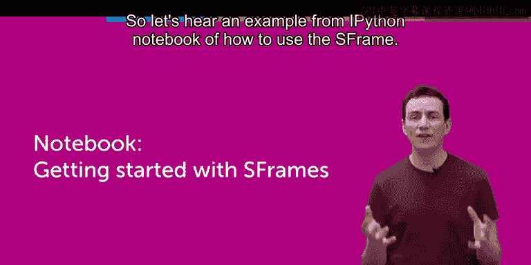
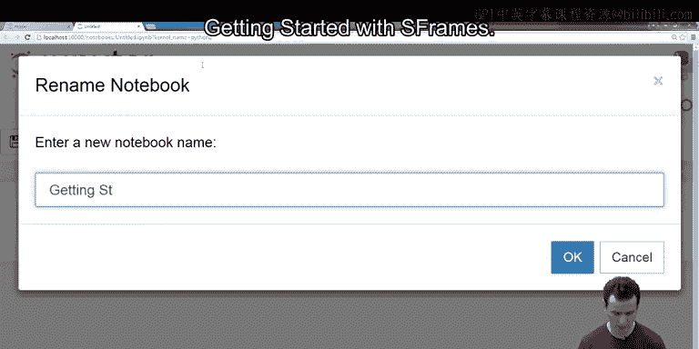
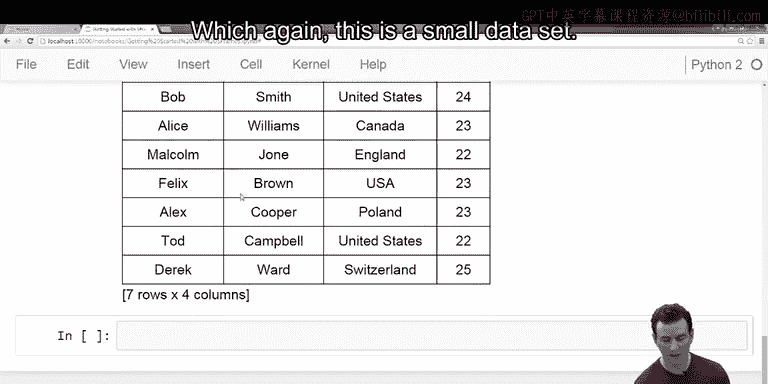

# 华盛顿大学《机器学习（基础篇，第1课／共4课）｜Machine Learning》中英字幕 - P15：14_启动Turi Create和加载SFrame.zh_en - GPT中英字幕课程资源 - BV1zw4m1e7Zh

。

In this specialization， we're going to use a number of Python tools that really help us get started doing machine learning and build applications that really scale to lots of data。

One of them is called S frames， which is a really scalable data structure for dealing with big tables of data。

 it doesn't have to fit in memory， it goes into the disk of your computer and so it can scale up to millions of rows of data even if you don't have that much memory in your machine and we'll see lots of examples of that and that data searcher Sframe is part of a package called GraphLb C that we'll also use in the specialization so let let's see an example an iPython notebook of how to use the S frame。

😊。

So here's an iython notebook just so like we did with the previous example。

 and I'm going to call it getting started。Starting with S frames。

And just to get a little bit more space on my slide。

 I'm going to hide that header and hide the toolbar。

 So now there's a little bit more space in the slide。 Now firing up to get to a frames。

 you have to fire up graphlab create and so firing that up is it's pretty easy So I'm hitting S am here to get a text box just like a wki page and when a fire up。

Oops that I hit enter too quickly， and I'm going， let me just edit that again。

It does not want to let me edit it there， fire up。Graph lab。

So every time we went to Star Gralab create all we have to do to install is type import GraphLb。

 and now we have all the tools of GraphLb create available for us。

 including the S frame and meaningful machine learning algorithms that we'll use throughout this course。

😊，So the first thing I'm going to do is load some data from disk。So I'm going to load。呃。Tabular。

Data set。So loading a tabular data set as a dash frame is pretty simple。

 that data set can be in many different formats what we're going to use is looks called the CSV format in this example which is just a comma separated file and that file is in my current directory and I actually if I。

😊，If I just call， I'm going to create a variable in S frame， I just call it SF for this example。

 all I have to do is graphlab dos frame。😊，And give it a target directory， a file。

 and it will load it。 So in this case my file is going to be called people example do CSV。

And here we go， so it prints a few things saying that it pars and it par it correctly。

 and now we have it， so let's do some S frame basics。😊，So let's start with some S frame。Basics。

So some aspiring basics here， if you just type SF。Enter， in this case。

 shift enter because when the iPadyon notebook， it just shows you the first few lines of that table。

 So in this case， I'm going for a comment here， we can。Vi。First few lines。Of the table。So here we go。

 this is a very simple table actually I'm seeing all the lines it says the first name Bob。

 last name Smith who lives in the United States has age 24 and we have this for several people by the way there's two ways to access the first few lines of file you can do type SF you can also type SF。

 head。To show the first few lines and again it's a small data set we're playing with so far。

 but there's another command called SF。 T。That shows the last few lines of the data， which again。

 this is a small data set， so first few lines， last few lines， all of the lines。

