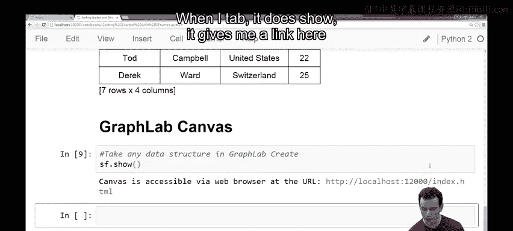
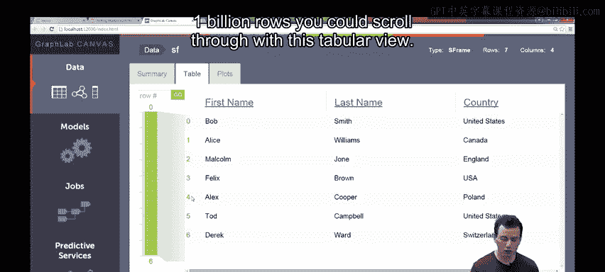
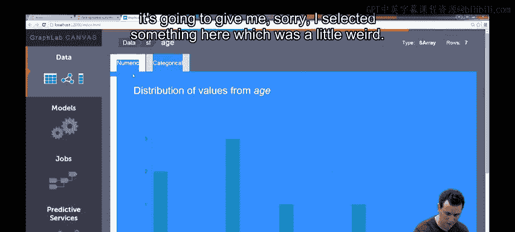
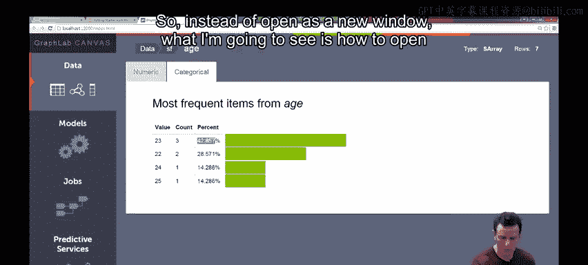
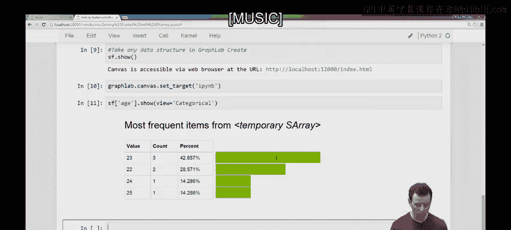

# 华盛顿大学《机器学习（基础篇，第1课／共4课）｜Machine Learning》中英字幕 - P16：15_数据可视化画布.zh_en - GPT中英字幕课程资源 - BV1zw4m1e7Zh

。So now that we've taken a quick look at the data set， let me show you something pretty cool。😊。

So let's introduce what's called the graphra La。Canvas。

So this kind of tab of data graph data text data image data we have。

 there's many ways you can visualize it， what we have inside GraLlab created is a data visualization companion that can be used to view the data in various ways。

 so if you take any data structure，😊，That we play with any data structure in Grafllab creates。

 so take any data structure。嗯。You our lab create。And you type dot show after it。

 so if you type Sf dot show is going to start the Gla canvas and give you visualization first visualization the data structure in this case we have a very simple data set when I tap dot show it gives me a link here to a new webpage that shows you that data so I'm going to decrease the font size a little bit and you'll see this data set has four columns。

 the first name Alex Malcolm Felix and so on the last name the country this person lives in and their age and you see that the Max ages 25。

 the moon ages 22， the median ages 23， the media ages 23 0。

143 and so on and if you can click on tabular view you can actually view the data and this is pretty cool if you have a million rows is really hard to actually view the data but this allows you to scroll through millions 1 billion rows you could。

Scrorow through with the tabular view。 And now， if I click on any column， for example。

 the age column is going to give me。So I selected something here， which。

I was a they weird， let me just type reload because I did something funny。A histogram。

 but if I type categorical is going sorted by the most common value。

 you see that the most common value is 23， there's three of these folks and so that's 42% of the data has age of 23 so the L you should play with we play Canva and visualize the data in various ways and get started。

😊，Now for the notebooks that were filming here， the canvas popping up in a new window like this makes it kind of awkward to go back and forth when we're just filming so instead of open as a new window what I're going to see is how to open the canvas or some visualizations inside of thePython notebook so I'm going to call a command called Gralab。

 canvasvas。

Dot set target and I'm going to see that the target is the i Python notebook short i and B and we're going to do this again。

 again again， but what happens is now the visualizations that we do are all going to target this actual notebook。

😊，So let's visualize again， the age column。But now inside our notebook so here's we're going to do it's pretty cool I'm going to take this S frame SF and I'm going to select square brackets allows you to select a particular column or many column so I'm going to select a column H。

😊，Just one。I'm going to type dot show。On it， and I'm going to tell it the view that I want。

Is that sorted categorical view that we just saw？So here we go。

 we just saw that 23 is the most common age， 302 people with 23 years of age， 42% of the data。

 so now we've seen how to do a little bit of visualization using GraphLA created we're going to see several other visualizations within GraphLlab and within other tools during the course。

