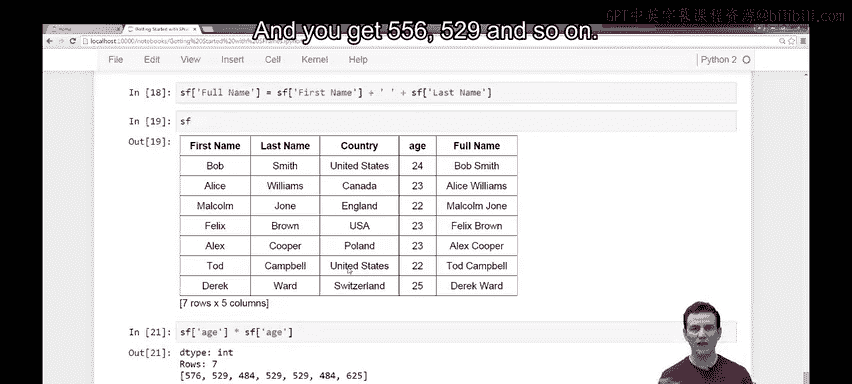

# 华盛顿大学《机器学习（基础篇，第1课／共4课）｜Machine Learning》中英字幕 - P17：16_与SFrame的列交互.zh_en - GPT中英字幕课程资源 - BV1zw4m1e7Zh

。

So next。We're going to inspect some columns of our data set。呃， let me。诶。Let's inspect。嗯。

Some columns of the dataset set。So let's take a look at it。 So if I type S。Of country。

What it's going to do is select a column country and since I don't do anything to it。

 I don't set it equals to anything， it's just going to print it。Now it says United States， Canada。

 England， USA， Poland， United States， Switzerland。So that's that whole column but printed horizontally。

Now let's look at another column， so for example， let's look at the column H。😊，So Sframe。h。

 I'm just going to look at it， so we have the columns 24， 23， 22， 23， 23， 22， 25。

 same one that we did a visualization up here。Now we can take the same column as F dot H and do some computations on it。

 So if you type dot mean。😊，Its not saying that column is mean， you mean column。

 but actually computing the mean of that column， which the mean age is 23， do 14， 28， 57， and so on。

😊，Now you can compute， for example， the max H， so SF of age。And say Max。And again， you get 25。

 that's a maximum age。Now this is some pretty cool stuff， but let's do more。😊，That's a。Create。

New columns。In our S frame。So。When you're doing machine learning or often taking columns and transforming them。

 creating new one thiss called feature engineering。 We're going to do a bunch of those。

 I'm going to do now a creation a new column。 So let's go back and print or S frame。

 and you see that there's a first name column and there's a last name column。

 There's no full name column。 Let's say that you wanted to create a new full name column。

 It's pretty easy。 I'm going to say SF or S frame of full name。

 So there's going to be a column called full name。😊。

And what is that column equal to well it's just a concatenation of first name and last name and in Python it's really easy to take string and concatennate them together all you have to do is put a plus sign so we can do SF as frame of full name going to be called is going to be the first name column so first name。

😊，And then I'm going to put a space between it， so plus the space。Plus。The last name column。So， last。

Name now this is pretty cool I just create a new feature。

 new column called full name which is just the first name space last name。

 it's very easy to do these things in Python， especially if you don't have typos I see that this is fist name instead of first name and there we go so now if you go back and show show that S frame again youll see this a new column called full name has been placed at the end so Bob Smith is the first full name there。

Now you can do all sorts of interesting things， so for example， you could take the H column。😊。

And I'm not going to create a new column， but I'm just going to do add2 here today's column and youll see that it's just going to add two to every element and so you can do these kinds of operations。

 for example， you can do age。😊，And multiply it by the column H again now what happens when you do that h times H。

 you're going to get h squared in every element and you get 556， 529 and so on。

