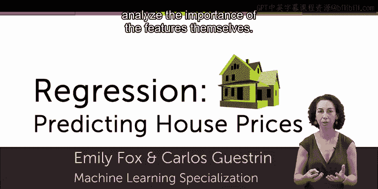

# 华盛顿大学《机器学习（基础篇，第1课／共4课）｜Machine Learning》中英字幕 - P19：18_预测房价：回归案例研究.zh_en - GPT中英字幕课程资源 - BV1zw4m1e7Zh

。

Okay so in this module we're going to talk about regression。

 which is one of the most widely used statistical tools out there and the idea is really simple so we have some set of features and we want to model how our observations that are associated with these features change as we change the values of the features and we're going to ground our conversation in a case study of trying to predict house values so here we can imagine that a house has some set of features like what's the size of the house。

 how many bedrooms does it have number of bathrooms and the list goes on and on and the observation that we have is what's the value of the house or the house sales price but the tools of regression go much beyond just thinking about doing prediction tasks so as we're going to see in the classification course we can use regression tools for classification so for example let's say we have an email and we want to classify whether it's spam or not spam well that email we can think of having。

feeatures about the text of the email that's indicative of whether that email is spam or not spam and in addition we can think about using regression for analyzing the importance of the features themselves and we're going to talk more about that in the regression course。

