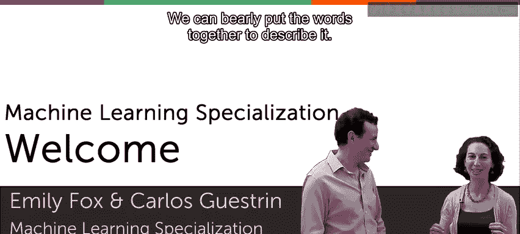

# 华盛顿大学《机器学习（基础篇，第1课／共4课）｜Machine Learning》中英字幕 - P1：0_欢迎参加本课程和专项课程.zh_en - GPT中英字幕课程资源 - BV1zw4m1e7Zh

。

Welcome to the machinechine learninging specialization and this first course on the fundamentals of machine learning。

 we're really excited to embark on this journey with you。😊，G we are。

 are you going to say who you are， Oh I'm Caros and I'm Emily。

 and together we're going to learn about applications of machine learning。

 how to build machine learning systems and how the algorithms behind them work and how to build those algorithms。

Algorithms。We're clearly just so excited about this course and this specialization。

 we can barely put the words together to describe it， so let's get going。

