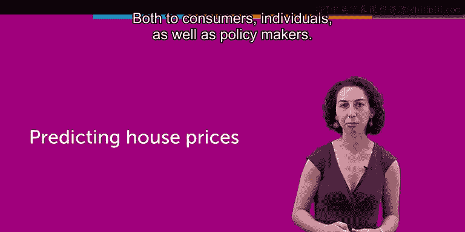
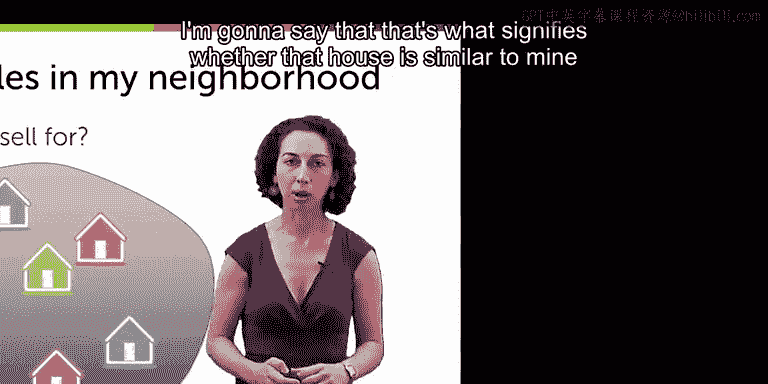
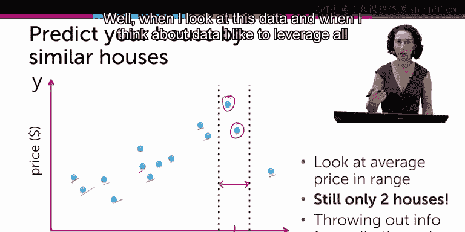

# 华盛顿大学《机器学习（基础篇，第1课／共4课）｜Machine Learning》中英字幕 - P20：19_目标是什么以及如何初步应对.zh_en - GPT中英字幕课程资源 - BV1zw4m1e7Zh

。

Okay， so let's talk about this problem of predicting the value of a house。

 So this is a very important problem。 at least in the United States。

 it's estimated that household wealth is nearly 50% invested in real estate。

 So this is clearly important both to consumers individuals as well as policymakers。 Okay。

 so I'm here。 I want to sell my house。 I have this nice big lime greenhouse。

 but I don't know how much to list it for。 So I'm not sure what value my house has。

 And so how do I think about estimating the value of the house。 Well。

 it might make sense that what I do is I look at other recent sales that have occurred in my neighborhood。

 So I look locally。

At the region around me and I say how much have the other houses sold for and what do those houses look like So what I'm going to do is I'm going to record for each one of these recent sales。

 what was the sales price and also what was the size of the house that was sold I'm going to say that that's what signifies whether that house is similar to mine or not Okay so being a statistician I'm going to take all these observations I had and I'm going to make a plot of them。

So in the US， at least the size of the house is measured by square feet。

 so that's going to be my X axis。And then my why access is going to be the sales price of the house。

 Okay， so that's my y variable。 And each one of these points represents some individual house sale。

 So here this is。1。Previous。House sale。In my neighborhood。

And just to introduce a little bit of terminology here， when we're talking about regression。

 people often refer to x， this variable x as being the feature。

 that's the terminology we've been using， people also talk about it being the covariate or the predictor and in some cases it's called the independent variable。

And then our observation， Y is， as I just said， I tend to refer to it as an observation。

 People also call it a response or the dependent variable。 Okay， so a question is。

 how am I going to use these observations to estimate my house value？ Well。

 I might look at how big my house is。And look for other sales of houses of that size， well。

Most likely there are going to be exactly zero house sales of other houses that had exactly the same square footage as my house。

Okay so I say， well， I can't use this approach， I'm going to be a little bit more flexible and I'm going to look at some neighborhood。

 not geographic neighborhood， some little range of square footage around my actual square footage here。

 so I'm going to say， okay， let's look at all house sales that were for houses within this range of square footage。

But even with that approach， in this case， for example， I only have two house sales。

That I'm going to base my estimate off of so I don't really feel very comfortable with that。

 And what I'm actually doing here is I'm throwing out all these other observations。

As if they had nothing to do with the value of my house。And the question is。

 is that reasonable do we actually believe that there's actually no information in these other observations？

Well， when I look at this data and when I think about data。

 I'd like to leverage all the information that I can to come up with good predictions。

