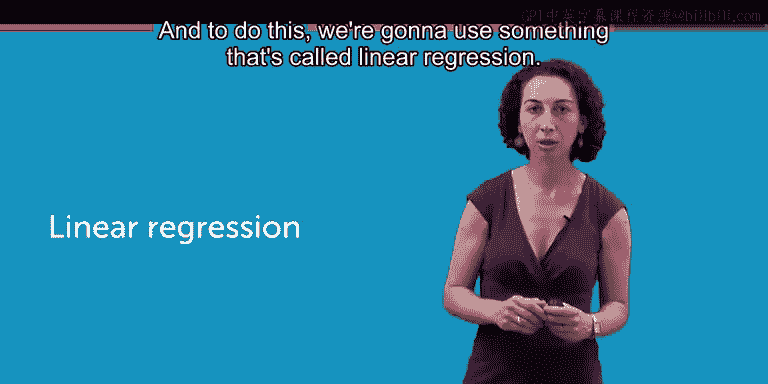
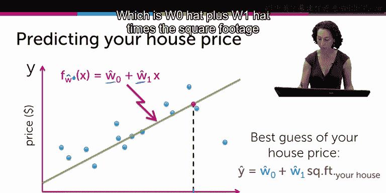

# 华盛顿大学《机器学习（基础篇，第1课／共4课）｜Machine Learning》中英字幕 - P21：20_线性回归：基于模型的方法.zh_en - GPT中英字幕课程资源 - BV1zw4m1e7Zh

。

Okay， well instead of the analysis that we just did。

 we can instead think about modeling the relationship between the square footage of the house and the house sales price and to do this we're going to use something that's called linear regression okay so to leverage all the observations that we've collected what we want to do is be able to understand the relationship between the square foot of the house and the house sales price and so the simplest model we can use for this is just fitting a line through the data so here's an example of a line fit to this data and this line is defined by an intercept W0。

And a slope。W1。And so often we'll talk about W1 being the weight on the feature X。

 or it's called the regression coefficient， and what this weight has an interpretation of is as we vary x the square footage of the house。

How much of an impact does that have on changes in the observed house sales price？Okay。

 so these two things are intercept in our slope are the parameters of our model。

And so to be very explicit here， we're going to write this function。

 this linear function here with a subscript W that indicates that this function is specified by parameters。

W being the set of W0 and W1 Okay so this is the line that we fit through the data。

 but a question is which line is the right line or a good line to use for a given data set？

So maybe we could draw this line or this one instead and each one of those is given by a different set of parameters W and a question is which W do we want to choose for our model？

Okay， well to think about this， let's talk about defining a cost for a given line and one very common cost associated with a specific fit to the data is something called the residual sum of squares。

 so the residual sum of squares we take our fitted line， and we look at each of our observations。

And we look at how far。Is that observation？From。What the model would predict。

 which is just the point on the line， so we look at all of these distances here。

And we actually look at the square of these distances， that's why it's called the residual。

 the residual is the difference of your prediction in your actual observation。

 and we're going to look at the square and we're going to sum over them Okay so this is the equation here more explicitly where we have the price this is our observed house sales price for the first house。

And what is this term here？So if this is what I'm calling dollar house one。嗯。

Then what this point here is is if this is。Square footage of House one。

Then this X that I've drawn here。Represents。Exactly this term here， this。

Is that that value the point on the line， so this dollar sign minus this term here is the difference between our observed house price versus what our model just this line predicts for this given house square foot。

 and we're squaring that and then we're summing over all the different houses in our data。Okay。

 so when we think about trying to find the best line。

 according to this metric that I've defined here， this residual sum squares。

 what we do is we search over all possible W0 and W1。

 so all possible lines and we choose the one that minimizes this residual sum squares。

 so we're going to denote the resulting W as W hat。

 so remember that's going to be the set of W hat zero and W hat1 are intercept and our slope。Okay。

 so there exist really nice and efficient algorithms for computing this W hat。

 this search over all possible Ws we could look at parameters of this model。

 but we're going to discuss these algorithms more in the regression course。Okay。

 so now let's talk about how to take our estimated model parameters and use them to predict the value of my house so I've gone through。

 sorry this star shouldn't be there， this should be a hat just to be clear。

And I've gone through and plotted the line associated with our estimated W0 hat and W1 hat and now here's my house。

 this is its square footage。And the best guess of my house price is simply what the line predicts。

 so I go and I compute what is the value for this square footage of my house， which is W0 hat。

Plus W1 hat times the square footage of my house。

Okay， very， very straightforward。