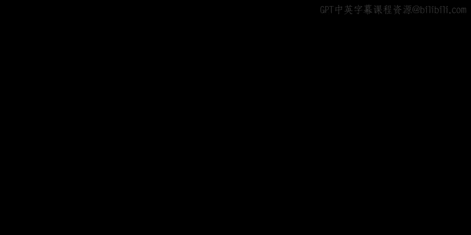
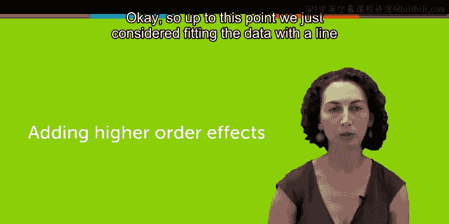
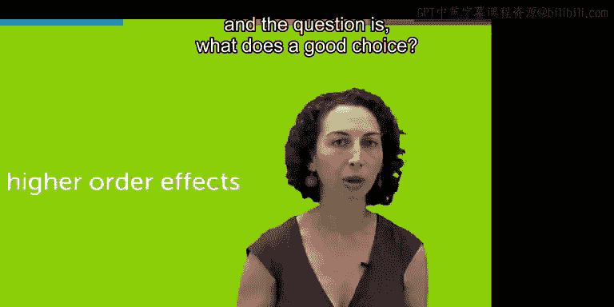
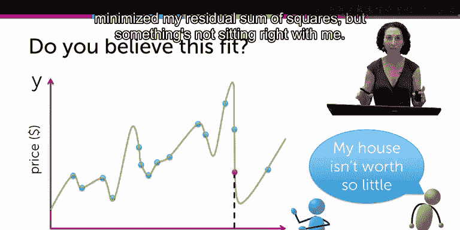

# 华盛顿大学《机器学习（基础篇，第1课／共4课）｜Machine Learning》中英字幕 - P22：21_添加高阶效应.zh_en - GPT中英字幕课程资源 - BV1zw4m1e7Zh

。

Okay， so up to this point， we've just considered fitting the data with a line and the question is was that a good choice？

So I'm actually feeling pretty good about my analysis to be pretty truthful here， I fit this line。

 I minimize the residual sum squares， I made a prediction for my house value and in doing so I leverage all these observations that I went through and recorded of all the recent house sales and I go and I go to Carlos and I say。

 hey， look at my analysis， this is my estimate of the value of our house。😊，And he goes，Well。

 I'm not so sure because really to me。I'm not sure that this is a linear trend。He actually says。

He says it's not linear or according to my cartoon， he says， dude， that's not a linear relationship。

 dude， no， I guess Carlos would not say dude but。Anyway， he says bro， okay， bro。

 he always refers to me as bro， of course。Okay， but anyway。

 the point is Carlos doesn't think that it's a linear relationship， he thinks。You know。

 maybe it's quadratic， He said did you try a quadratic fit， I go， well。No。

 I look at the plot that he just put up here and I say。Actually， that looks pretty good。

And what do I have to do， I have to figure out which is the best quadratic fit to this data and how am I going to do that。

 well I'm going to go again and I'm going to minimize my residual sum squares。

So I'm just about to go minimize my residual sum squares。

 So let's talk about what that would involve。 because when I'm looking at a quadratic function。

 I now have three parameters here。 I have my。Still my intercept。Which is just。

Where is this curve up and down on the Y axis？And then I have this linear term of x。

 And then I also have this extra term here， which is now the square of x。

 That's where I get that quadratic component。But I want to make one quick comment here。

 so a little aside that this is actually still called linear regression。

And the reason is because we think of x squared just as another feature。

And what we see is that the Ws always appear just as w's， not w squared or other functions of W。

 and we're going to discuss this in more detail in the regression course。

 but remember even though we're talking about a quadratic function fit to the data。

 this is still called linear regression。Okay， but the point I want to make here is we have three parameters when I'm going to minimize my residual summa squares I have to search over the space of three different things now。

 I have to minimize over the combination of best W0。

 W1 and W2 in finding the quadratic fit that minimizes my residual sum squares。Okay。

 so I'm just about to go and do this computation， which actually turns out to also be efficient。

 and again we're going to discuss the generality of that in the regression course。

I then Carlos has a brilliant idea， he says， wait， wait， wait。I told you about that quadratic。

 but did you try a 13 order polynomial and I go。No， I didn't。 It does。 It makes a lot of sense。

 Look at this。 This is pretty good。This is the fit that Carlos gets with his 13th order polynomial he says。

 I just minimize your residual sum of squares。Pretty good， right。

 my residual summa squares here are basically zero。😊，But。

I'm personally not feeling so great about this because I'm looking， and I'm saying。

My house isn't worth so little， I know that。I do。Yes。

We talked about residual summa squares as being this cost of the fit， and yes。

 Carlos seems to have really， really， really minimized my residual summa squares。

But something's not sitting right with me， this function just looks crazy。

