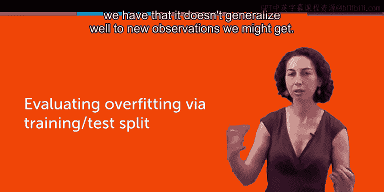
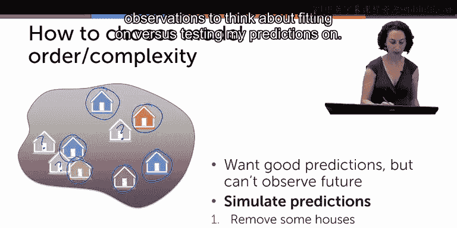
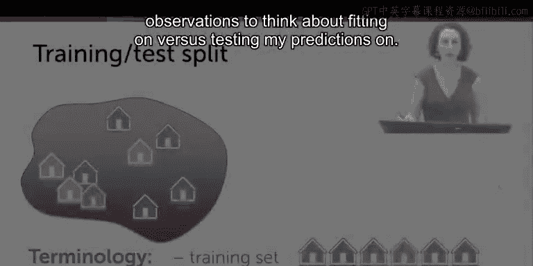
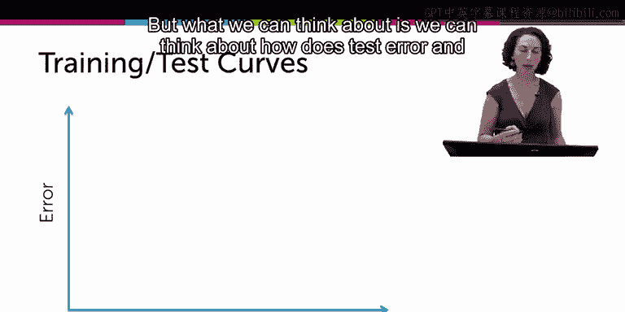
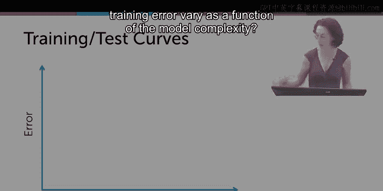

# 华盛顿大学《机器学习（基础篇，第1课／共4课）｜Machine Learning》中英字幕 - P23：22_通过训练测试集分割评估过拟合.zh_en - GPT中英字幕课程资源 - BV1zw4m1e7Zh

。

Okay， so the issue we're facing here with this crazy 13th order polynomial fit is something called overfitting so in particular what we've done is we've taken a model and really really really honed in to our actual observations。

 but it doesn't generalize well to thinking about new predictions and so。

The issues actually go beyond just making really crazy predictions and we're going to discuss this in a lot more detail in the regression course。

 but I want to mention that this is a real problem with any machine learning model or statistical model that you might consider so in these cases we want to fit a model to data。

 but we don't want that model to be so specified exactly to the one data set that we have that it doesn't generalize well to new observations we might get。

Okay so let's go back to this 13th order degree polynomial fit and a question is do we actually believe this。

 do we believe that this might be a reasonable fit to the data and I think as I alluded to before。

 probably not， so although it minimizes the residual summa squares。

 it ends up leading to very bad predictions。Because I'm sitting here and thinking， well。

 this quadratic fit that we had， even though it didn't minimize my residual summma squares as much as that 13th order polynomial。

 it's still my gut feeling is somehow this is a better model okay so a question is what's going on here and how do we think about choosing the right model order or model complexity？

Well， what we want is we want good predictions， of course that's what we're aiming for。

 but we can't actually observe the future right so we can't actually observe that prediction that we want to make and say did we do a good job or not until we actually go ahead and do it So when we're thinking about choosing our model somehow we have to work just with the data that we have So how can we think about trying to choose a good model in this case Well what we can do is we can think about simulating predictions。

So we're going to take our data set that we have and we're going to remove some of the houses。

 So those are the grayed out houses here。 are。going to be removed temporarily。

And we're going to fit our model on the remaining houses。 So all of these guys。We're going to use。

To fit our model using exactly the kind of methods that we talked about before。

 and then what we're going to do is we're going to predict。

 so I'll go through and erase these x's now and put question marks。And say。

From the model that I just learned on the circled houses。

What values do I predict for these question marks， and then I can compare to the actual observed values because these houses are in my data。

Okay， so I can use this as a proxy for doing the types of real predictions that I want to do on data that I haven't yet collected。

Of course， this type of method only is going to work well if I have enough observations to think about fitting on versus testing my predictions on。

Okay， so let's introduce a little bit of terminology while the houses that we use to fit our model。

 we call that the training set and the houses that we're using as a proxy for our predictions。

 those that we're holding out， we call the test set。Okay。

 so let's dig a little bit more into how we're going to do this analysis。

 And the first thing that we can do is look at something called the training error。

 So we're going to examine every house in our test data set。 So let's look at this red color here。

 So all of our。Training houses are represented with these blue circles here。

And these are the only houses we're going to look at when we're thinking about defining our training error。

 so in particular we're going to look at what are the errors that we make on these houses。

 so this is just the residual sumquas on the houses in our training dataset and that's called the training error。

 so in particular the training error looks exactly like what we had for our residual sumquas calculation but we're only including the houses that are present in our training data set。

Okay， so then for any given model such as a linear fit through the data， quadratic fit or so on。

 what we can do is we can think about estimating our model parameters as those that minimize the training error。

 so that's equivalent to what we talked about before of minimizing the residual sum the squares。

 but again here we're only looking at the houses in our training data set。Okay。

 so then that's how we get our estimated W hat， our estimated model parameters。

But then what we want to do is we want to take these estimated model parameters and we want to say how good are we doing and remember what we said what we're going to do。

 so we're going to look at our heldout observations。Here， these gray circles。

Are the houses that are in our test set。So these are houses that were not used to fit this model。

And we're going to say， how well are we predicting these actual house sales？

Okay and so what were our predictions， well remember when we thought about making a prediction。

 we just used the value of the fit， so just the point on the line。

So to assess how well we're predicting these heldout observations are test data。

 we're going to look at something that again looks exactly like residual summa squares。

 but it's called our test error where we take these estimated model parameters W had。

 and we sum over our residual summa squares over all houses that are in our test data set。Okay。

 so that's our test error， but what we can think about is we can think about how does test error and training error vary as a function of the model complexity？

