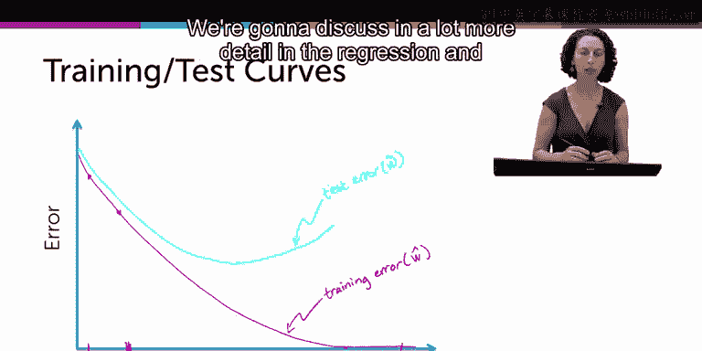

# 华盛顿大学《机器学习（基础篇，第1课／共4课）｜Machine Learning》中英字幕 - P24：23_训练测试曲线.zh_en - GPT中英字幕课程资源 - BV1zw4m1e7Zh

。

So for each model order that we might consider， for example， a linear model。

 or we also talked about using。😊，A quadratic model。

All the way up to our very crazy 13th order polynomial。And of course。

 we could consider even higher order models。Well， what happens to test error。

 sorry I don't mean test error， let's start with training error， a lot easier to think about。

 so training error。As we increase the model order。Well。

That model is able to better and better fit the observations in that training data set so what we're going to have is we're going to have that our training error。

Decreases。With increasing model order so remember the curves that we had we had the residual sum squares associated with that linear fit。

 quadratic fit all the way up to the 13th order polynomial that basically hit each one of those observations so we saw that our residual sum squares what's going down and down and down so that's true even if we hold out some observations and just look at our training data set so we're going to have our training error decreasing and decreasing as we increase the flexibility of the model。

But okay， so let's just annotate this as being our training error。

Particularly four are estimated model parameters， W hat。So let's be clear about what we mean by What。

 so for every model complexity such as linear model， quadratic model and so on。

 what we're going to do is we're going to optimize and find the parameters W hatt for the linear model we're searching over all possible lines。

 minimizing the training error， remember that's what we said a couple slides ago we said that the way we estimate our model so we're going to minimize the error on that observations in our training data set so that's how we get W hatt for the linear model and we compute the training error associated with that W hatt。

 so we look at all possible quadratic fits， minim the training error for over all the quadratic fits。

 that's how we get W hatt for the quadratic model， and then we plot the training error associated with the W hatt for the quadratic model and so on。

Okay。Well， we can also talk about test error， but here it's a little bit more complicated because what do we think is going to happen as we increase and increase our model order？

Well， what we saw if you remember that 13th order polynomial fit that really crazy wgggly line。

 we had really， really bad predictions， so when we think about holding out our test data。

 fitting a 13th order polynomial just on the training data， we're going to get some wgggly crazy fit。

And then when we look at those test observations， those houses that we held out。

We're probably going to have very poor predictions of those actual values okay。

 so what we're going to expect is that at some point our test error is likely to increase so the curves for test error tend to look something like the following where maybe the error is going down for some period of time。

 but after a point，The error starts to increase again。Okay， so here this curve is our。trainraining。

Not our training， our test。Oops。Our test error。For these fitted models where the models were fit using the training data。

Okay， so these are what curves tend to look like for training error and test error as a function of model complexity and how we think about using these ideas to actually select the model or the complexity of the model that we should use for making our predictions。

 we're going to discuss in a lot more detail in the regression and classification courses。

