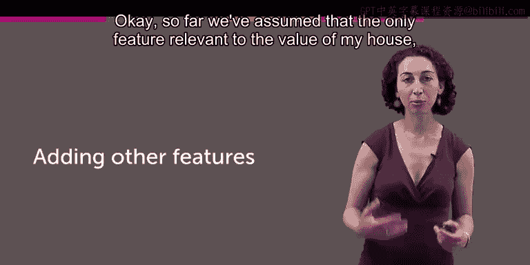
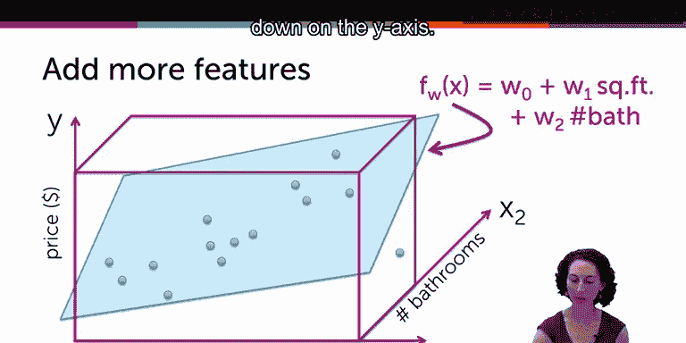
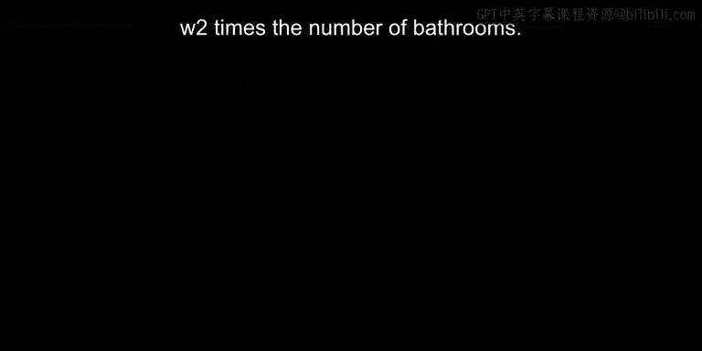
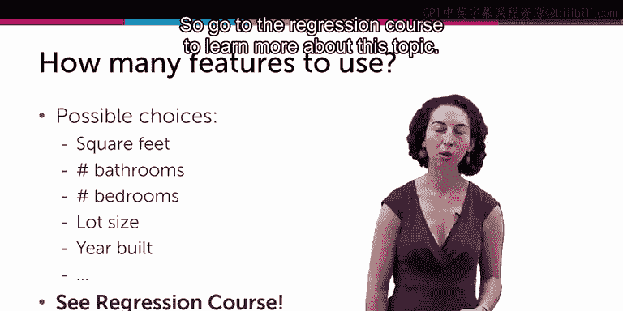

# 华盛顿大学《机器学习（基础篇，第1课／共4课）｜Machine Learning》中英字幕 - P25：24_添加其他特征.zh_en - GPT中英字幕课程资源 - BV1zw4m1e7Zh

。

Okay， so far， we've assumed that the only feature relevant to the value of my house is the square feet of the house。

But I dig into the data a little bit more， and I look at a house that's supposed to be very similar to mine。

 It's a house that has very similar square footage。

And so this house is definitely making an influence on what the predictions are for my house。

 but I look at it and I say and I look at the specific listing and it shows that that house only had one bathroom。

 it's actually quite a big house， only one bathroom， and I say that's really。

 really not comparable to my house， which has three bathrooms， so that the value of that house。

 that house sales price really shouldn't be indicative of what my house sales price should be。

So instead what we can think about doing is adding more features。

 so instead of just looking at the relationship between square feet and price we can add number of bathrooms and now for each one of the listings that I looked at before。

 I'm going to have to go through and record how many square feet that house had and the number of bathrooms and I'm going to plot each of these points in this 3D space so it's this hypercube of square feet versus bathrooms versus price。

And now instead of fitting a line to the data， if I'm thinking about just a very simple model。

 I can think about fitting a hyperplane okay so it's just a slice through this space where here this is the equation of the hyperplane and this is the equation of this plane so we have W0 which is our intercept is where this plane lives up and down on the Y axis and we have w1 times the number of square feet and W2 times the number of bathrooms but a question is where do we stop do we just want to include the number of bathrooms as our additional feature there are lots of things we could think about including we could think about in addition to our square feet。

 number of bathrooms， there's the number of bedrooms， the lot size。

 how old the house is and the list goes on and on in terms of different properties of the house that could be influential in assessing its value。

But we're going to actually hold off on this question of looking at which features are important for this regression task until we get to the regression course。

 so go to the regression course to learn more about this topic。

