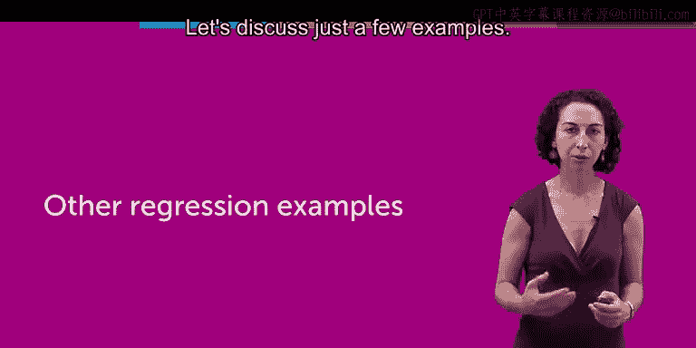
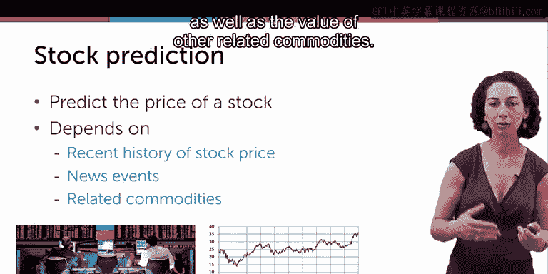
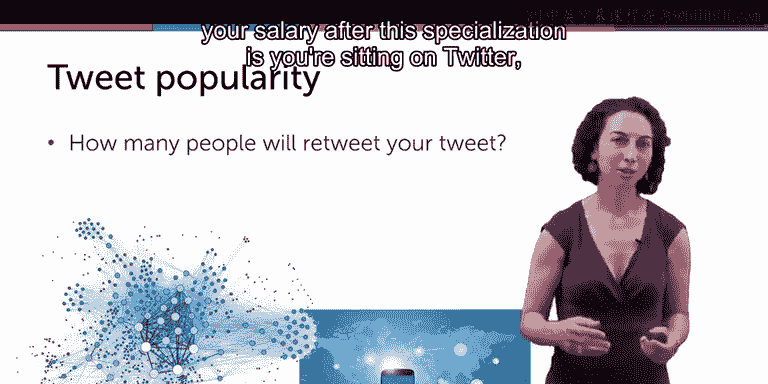
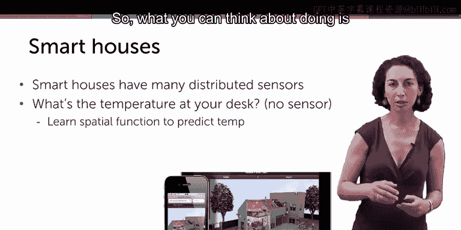
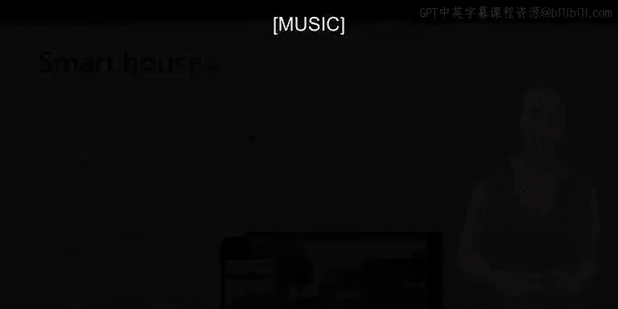

# 华盛顿大学《机器学习（基础篇，第1课／共4课）｜Machine Learning》中英字幕 - P26：25_其他回归示例.zh_en - GPT中英字幕课程资源 - BV1zw4m1e7Zh

。

Okay well we've talked quite extensively about using regression for the task of predicting a house value。

 but of course the number of applications in which regression can be used are quite large let's discuss just a few examples so one is for predicting your salary after you take this machine learning specialization so you work really really hard in the specialization and hopefully after that you can go earn a really cool job。

 have a very big salary but to predict how much your salary will be maybe that depends on things like what was your performance in the various courses of the specialization。

 what was the quality of your capstone project， how many form responses did you make and so on okay when we think about predicting your salary。

 why hat what we're going to do is we're gonna estimate our model parameters。

 W0 W1 W2 and W3 which are our intercept and our weights on your performance in the class。

The quality of your capstone and your participation in the forum。

 and when we're estimating these model parameters， what we're going to use。

 we're going to use these features for other students who have taken this course and the observations of what their salaries were and the jobs they got after taking this machine learning specialization。

Another application of regression is for doing stock prediction。

So here we might think about the fact that the prediction for the price of a stock tomorrow depends on the recent history of the stock price。

 It depends on news events， different things going on in the world as well as the value of other related commodities and a very different application than thinking about predicting stock prices or your salary after this specialization is you're sitting on Twitter。

 you tweet something and you want to know how many people are going to eventually retweet。

 what you just tweeted Well， this might depend on how many followers you have。

 how many followers your followers have different features of the text of what you tweeted。

 the popularity of the hashtag you included， number of past retweets of your tweets that you've had and things like this。

And it turns out these types of models can actually be really good at predicting the ventual number of retweets of your tweet。

And another very different application is maybe you have a smart house。

 there's lots of different sensors in this house and lots of different things you can control like temperature settings in different locations。

 vents， window blinds and things like this， and you have a home office and you have a desk and you want to be able to predict what's the temperature at your desk based on various settings of all these controls but there's actually no sensor directly at your desk so what you can think about doing is fitting a spatial model。

In order to predict what the temperature is at all these different locations throughout the house。

 and this might depend on features such as the thermostat settings in the house。

 whether the blinds are open or closed， temperature outside。

 how you set different fences and as well as things like the time of the day。Okay。

 so hopefully you see that applications of regression and this really just touches the tip of the iceberg of where regression is used。

 but it's really quite a powerful tool。

