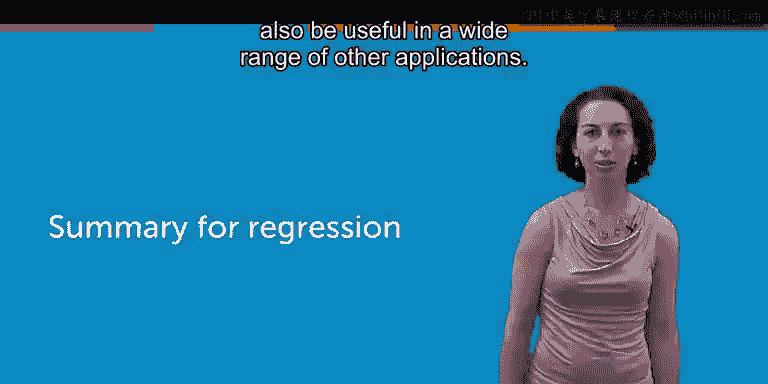
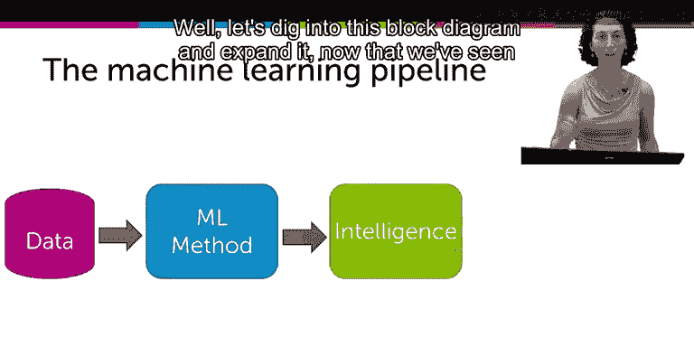
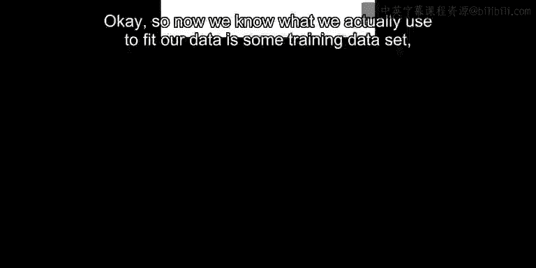
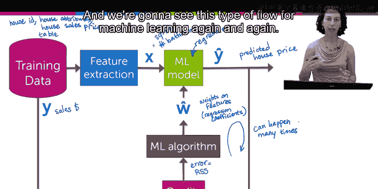

# 华盛顿大学《机器学习（基础篇，第1课／共4课）｜Machine Learning》中英字幕 - P27：26_回归机器学习模块图.zh_en - GPT中英字幕课程资源 - BV1zw4m1e7Zh

。

In this module， we've seen how regression can be used to predict house prices and also be useful in a wide range of other applications。

 so in the introduction to this course， Carlos introduced this machine learning pipeline where we go from data。

Which gets shoved into some machine learning method。 And we use that to derive intelligence。 Well。

 let's dig into this block diagram and expand it now that we've seen some of these machine learning tools in a little bit more detail。

 Okay， so now we know that we what we actually use to fit our data is some training data set。

 So that's going to be our data and in our housing application where we're going to predict the price of some house。

 the data that we collected was we had this table of。

The house IDd and some set of house attributes。As well as that house。The house is sales price。

And we had this for a whole bunch of houses in our neighborhood。

 and we collected this data into some table。So that represented our training data set。

And then we took that data and what we did was shoved it through some feature extractor。

 which in this case is a very simple feature extractor where we just choose some subset of the house attributes。

 so in the examples we looked at，X， our set of features represented things like we looked at square feet of the house。

 and we also looked at。Number of bathrooms。And we talked about possibly using more features。

 again we'll talk about that more in the regression course。

 but those were two that we examined in this module。

And so then what did we do with these features while our goal was to take these features and have some type of model that led to a prediction of the house price。

 Okay， so our output， the intelligence that we're deriving is the predicted。House price。

And we're going to do this for every house in our training dataset。

 we're going to take its associated features and shove it through this machine learning model and predict the house price and what's the machine learning model we talked about well in this case it's regression。

That's our specific machine learning model that we're looking at。Here。Okay。

 but remember that this machine learning model had some set of parameters。 Okay。

 so the parameters we call W， these are the weights on our features。So for example。

 it's the weight on square feet or number of bathrooms and so on。

 more technically these are called regression coefficients。

And we talked about estimating these parameters from data So that's our W hat is our estimate of these parameters and how do we talk about doing that Well。

 we took our predicted output， so our predicted house price and we compared it to the true house price So the actual sales price that we recorded in our training data table So why here。

Is our actual sales price？For the houses in our training data。

 and we compare to the predicted house price， and we use a quality metric to measure how well we're doing with our prediction。

Using our model， using W hatt as the parameters of that model。Well， how well are we doing。

 what was the error metric we talked about？The ametric we talked about was something called residual sum of squares。

 where we just sum up the square difference between the actual house sales price and the predicted house sales price summing over all houses in our training data。

Okay， so our quality metric is going to take our predictions and our actual house sales observations。

Spit out this error and it's going to go into a machine learning algorithm。

That's going to be used to update the weights， update our parameters of our model。

And we're going to talk about this machine learning algorithm or different variance of it a lot more in the actual course on regression。

 but this is the overall flow chart for this machine learning method for our house prediction problem and this loop here where we're taking our predictions。

 computing our error relative to the actual house sales prices and updating the weights or our model parameters。

 this process tends to happen in an iterative way where we update values again and again。Okay。

 so if we abstract away what we see is we have some training data。

 we have some feature extraction process， we have some machine learning model。

 and it's going to produce some intelligence， which in this case is a prediction。

 and we're going to assess the quality of our intelligence with some quality measure。

 and we're going to use that error or accuracy depending which way we're thinking about measuring it to adjust our model parameters using some algorithm。

 and we're going to see this type of flow for machine learning again and again。

In this module we've seen how to take our data and derive intelligence using something called regression。

 where we have a model that relates our features to our output。

 and we talked about this in the context of predicting house values and you also work through a really interesting iython notebook and from this you should be able to deploy really interesting regression models in practice now。

