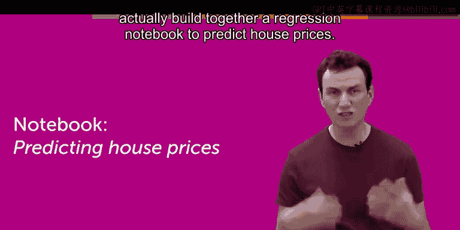
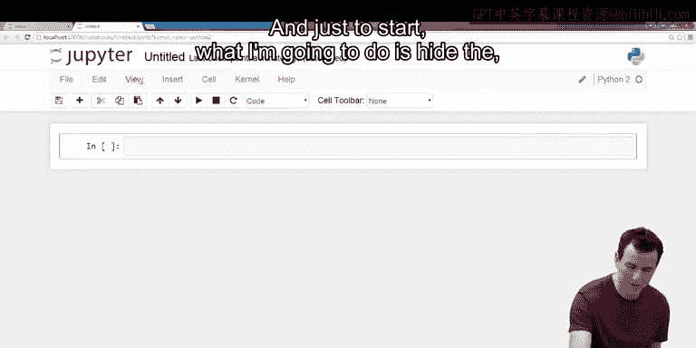
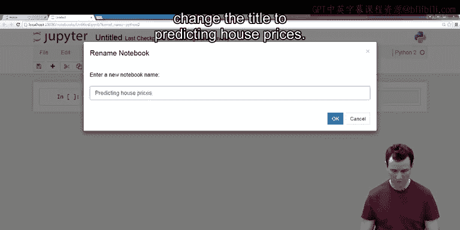
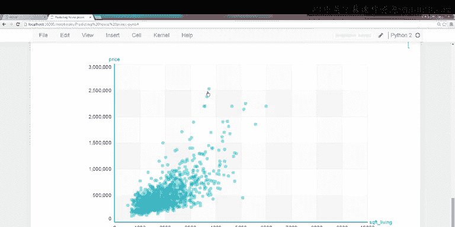

# 华盛顿大学《机器学习（基础篇，第1课／共4课）｜Machine Learning》中英字幕 - P28：27_加载并探索房屋销售数据.zh_en - GPT中英字幕课程资源 - BV1zw4m1e7Zh

。

In this module we talked about how to do regression in fact we talked about how to use it to predict house prices now we're going to build together an ipyython notebook using Python to predict house prices for a real data set based on what's called King County data King County is the county or the region where the city of Seattle where Em and I live is located so we're going to take some of that data it public record data and actually build together a regression notebook to predict house prices。

😊。

So let's get started。 Okay， so here's a blank i Python notebook。And just to start。

 what I'm going to do is hide。

Oh， first， let's change the title。 So when to change the title to predicting。Hows。

Prices。So we just renamed it and。I like to go to the view menu and hide the header。

And hide the tool bar this part at the bottom。 So we have more space on the slide。

 So we've done that hiding。 and the first thing we're going to do is fire up Gralab create the tool that we're going to use to run some machine learning algorithms in Python。

😊，So I'm going to type Sca and we'm going to say fire up。Graph La， create。

So we do that by typing import Graphlab。flood。And that just starts up Grala create。 Now。

 our task today is to predict house prices。 So the first thing that we're going to do is to。😊。

Load some house。Sales data。So this is public data， a public record of houses that got sold in the Seattle region。

So I'm going to call this table data sales， and I'm going to say graphraph Lab。

S frame remember we talked about S frame as the data structure for representing tabular data in Grafl create。

 so it's a really fast hour of core data structure and we're going to load up some house listings in there so this is going to be called home。

And there score。Data and notice that I passthon notebook does's how to complete for you。

 so that just happened there。And so if I just type。

 this is loading up and it's firing up GrLb create。If I just type sales here。

You'll see what that data looks like， so I'm going to scroll up a little bit。To the top。

 I just typed sales and says there was an ID for a date for the sale， the price， number of bedrooms。

 number of bathrooms， square feet which is kind of like the American version of square meters if you're living other countries for the house square feet for the lot of land。

 number of floors in a bunch of the categories， whether the house has a view or not。

 whether it sits on a grade which means it's on a hill and a bunch of other measurements so we've loaded this house data and it looks pretty cool。

 the first thing that we're going to do is use graphralab canvas to do a little bit of visualization。

So， when we do is。Again， create a cell。 And this says exploring。The data。For housing。So。

 housing sales。So we're going to do some data exploration。So we're going to take the sales。Data。

 and I'm going to show them。So when I type dot show is going to show some visualization of that data。

 And in particular， what I'm going to do is view。Just rather than letting graphl K to this devote view。

 were and just do a scatter plot。So we'll see what a scatter plot is in a second。

 but just type use scatterter plot。That relates to variables on the x axis。

 we're going to have the square feet of living space。And in the Y axis。We're going to put the price。

So what that should show us is the relationship that requires square feet of living space and price。

Now， one little trick that I like to do when I create notebooks is that sometimes we push out GraLb canvases in a new tab。

 but often it's kind of fun to just plot those。Scatter plots and simple plots inside the notebook itself。

 so I can print it out and hand it off to somebody so the way to do that is I can just take telegraphralab canvas。

😊，To set its target not to be the browser， which is a default target。

 but to be the i Python notebook。 I just type canvasvas do set target i and B iython notebook and it's going to plot this scatter plot on the canvas on the notebook itself。

 So if I hit enter here what's going to do is take。

Those two axes and just plot them together so here we go on the x axis is the square feet of the house and the y axis is the price so let's let's kind of browse this a little bit。

So for example， more square feet are big houses， so if I mouse over here。

 you'll see that this big house had 5，990 square feet， which is pretty big。

 it's like $600 square meters and it was sold for $2。2 million which is quite a lot of money。

Now you also notice there's a nice relationship that bigger houses tend to cost more。

 there's a big blob of houses here， so most houses are between 1000 and 3000 square feet and even at this level see this house over here it's an outlier so even though it's only。

1910 square feet， it was sold for $1。5 million dollars while down here。

There's a house that is a similar 1700 square feet that sold for just $149，000。

 so is a big discrepancy and here's the biggest houseli this data set， this house has $3。

730 square feet and got sold for $2。5 million。

。