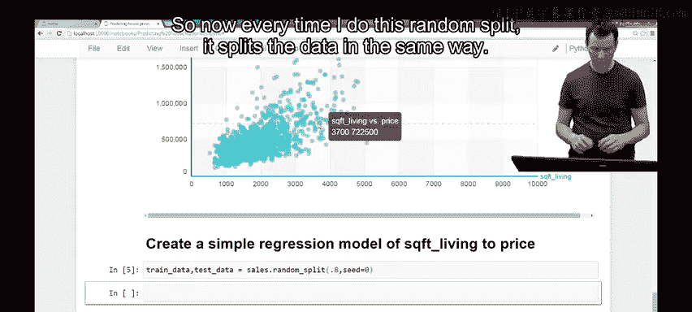
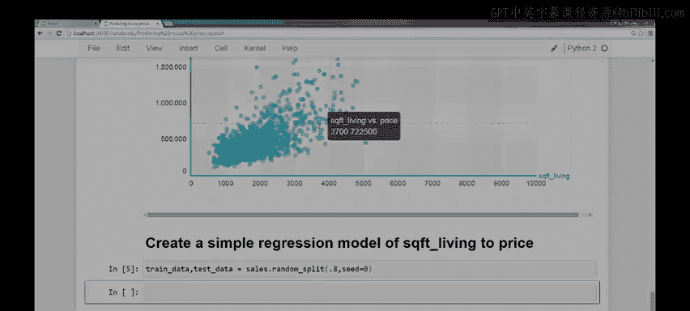

# 华盛顿大学《机器学习（基础篇，第1课／共4课）｜Machine Learning》中英字幕 - P29：28_将数据分为训练集和测试集.zh_en - GPT中英字幕课程资源 - BV1zw4m1e7Zh

。

So we've now built a simple scatter plot and we get an idea of what our data looks like。

 and the question is can we use the scatter plot to predict sales price from square feet of leaving。

 so we're going to do a simple regression model。😊，So let's do that I'm going to hit SM。

And we're gonna say， create simple。Regression。Moel啊。Square foot of living。To price。All right。

 so let's do just that。So remember from the lectures。

 that the first thing that you do before you do anything to your data。

Is to split it into a training set and a test set， because you never want to do training training or learning on the test data。

 You want to do that just on the training data。 So let's do that。 split。

 So I'm gonna to take my data and split it into training data。And test data。By calling a function。

Thiss called。That you can apply to nest F， so it's called the random split function， sales。

tran split。By the way what I did there was just use tab complete so let me just show you that little trick just for a second so if I just do sales。

 R and a press tab you'll see there's a few things that could do random split， read a CSV file。

 remove columns rename columns and so on so I'm going to just do random split and what I'm going to tell it。

😊，Is to do a 0。8 split， so 0。8 of the data， 80% is going to be for training and 20% is going to be for testing。

Now one last thing that would be useful for your homework and in general to make sure that you have always the same results is to set a seed for the split because it's a random split。

 it's a pseudo random number generator we can set a seed to it and I'm just going to set the seed to be any number we want。

 for example it could be 2015， it could be many things I'm just going to set it to zero。

So now every time I do this random of split， it split the data in the same way。

。