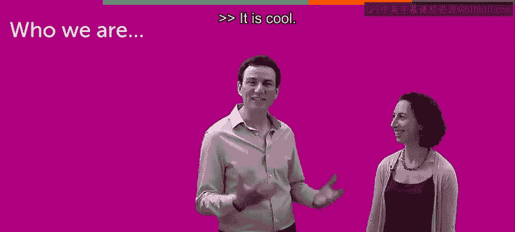
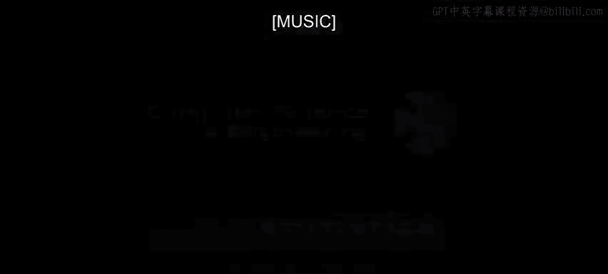

# 华盛顿大学《机器学习（基础篇，第1课／共4课）｜Machine Learning》中英字幕 - P2：1_我们是谁.zh_en - GPT中英字幕课程资源 - BV1zw4m1e7Zh

。

Hi， I'm Carlos Gaston， I'm the Amazon Profes of Machine learninging。Wait。

 I'm the Amazon professorfe of Maine learning Who are you I'm Emily Fox Well I'm the Amazon professorfe Ma learning in Comp Science and I'm the Amazon professorfe of Ma learning in statistics We're both at the University of Washington in Seattle this is the United States。

This is the United States of America of America to clarify America。

So so what are your qualifications to be here today Emily am I supposed to read my CV no okay just the beginning of it what are my qualifications Okay well I went to MIT for way too long nine years though it wasn't all for one degree got a couple of them during those nine years but yeah I was there for my PhD studying in electrical engineering and computer science should I list more qualifications I think that's。

😊，That's that's pretty good in that shes very well qualified， let me just that。

And I got my undergrad from University of Sao Paulo in Brazil and my PhD from Stanford in computer science and I've been working in machine learning for a long time as anybody likes to say a very long time I guess maybe I should describe a little bit about my transition to statistics so after I did my PhD in electrical engineering and computer science。

 I did a postdoc in statistics at Duke and actually honestly a lot of my PhD really was a statistics PhD but MIT as the time of this recording does not have a statistics department it did not at the time that I studied there so yes。

 I'm a self- taughtaught statistician。😊，And we can all be self do。That's what this MOOC is about。Hey。

 we're learning together。So I've been working machine learning for a while and I'm really excited about methods in machine learning from a wide range of settings。

 I've worked on theoretical algorithms for what's called planning under uncertainty for making decisions using machine learning I've worked with sensor data with distributed sensor something called sensor networks which is today is called internet of Things but this is way back and then I took a big focus on large scale machine learning。

 so how do you scale up machine learning methods to lots and lots and lots of data。😊。

And we'll use some of these ideas in this specialization as well。

How about you I don't have quite as long of a history as Carlos does but the things that I really enjoy working on are time series applications so data that comes in over time。

 and we want to find some underlying structure or patterns to that data and a lot of my focus in my research is on how to scale up to really high dimensionional or large collections of time series especially when they have very complex dynamics。

 and another one of my big interests is how to make inferences online as data is streaming in。

 and I've worked on a wide range of different applications。

 some that I'm really passionate about one in particular right now is neuroscience。

 but I've also worked on speech data， motion capture applications。

 analyzing human motion to financial data and the list goes on and on but lots of data have really important temporal structure and that's really a passion of mine and no yeah。

I teaching machine learning for a long time， mainly in the some of us stronger than others This joke never end mainly at the university setting。

 so here we are， it's an exciting experience for us to teach in this online course。😊。

So how do you decide to do this online course？How did I decide that's a very good question Well no。

 there are a lot of reasons why I wanted to do this online course。

 but really the most fundamental reason was thinking about how to disseminate machine learning to a very broad audience because personally I came from a very different background and training and actually Caros did as well and so。

😊，I myself have gone through this experience of trying to learn machine learning。

 learn statistics and I think there's a really nice way that it can be taught at a very fundamental level to a very broad audience and that's one of my passions and another reason is I'd like to think about this for other goals in the future of how to convey this to other groups that I interact with on campus as a teacher at the University of Washington professor So yeah and I'm very excited about how machine learning gets taught and we've really been thinking a lot about how to approach this really broad idea of machine learning in a new way so in this specialization as we'll talk more about in this module you're going to experience machine learning in a whole different way the new experience in other places we're really going to be focused on applications first understanding how machine learning。

😊，Zbar and then digging in and understanding how those methods are built and how they can be useful so part of their journey for us is to build a new way to teach machine learning。

 which is cool。😊，It is cool。 So very exciting， yes。

We're excited。

