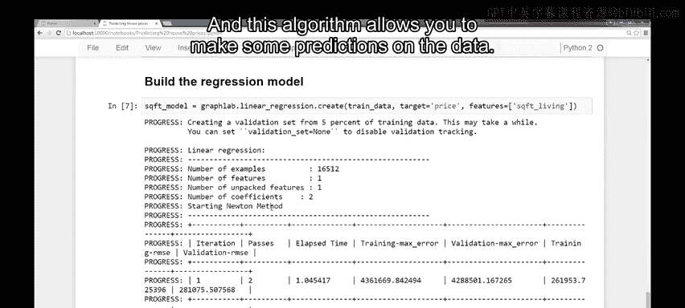

# 华盛顿大学《机器学习（基础篇，第1课／共4课）｜Machine Learning》中英字幕 - P30：29_学习简单回归模型以根据房屋大小预测房价.zh_en - GPT中英字幕课程资源 - BV1zw4m1e7Zh

。

So now we have some training data and some test data。And， and what we can do next is。Build。

So I'm gonna theres a sub heater here。 build the。Regression。Model。So， Gral create has many。

Algorithms pre implemented for a various machine learning tasks or you can implement your own if you like and during the sequence of the special realization you're going to write many algorithms of your own。

 but for this course we're just going to use pre- implemented algorithms so can really try to understand how machine learning works。

😊，So what you can do with machine learning。 So what we're going to do is。IBuild a square foot。

Prediction model， just called it square foot model。And in Graphlab， there's something called linear。

Regression， so。Linear regression is what we learned。

 what we explored and talked about and really understood quite well during the module that M was teaching and so if you just say linear regression dot create。

It's going to create a linear regression model for you and do creates name creates the name of the project here GraL create and creates also the verb that you use to create various things with a GraLb create so we're now going to create a linear regression model and whether do I have to give input I give it the training data。

😊，So here's the training data。嗯。You have to say what variable you're trying to predict。

 so that's a target。 So I'm going to say the target is going to be price。

 so I'm trying to predict price。And。The question is what are the features。

 what is the input so I'm going to say that the features and by the way you can use tab complete even within parameters of functions which is pretty cool so the features is a list of features if you don't give anything it will use all features all columns of the data but here the only feature input we want to use is a square foot feet of living space。

😊，And that is a string that I need to put in。 So I forgot to put it in quotes。

 So let me fix that real quick here。An。So， open quotes。嗯。So squs。All right。Very good。

 So let me just re that for us。So square feet model， graphra lag。

 the linear regression do create on the training data to predict the target price using features square foot of living。

 and let's go and execute this。Oh。Oh training data train， I wrote data twice here。

You see the error came out here training data and the score data。So now let's execute。

 So what's happening here， it's done actually， but what what we did was。😊。

Create a linear regression model， it used a particular algorithm called Newton's method。

 but a Graflb create choose an algorithm automatically for you unless you tell it which ones you use。

And this algorithm allows you to make some predictions on the data。

你那个。