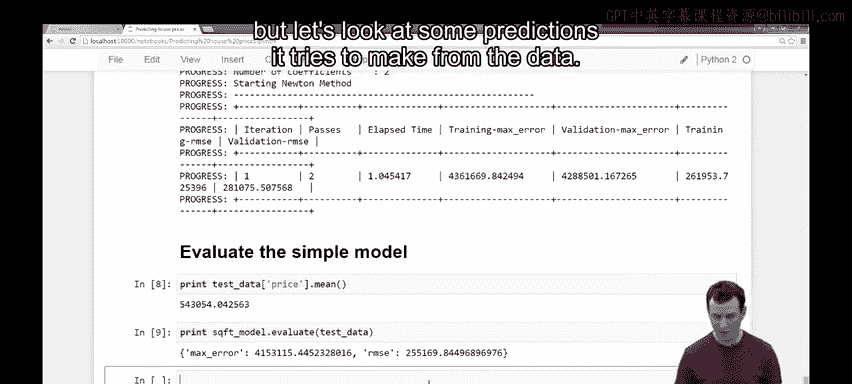
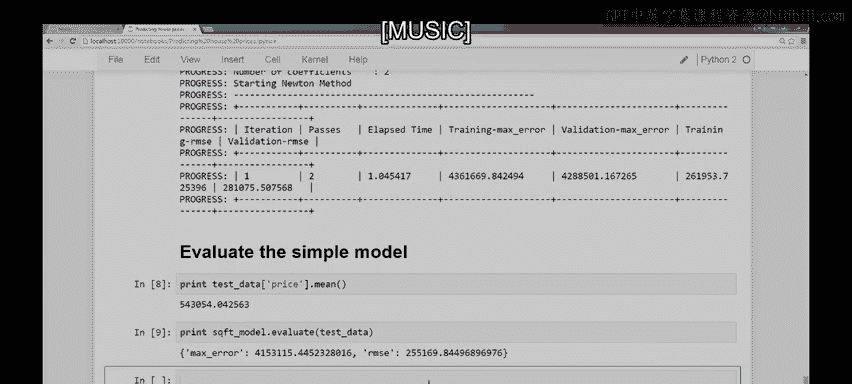

# 华盛顿大学《机器学习（基础篇，第1课／共4课）｜Machine Learning》中英字幕 - P31：30_评估简单模型的误差（RMSE）.zh_en - GPT中英字幕课程资源 - BV1zw4m1e7Zh

。

And so let's actually use the model。So next， we've now trained a linear regression model。

 let's evaluate it。We I going do next is evaluate the。Simple model。So how to we evaluate it。

 we're going to look at the test data。So remember， we had split test data。

 Let's understand test data a little bit。 So， for example， let's print。For the test data。What？

For the price column。What's the average price， what's the mean price？

So this computes the average price and the average price for the test data for this data from Seattle is $543000 so the average。

House cost is pretty expensive， actually。Now。We've built a square foot model and so what we want to do is evaluate it on this test detector。

 so we're going to take the square foot model。That we built。

And we're going to call what's called evaluate function。

 which can test take a test data set and print out or return some statistics of how all that fit is doing。

So。Let's let's do that。So I'm actually going to type print in the beginning because it formats it a little bit nicer and you'll see that the maximum error over all test houses was。

4。1 million， so there was one house that was an outlier， was really badly predicted。

And the average error so the RMSE， so the root mean squared error we talked about this。

 Emily talked about this with us during the lectures is $255，000 so that's the RMSC。

 so we built this simple model we tested pretty high RMSE。

 but let's look at some predictions it tries to make from the data。

你。

