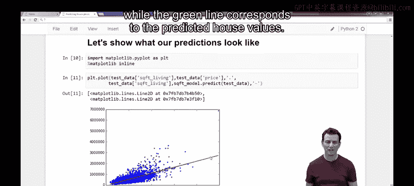

# 华盛顿大学《机器学习（基础篇，第1课／共4课）｜Machine Learning》中英字幕 - P32：31_使用Matplotlib可视化简单模型的预测.zh_en - GPT中英字幕课程资源 - BV1zw4m1e7Zh

。

So what we're going to do next is let's show。呃。What are predictions。Look like。No。

I talked about using GraphLlab Canvas as a way to visualize data。

 but you can also use other tools out there to visualize other Python tools。

 so just as a simple demonstration of that， I'm going to import one search tool。

 it's a pretty commonly used one， it's called Matpl Lib。And。

So and from there I'm going to import something called pipepl which allows you to do some plotting in Python and I'm going to refer to it as PT so when you do an import in Python if you type import Matplotlib。

 pipepl is a particular piece of the package and I write as POT now I don't have to write this whole thing Matplotlib。

 pipeplot blah， blah I just write POT that's why we use the as command。So I'm going to import it。

And one little trick I'm going to do， just like you did of canvasva to make sure it prints inside an notebook。

 I'm going to do it here too， so you put this percent。And you say mud， plot。Live。Inline。

So they just plot it on the notebook itself。 So let's hit enter。 we've imported it。

 And now I'm going to actually build。诶呀。A mat plot plot for。For the results here。

 for the regression results， so we're going to plot。PLT dot plot。And there is a function here。

And I'm going to plot my test data in two ways。So it's interesting you can plot two multiple plots on top of each other with my plot 1 and we're just going to do that together。

 so I'm going to take my test data。😊，And。In my test data， I'm going to plot on the X axis。

 the square feet of living space。And in the white axis for my test data， I'm going to plot。The price。

So this is kind of similar to plot we did above the scatter plot。

 and I'm going to refer to each one of these points as test points， I'm going to draw them as a dot。

 so that's what this little dot here does。However， I'm also going to plot one more thing。

 so I'm going to plot two things on the same plot。Actually， so I' missing a comma out here。

So in addition to plotting the test data， let's plot our predictions。So again。

 on the x axis is going to be the square feet。Of a living space。But on the Y axis。

 I what about something else。I'm going to plot what my model predicted。For each one of those houses。

 So remember， we built a square foot。Model。And it has many functions associated with it。

 if you go down one of those functions it has is called a predict function and a predict function you can give it a bunch of data as input and it's going to output an S array or a column of data with the predictions for each one of these input element。

 so I'm giving the test data and I'm going to draw it as a dash。😊，Now， before I execute this line。

Just take a moment to imagine what the plot is going to look like So the top line says plot living space for the price of test data with dots it's going to look very similar to the scatter plot that we drew before and the second line says plot the input houses living with the prediction with a dash and now remember this was a simple linear regression model of a single variable so all we have。

Is a single variable。 And as we， as we covered。In the lectures， we just can provide a single line。

And we'll see that execute。 and here we are。So the blue dots here are the test data for the houses while the green line corresponds to the predicted house values。

。