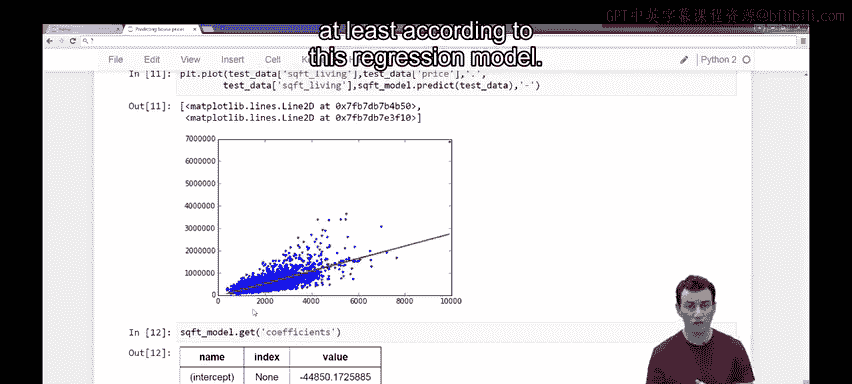

# 华盛顿大学《机器学习（基础篇，第1课／共4课）｜Machine Learning》中英字幕 - P33：32_检查学习到的模型系数.zh_en - GPT中英字幕课程资源 - BV1zw4m1e7Zh

。

In fact， we can actually look at the coefficients of that line for a model so we can take this square foot model that we build。

😊，And we can call the function get。And we can get the coefficients。

So these are what in the course we call the weights。And so there are two weights， two coefficient。

 The first one is the intercept。 So where this line crosses the y axis in this case， minus44000。

 and the second one is the。Coicient of the square feet， so this angle。

 which corresponds to if you interpret it in this case， the price per square feet。

 how much does a square foot of a house cost 500 square foot， how much it adds。

 and it's $280 per square foot， this is the kind of average for Seattle。

 some houses cost more per square foot， the ones up here some houses cost less。

 but on average if you think about it it's about $280 per square foot or at least according to this regression model。

。