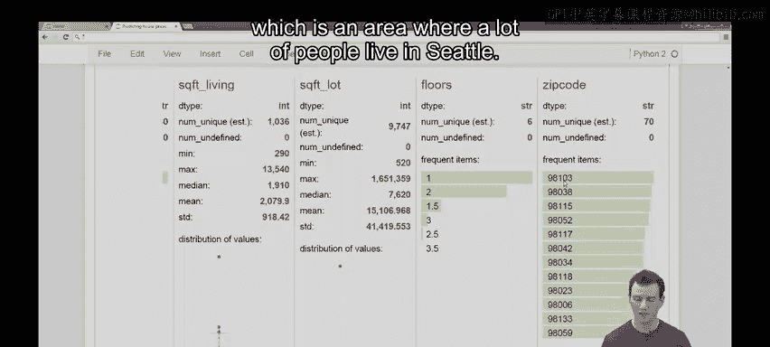
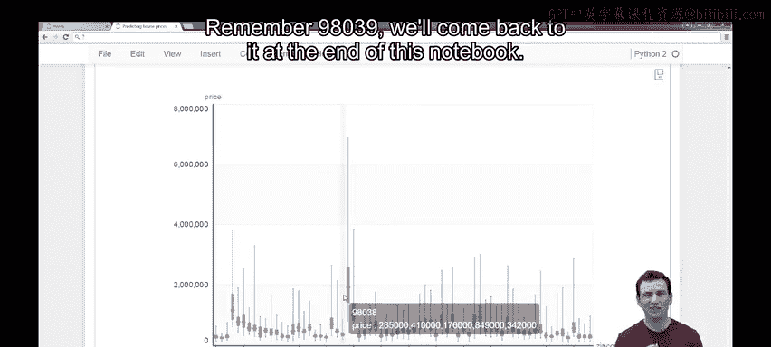

# 华盛顿大学《机器学习（基础篇，第1课／共4课）｜Machine Learning》中英字幕 - P34：33_探索数据的其他特征.zh_en - GPT中英字幕课程资源 - BV1zw4m1e7Zh

。

We've done now some simple regressions。Some simple regression here our data just using square foot of living。

 But if remember， our data set have had many other columns associated with it or features。

 So we're going to do next is。Explore。Other features。In the data。

So let's do sum an exploration of other possible features we might use。

So I'm going to use a set of features， so let's create a list of the features I'm going to explore。

 called features。And these features are going to be。The number of bedrooms。The。Number of bathrooms。

TheLet's see what else， The square foot of living。Leivaving space。

 which is what we've been exploring so far。In addition to this。

 I'm going to include the square foot of the lot。 So this is how much land the house has all around it。

The number of floors。In the house。And， finally。I'm going to include。A variable code is zip code。

And so the zip code。Is the zip code in the United States is what other countries call the postal code。

In Brazil， we call it spi。But there are many names in different places， that's what we'll include。😊。

So。Let's see if I take the sales data and I just select these columns。

 I just select the features column here。why， why don't we call them just to be totally clear。

 circling them features and we call them my features。shift enter。

And then I'm going to look at what my features columns look like。 so I'm going to type dot show。

Remember， you can type not show anything with GraphL create on the S frame for sales。

 selecting my features。And now we're going to have a visualization of this feature。

 so let me just walk you through this visualization。

get my mouse here so bedrooms let's look at frequency。

 there are 13 different unique types in fact there are some houses with 10 bedrooms。

 there is most houses have three bedrooms， some have four， some have two。

 some have five and very few have more with bathrooms， it turns out that houses in the US。

Again a fractional number of bathrooms when you say for example， 2。

5 bathrooms is the most common number is because if you have a house with a bathroom with a bath in it。

 it's called a full bath accounts for one but if you have just a bathroom that has a sink and a toilet in it it it's worth 。

5 and so here you have 2。5 in fact if you have a bathroom with a。A sink， a toilet and a shower。

 but no tub that's sort 0。75 in the US。 so there you go that's where we can have one bathroom is the second most common and then you have this 1。

75 bathrooms which is probably going to be one bathroom， one full bathroom or bathroom。

 one bathroom for shower and you can see the distribution here。😊。

Similarly for other things like square foot of living and。The number of floors。

 most houses have one floors some have two and then the zip code the most common zip code is 98103 which is an area where a lot of people live in Seattle okay so we've seen a high level visualization of the different columns of the data now let's look at some other relationship to data let's do some fund visualization here so I'm going to take the sales table and I'm going to type show。

But the view they're going to do is not going to be a scatter plot。

 but it's going to be what's called a box。Whisker。Blood。

And this box whisker plot is going to relate two variables that we looked at。On the X side。

 I'm going to use the zip code。 So this is the postal code that we discussed。And on the Y axis。

I'm going to plot。The price。 So what we're going to see is the relationship。Between the location。

 the zip code， where the house is and the price。 And we're going to sit out with what's called a box whisker plot。

 So I'm going to press shift enter and we're going to plot it。And here's what we'll see。

So you'll see， for example， this area is zip code post code 998。003 has a significant lower price。

 so average price is low that's the red line and not a lot of variability Well there's other zip called 98004 so this is 0039004 has a highest average price much higher 1。

 something million 1。1 million and a huge variability so the houses range from something like。呃。

What is this $800000 to almost $4 million dollars。 But here I'm just showing a few zip codes if I drag。

Down here， you'll see more and more zip codes。And， wow。What is this one over here。

 There's one that's astronomical。 It goes out of the scale。 Some houses here cost like。What is this？

Mion，$7 million or something。 And this postcode is 9，8，0，3，9。 Remember 9，8，0，3，9。

 We'll come back to it at the end of this notebook。 It's kind of fun。

你们个。

