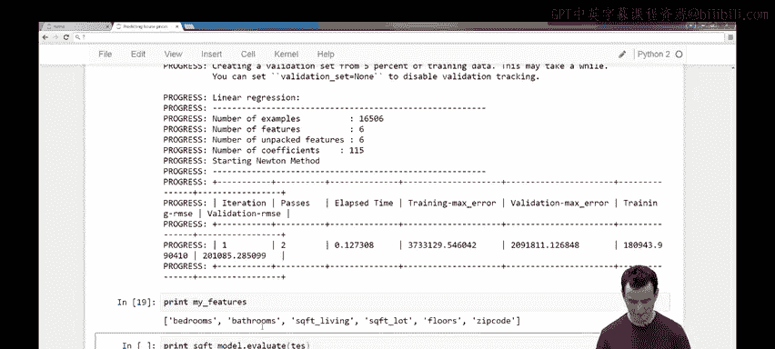

# 华盛顿大学《机器学习（基础篇，第1课／共4课）｜Machine Learning》中英字幕 - P35：34_学习使用更多特征预测房价的模型.zh_en - GPT中英字幕课程资源 - BV1zw4m1e7Zh

。

We've build a simple model just relating square feet of living space to the price of houses。

 And then we explore some other features like zip code。

 And it's clear that the zip code makes a big difference。 And there's other features。

 bedrooms also make a big difference。 The question is。

 can we get a better model by including more features， More of these。 And so let's。

 let's look at that。 So。😊，So we're going to do here is。Build a regression。马low with。More features。

So this is using this bigger feature set that we just described。 So the first 1。

 I called the square feet model。 That's called this the。My。Teachatureers。Model。

 so the Mar features model is， again， going to take graphlab dot linear regression， dot create。

So we're going to create it。 I'm going to use the training data， just like we did before， our target。

Is again， going to be the price。Just like before。However。The features here that going I use。

Are going to be those features， what are called my features。Which I created earlier。

So let's go and execute this。 So now I use more features and it's traininging。 and I think it's done。

 it's done using those I forget how many eight features I use this let's just print them out here。

 print my features。😊，So I use bedrooms， bathrooms， square foot of living， square foot of lot。

 floors and zip code。Now we have two models， we have the square foot model。

 and we have my features model。 How do they compare in terms of performance。

 So here's what we'm going to do。 I'm going to print。😊，The square foot。Model。Dot evaluate。

Evaluate all my test data。

And I'm also going to print。The my。Features model。Dot evaluate on the same test data。

And let's compare， let's see what happened。😊，Okay， so to start with。

 we saw that the biggest error in the simple square foot model was $4 million， now it's down to $3。

4 million 49， so 3。3 and a5 million so went down a bit。And the root mean squared error。

 kind of the average error， went down from $255，000。As we had over here to $179。

000 now if you add more and more features， your error is likely going to decrease quite a bit more because there's quite a bit of data here and there's lots that you can learn。

 but again， just adding some extra features already helped us with our performance。😊。

