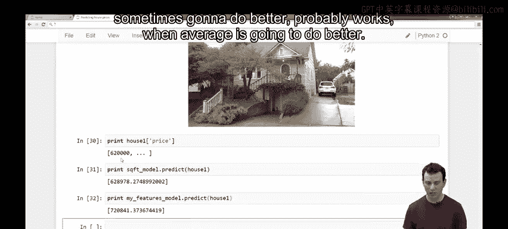

# 华盛顿大学《机器学习（基础篇，第1课／共4课）｜Machine Learning》中英字幕 - P36：35_应用学习模型预测平均房屋价格.zh_en - GPT中英字幕课程资源 - BV1zw4m1e7Zh

。

We've learned now together we learned two regression models from our data。

 one just based on square foot of living， then than one based on this more advanced features。

 so let's apply these models， let's see what it looks like when we use them in practice to predict house prices。

What we're going to do is。Apply this learned models。To predict。Prices。Of three houses。From the data。

So three different houses。So the first house。Is and this is city that I picked that had kind of different sizes。

 different properties。 They look a bit different in different neighborhoods。

 So let's just look at them。 So the first house。😊，Is from our data。And。

And so what we're going to do with this house。Is。So this is for not data， but sales data。

So out of my sales data， I'm going to select the house whose ID。Is equal to。

A particular ID and so the county record gives this string IDs for every house， gives it a number。

 so this one is 5309 I'm copying for a piece of paper here， 101200。

So a particular house for a particular ID。And so I'm selecting it。And。If I type house one。

You'll see what it is， so it's the house that has this particular ID。

 it got sold on this date for $620，000， it had four bedrooms。2 and a quarter bathrooms， 2。

400 square feet of living space and so on。Now， what you can do is。In myython notebook。

 you can embed not only markups and text and Python code but it can also embed HTML and images。

 So let me just do that for you right now just as an example。

 so I'm typing XM and I'm going to add an image to my notebook and this image is an image that I downloaded from the county records for this particular house。

 so。😊，The image is on my directoryies， it's called How。呃。So house's5，3， what was the number。

09-101-200？So this is going to be pretty cool。 I'm going to see a picture of the house we're trying to make a prediction for。

 oops。😊，I must have tried that wrong。 Oh yeah。 I forgot his dot Jpeg。And as we up。

 here's a picture of the house we're pricing， so this house was sold in 2014 for $620，000。

It has four bedrooms， two and a quarter bathrooms， and it was built， for example， in 1929。Now。

 let's see what our model predicts。So。We had two models。

 so we had first so the true price of the house。 let me just print out to remind ourselves。

 So this is house one of price。This is。200。 so if I just type print here， it look a little nicer。

$620，000 this is the house price then let's see what my first model predicts so that was the simple square foot model that we build when you give it so I'm going to type do predict to predict predict。

Predict the price of house one。And it says it predicts it as $628，000， so pretty close， actually。

 that's really good。And let's see what adding more features did for us。My features model。

Thatt predict。Huse one， so you remember on average。

 my features model of adding more features give you better performance。

Now if you look at the prediction here， it's $720，000 so the square foot model had a better prediction than the one of more features。

 so what we learned here is even though an average adding more features give a better prediction for this one particular house。

 the simple model data a better job than the more advanced model， but this is to be expected。😊。

Not always， but sometimes's going to do better surprise but it works。

 but average is going to do better。

。