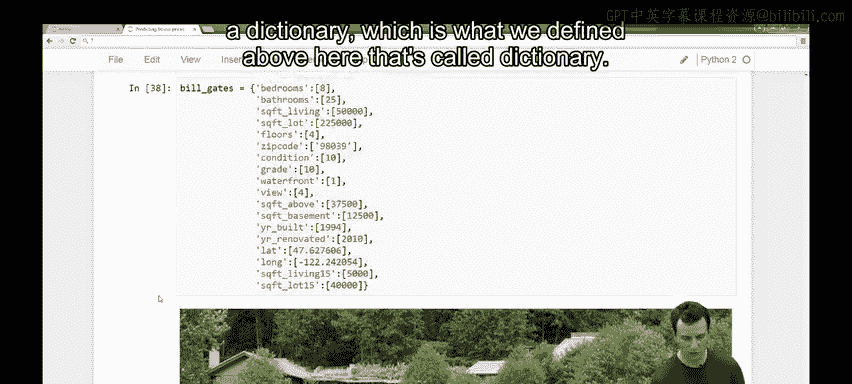

# 华盛顿大学《机器学习（基础篇，第1课／共4课）｜Machine Learning》中英字幕 - P37：36_应用学习模型预测两个高档房屋的价格.zh_en - GPT中英字幕课程资源 - BV1zw4m1e7Zh

。

So we've seen this one example， and now let's look at a second house。😊，So， I'm going to。Now。

Prediction。For a second。Fcier house。So let's look at that， so let's call this house2。

So how's true from our， from our sales data， sales。Is going to be the one again。

 we're going to use a filter here。 So it's the one whose' ID。Is equal to。1，9，2，5。0，6。9，0，82。

So let's take a look。At what House2 looks like。House2 was sold in 2015 for $2。2 million。

 it has five bedrooms， four in a quarter bathrooms， so many more bathrooms。

4640 square feet of living space so it's much bigger， it's about 460 square meters。

 it's a pretty big house。So let's look at， an image。

I kind of downloaded also an image for this house。 So here's my my little cheat sheet。For。

 for the image。And I'm going to insert it So as ca。 so as before we're going to do an image。

 whose source So this is I downloaded to the basic director here， it's called house。1，9，2，5，0，6。9，0。

82 dot Jpeg。C。Not jog， but G big。So that should work， so remember that other house cost $620，000。

This one costs $2。2 million let's take a look at it， it looks fancy here。

 it looks cool it has a bigger yard but check this out it's on the water。

 it's a waterfront house you know that explains why it costs $2 million its fancier much fancier so let's see now what our models predict。

😊，For the value of this property。 So it costs $2。2 million。

 Let's print what the square foot model predicts。So just like before。

 we're going to do dot predict on house 2。And it predicts it costs only $1。25 million。

 so it didn't do so well， so let's look at what the more advanced model， so my feature model。

Go't predict us。And before I hit enter here， it's good to start thinking about what should happen here。

 the other house， the one above where the one or more features。

 multiple more features didn't make a big difference or actually did worse。

 was a pretty standard house for Seattle。Stand in the number of bedrooms。

 standard number of bathrooms， it was kind of common， so you expected both models do about the same。

 but this house is crazy， has features which are hard to capture just because of the square feet。

 it has waterfront， has lots of bathrooms， lots of bedrooms。

 so we expect here for the more advanced feature model to do better。😊，Oh， I misspelled something。

Oh I forgot here my features model， sorry about that it was a little antichliimatic but if we run it you see it's 1。

38 million it's a little closer as you remember from before the error difference wasn't too big but here it's a little closer to the true price so it does a bit better on this house。

😊，Now， just to conclude， let's do a even fancier house。So when're going to look at。And so。

A third house。So the last house。This is going to be super fancy。看系。And in fact。

 we're going to do is take。Bill Gates house， Bill Gates lives in the Seattle area and tried to predict what the house looks like。

So it has a lot of different properties and rather than。Typing them all in。

 I' am going to paste them in。So I'm going to paste it here。

And this is what Bill Gatess house would have if we're in the data， it has eight bedrooms。

 25 bathrooms， Bill Gs really need to go to the bathroom， apparently 25 bathrooms。

 at least that is what I saw online， it has 50，000 square feet of housing。😊，About 5000 square meters。

 This is a big house。Four floors， lots of stuff。So that's what the East house looks like。

 we actually don't know what the houses were because it's never been sewn。

I guess it doesn't need the money。But here it is， and let's see。😊，What that house？Actually。

 looks like。 so， so I actually have a little cheat sheet here with a link。To an image。Of his house。

 So this is a picture。Of。Bill Gates's house。And here we go oh。Yes， sorry about that。 I forgot。

 I had to do。Tll her it was a markup。And there we go。So let's see what the， what the mod， what the。

Model predicts for the price of Bill Gates house， I'm going to print what my features model dot predict says for Bill Gates house。

Now these are GraL create models and they only take S frames as input。

 so I have to take that dictionary that I just created to describe Bill Gates house and convert it to an S frame so I just type GraphLb。

t S frame of Bill Gates， this was a dictionary。Which is what we define above here that' is called dictionary。

And then convert it to that frame and I execute and it says it predicts it to be valued at。😊。

$3 million dollars， I don't know。 sounds like a lot。

 but the house might be worth a lot more than 13 million Who knows？And that was exciting。

 we would build two models of house prices using county data， we explore it， we use it。

 and we applied it to this task。Of predicting houses。

 we even found out what we think Bill Gates's house might actually revalue that。

