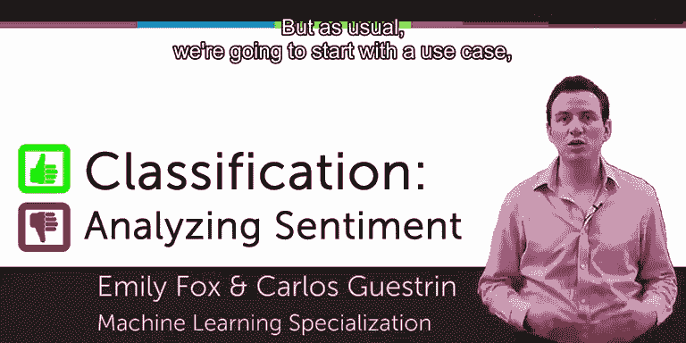
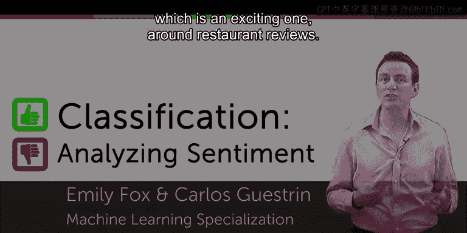

# 华盛顿大学《机器学习（基础篇，第1课／共4课）｜Machine Learning》中英字幕 - P38：37_分析评论情感：分类案例研究.zh_en - GPT中英字幕课程资源 - BV1zw4m1e7Zh

。

Today we're going to talk about classification， which is perhaps one of the most common areas of machine learning。

 one of the most used and useful areas of machine learning and perhaps one of those most intuitive ones as well。

 so things like figuring out whether your email spam or not or whether a document comes from a sports topic or it's about politics or it's about entertainment and so on。

 but as usual we're going to start with a use case which is an exciting one around restaurant reviews。

😊。

