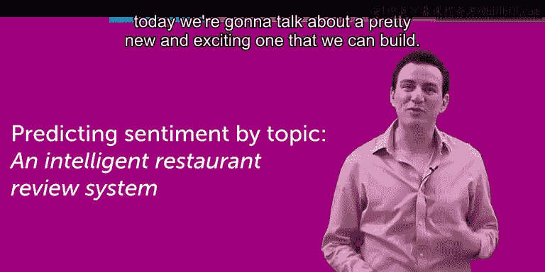
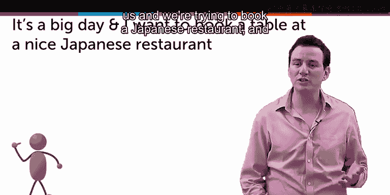
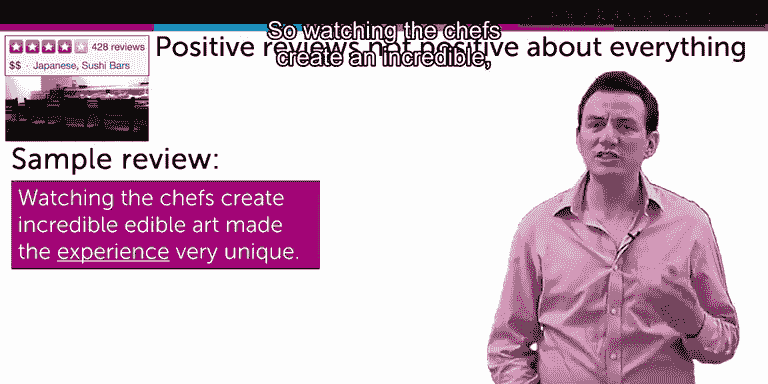
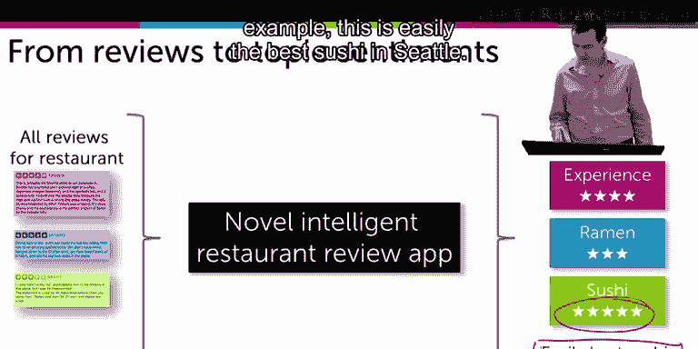
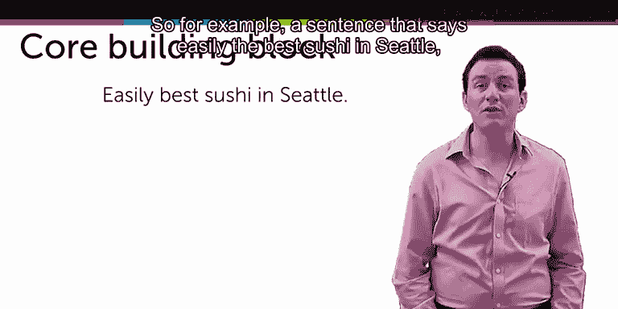
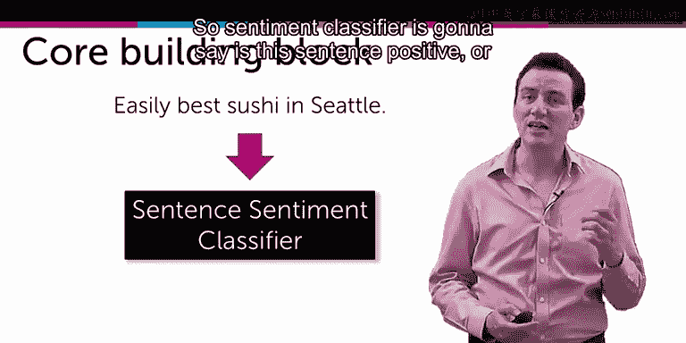
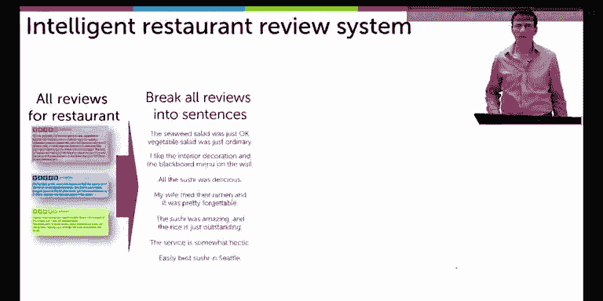
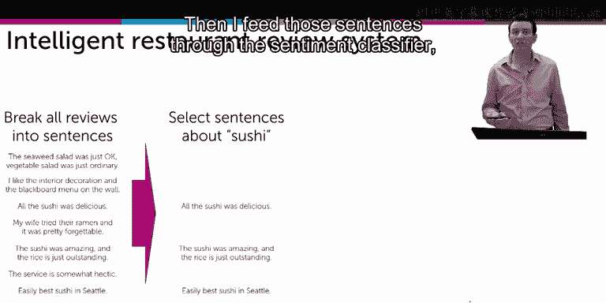

# 华盛顿大学《机器学习（基础篇，第1课／共4课）｜Machine Learning》中英字幕 - P39：38_什么是智能餐厅评论系统.zh_en - GPT中英字幕课程资源 - BV1zw4m1e7Zh

。

There are many systems for restaurant reviews out there。

 but today we're going to talk about a pretty new and exciting one that we can build。

So it's a new you know it's an important day for us and we're trying to book a Japanese restaurant and we love Japanese food and wanted a really cool place to have some Japanese food。

 but this is Seattle that we live in and Seattle is really awesome for Japanese food so there are many。

 many places for sushi and in fact there are many that have really good ratings， say four stars。😊。

So perhaps when I'm thinking about a restaurant to go to。

 I'm not just thinking about the overall stars of the restaurant。

 but I'm thinking about how is it in terms of the food in terms of the ammbience， in particular。

 how is it in terms of the sushi， which is the thing that I really care about。

 I really love sushi I want to really really the best。

 the freshest fish and the most awesome innovative sushi I can get。😊。

So when you talk about a positive review for a restaurant and here's a restaurant that we love in Seattle。

 a sample review might go something like this。So watching the chefs create an incredible。

 edible piece of art was really a unique experience， so the experience is really positive。

If you think about that aspect of the restaurant， but the review might don't go on to say， well。

 my wife tried the ramen and it was pretty forgettable， that means the ramen， not so good。

Now the review continues and says。😊，All the sushi was delicious， E， the best sushi in Seattle。

 So the sushi was really。😊，2 thumbs up。Now I don't care about the ramen I'm not going to this place for ramen。

 I don't care that this person really didn't like the ramen or his wife didn't like the ramen。

 what I really care about is good experience and amazing sushi， so this review is just for me。

So when I'm thinking about restaurant reviews， I want to understand the aspects of the restaurant that are positive or negative and really think about which ones of those really affect my interests so if I look at all the restaurant reviews。

 I'm going to feed them to this new really exciting new type of restaurant recommendation system is going to tell me the experience was good for stars。

 the ramen was so so but who cares。😊，But the sushi， the thing that I really care about。

 that was five stars and not just that is going to give me some interesting feedback so for example。

 this is easily the best sushi in Seattle now that's where I want to go。

So how do we build such an intelligent restaurant review system？

Well we're going to start with all the reviews and we're going to break them up into sentences。

 so each review is composed of multiple sentences and some sentences cover different aspects of the restaurant。

 so for example， a sentence that says easily the best sushi in Seattleto I'm going to fit that sentence through a sentiment classifier so sentiment classifier is going to sayI the sentence positive or is it a negative sentence？

😊。

Now we have a sentiment classifier which can take a sentence and say is it positive or negative。

 so how do we build this new kind of cool restaurant review experience so we're going to take all the reviews and break them into sentences that we discussed but then I'm going to select a sentence to talk about the aspect I care about so which ones of these are really about sushi so not all of them but a subset of those。

Then I feed those sentences through the sentiment classifier， each one of them。

 and then I average the results。

So in this case， all of the sentences were positive。

 and so I'm going to say this is a five star restaurant review in terms of the sushi。

And not just that。I can look at the sentences about sushi and look at which ones are most positive。

So for example this one might be the positive but easily the best restaurant in Seattle。

 maybe it's the most positive and I can display those I can also display the most negative ones in this case there's nothing negative to say about the sushi。

