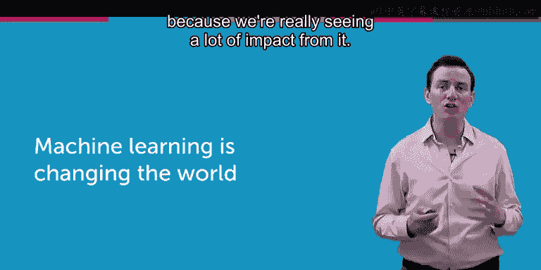
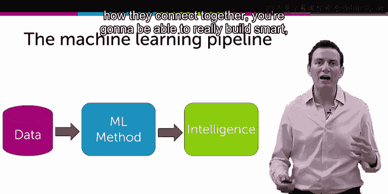

# 华盛顿大学《机器学习（基础篇，第1课／共4课）｜Machine Learning》中英字幕 - P3：2_机器学习正在改变世界.zh_en - GPT中英字幕课程资源 - BV1zw4m1e7Zh

。

I've been doing machine learning for a long time and it's a really exciting time to be doing machine learning today because you're really seeing a lot of impact from it。

 but this is not how I started machine learning if you just talked to me a few years ago the way I thought about machine learning was quite different you started with some data some data and you fed it to some you magical machine learning algorithm and then I just showed you that my curve was better than your curve and then I wrote a paper to a machine learning conference。

😊。

And that's how I always thought about machine learning。

 but this is not why I got into the first place Why did I get into machine learning。

 you know when I was a kid， I read a lot of books， a lot of sci-fi。

 and I really wanted to build robots that were really intelligent that you really thought about the world and reasoned about things what I call today intelligent applications and the really cool and exciting thing is that today we're seeing a lot of impact from intelligent applications that're using machine learning。

😊，In fact， if you look at industry after industry， successful companies today。

 companies theyre called disruptive， they take a market and completely change it。

 They're often differentiated by intelligent applications by intelligence that uses machine learning at its core。

 So for example， early days， Amazon really disrupted the retail market by bringing in product recommendations into their website。

 We saw Google disrupting the advertising market by really targeting advertising with machine learning under to figure out what people would click on You saw Netflix。

 the movie distribution company really change how movies are seeing。

 we don't go to a shop and rent movies anymore。 we go to the web and we stream data。

 Netflix really changed out in at the core， there was a recommender system that helped me find the movies that I liked the movies that were good for me out of the。

😊，many， many thousands of movies they were serving you see companies like Pandora where they're providing a music system。

 a music recommendation system where I find music that I like and I find streams that are good for the morning when I'm sleepy or at night when I'm ready to go to bed and I want to listen to for music and I really find good music for us。

😊，And you see that in many places， in many industries。

 you see Facebook connecting me with people who I might want to be friends with。

 And you even see companies like Uber disrupting the taxi industry by really optimizing how to connect drivers with people in real time。

 So in all of these areas， machine learning is。One of the core technologies。

 the technology that makes that company's product really special。 So in this specialization。

 we're really going to talk about all aspects of machine learning and get you ready to build intelligence applications just like that and we're going to see a pipeline again and again again where we're going to start from data and really bringing in a machine learning method that provides you with a new kind of analysis and the data and that analysis is going to give you intelligence intelligence like what product am likely to buy right now and by taking this pipeline and working through it in a wide range of settings in a wide range of applications with a range of algorithms but really understanding how to connect together。

😊，You're going to be able to really build。

Smart， intelligent applications of your own。