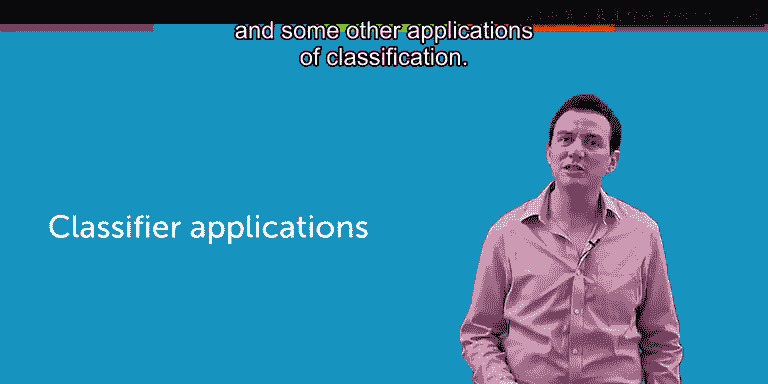
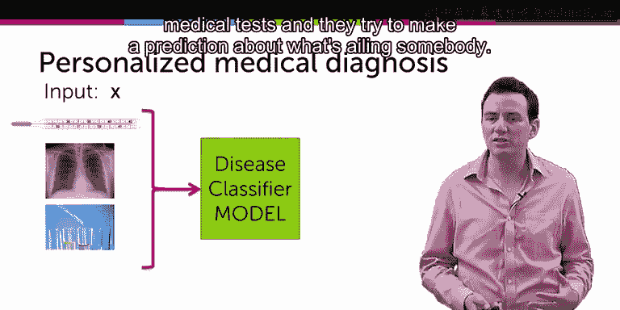
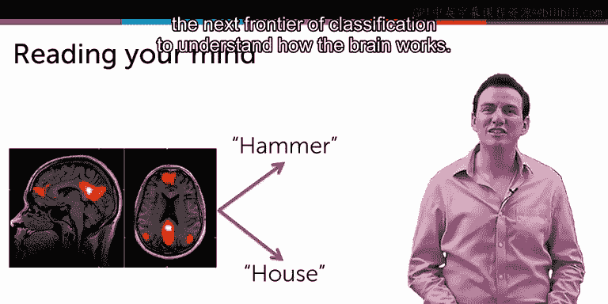

# 华盛顿大学《机器学习（基础篇，第1课／共4课）｜Machine Learning》中英字幕 - P40：39_分类任务示例.zh_en - GPT中英字幕课程资源 - BV1zw4m1e7Zh

。

So we now built a whole new kind of restaurant experience using or restaurant review experience using classifiers。

 so let's dig in and really understand a little bit more where classifier is and some other applications of classification。

So a classifier takes some input X， for example， a sentence from the review or other inputs as we'll see。

 it pushes it through what's called a model to output some value y that we're trying to predict and here it's a class。

 for example， positive or negative。😊，So positive in the case of a sentimental analysis corresponds to thumbs up reviews while negative correspondence to thumbs down。

But this is just one example of classification。You can look at text， for example， a web page。

 I want to figure out which web pages interest me and I can align them to categories， for example。

 is this about education， a page about education is a page about finance。

 is it a page about technology and so on so there's not just two categories there can be three。

 four or even thousands of categories I'm predicting from。😊。

Now another example of classification which is really has impacted all of our lives is in spam filtering。

 some of you might remember perhaps in the early 2000s was spam filters were like the quality was not very good really they were all handtoon things where somebody said oh it has certain words it must be spam。

 but the spammers kept changing the words a little bit adding numbers instead of letters and beating the spam filters and what really changed the world of spam filtering。

 it changed so much that I don't even look at my spam folder actually sorry if your message went my spam folder just don't open it is machine learning it classifiers they took the input X of the email and they fed it through a classifier they predicted whether it's spam or not and did that really well and it does it by not just looking at the text of the email but it looks at other characteristics so for example。

 who sent it if it's somebody who's close。😊，Or something I have lots of communication with。

 it's less likely to be spam， the IP address is a person sending it for their usual computer and so on。

 lots of information。😊，So this is another really interesting prototype application。

In computer vision we do a lot of classification we're going to take an image and figure out what is in that image。

 so for example here they input X or the pixels of the image。

 we feed it to a classifier and we're going to predict things like is this a dog in fact it's a laboratory retriever。

 golden retriever or a different kind of dog， this is actually my dog labbrador retriever。😊。

And as we'll see later on in the deep learning module。

 there's really interesting new ways of doing this with very high accuracy。😊。

Now you can also use classification in medical diagnosis systems and in fact this is what your doctor does。

 they take your temperature， maybe they look at your x-ray。

 they look at some medical tests and they try to make a prediction about what's alieniling somebody maybe they say now now you're just healthy or you have a cold。

 you have the flu， maybe even have pneumonia that's a variable why is's being predicted What is the disease is going on Now these days there's really interesting new things around personalized medicine because the prediction doesn't just depend on the standard measurements but can be really personalized to me can depend on my particular DNA sequencing。

 which is pretty exciting and also my lifestyle。😊。

It maybe look something like that's featured bottom left or maybe more realistic。

 something like this。And so given all these measurements。

 we can make an even better prediction at what's a me。Now。

 this idea of classification and of machine learning has really gone much further。

 even to be able to read your mind。😊，So when I was at Carnegie Mellon， Tom Mitchell。

 one of my friends and colleagues at his office next door and you come to me and say。

 we've done this amazing thing， we can take an image of your brain using a technology called FMRI。

 which is brain scan and predict when you're reading a word with text when you're reading the word hammer or the word house。

And so it's really reading your mind。But in fact， he went on to do many really interesting things。

 so for example， if you're looking at a picture of a hammer or a house。😊。

But you trained the classifier only on you reading words hammers and how。

 you was still able to read your mind and figure out what picture you're looking at。So this is。

Get the next frontier of classification to understand how the brain works。

