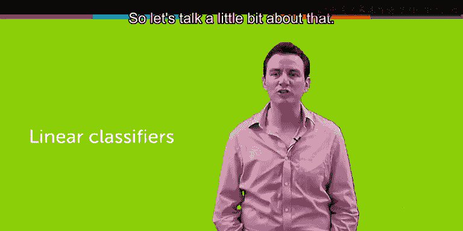
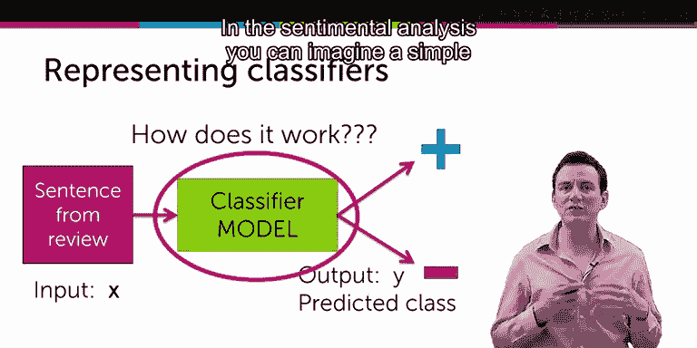
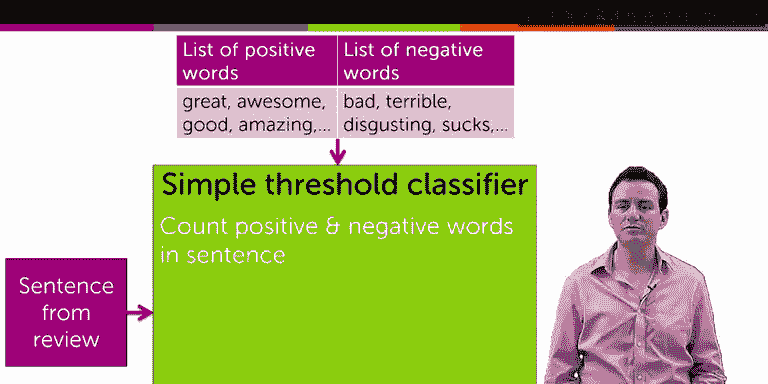
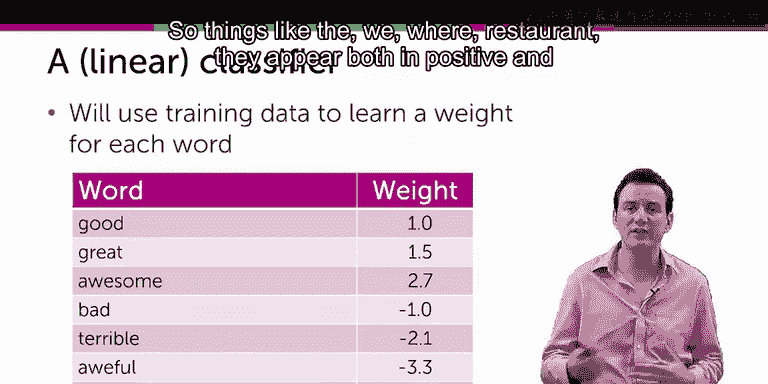
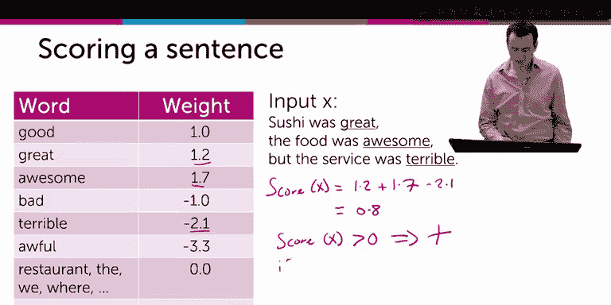
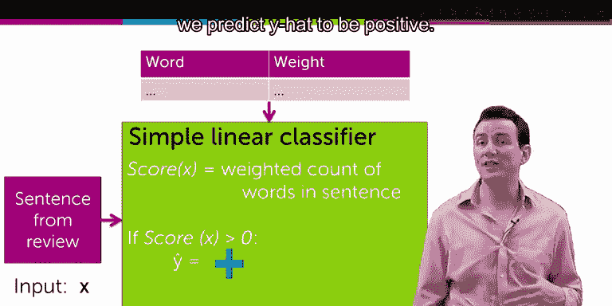

# 华盛顿大学《机器学习（基础篇，第1课／共4课）｜Machine Learning》中英字幕 - P41：40_线性分类器.zh_en - GPT中英字幕课程资源 - BV1zw4m1e7Zh

。

One of the most common types of classifiers is also so called linear classifiers。

 so let's talk a little bit about that。

The question here is how do we represent a classifier so we start with some sentences， for example。

 in a sentimental analysis case so you a classifier。

 you get a prediction whether it's a positive sentence or a negative sentence。

 so how does this classifier work？😊，In the sentiment analysis。

 we can imagine a very simple kind of threshold classifier。😊。

Suppose that I take a sentence and somebody tells me these are all the positive words， great。

 awesome， good， amazing and so on and here's a bunch of negative words， bad， terrible。

 disgusting food and so on， and so what I can do is take the sentence and count how many positive words there are in the sentence and how many negative words there are in the sentence。

 just count those。

And then say if the number of positive words is higher than the number of negative words。

 then we have a positive sentence， but if I use more negative words。

 then you have a negative sentence。😊，So for example。

 if the input sentence that we have is the sus's great， positive one， the food was awesome。

 positive too， but the service was terrible， negative one， you have two positives， one negative。

 and in the end， positive wins， and so you have a positive prediction。

Now threshold classifiers have some limitations。 where does this list of positive and negative words actually come from？

It has to magically come from somewhere。And not just that words have different degrees of positive and negativeness so great is more positive than good you want to tune and figure out what's better。

 great， good， amazing is amazing better than great， who knows so how do we figure that out。

 how do we weigh different words？😊，And。Single words might not be enough to make good classifications。

 so good food。So the food was good， it's positive， the food was not good。It's actually negative。

And so these are all issues that need to be addressed。

The first two areas where the positive and negative words come from and how they weigh them comes from learning a classifier and we're going to talk about next。

The issue of good versus not good is addressed by using more complicated features than single words and we're going to talk about it towards thes of the module。

😊，So a linear classifier， instead of having a list of positive and negative words。

 actually takes all the words and adds weights for them。So for example。

 good might have a weight of1 great might have a weight of 1。

5 awesome might have a really big weight of 2。7 well bad might have a weight of negative1。

 terribleible might have a negative 2。1 awful might be minus 3。

3 because awful is really just awful and this words that really don't matter to the sentiment so things like the we wear rest。

 they appear both in positive and negative sentences so they get weight 0。😊。

Suppose somebody magically told you what the weight of each word were。

 we're going to talk about it in a little bit how those get learned by the classifier。

 but given those weights， how do we figure out if the sentence is positive or negative here we use the idea of scoring。

😊，So for example， take the sentence， the sushi was great， the food was awesome。

 but the service was terrible， let's score that sentence。

 so we're going compute this the score of the input sentence X。 so in this case you get from grade。

 you get positive 1。2。😊，From awesome， you get another。1。7。But from Ter， you get the minus 2。1。

Right here。And so the grand totalto here is 2。9 minus 2。1 which is 0。8。

 and the key here is that since the score of the sentence is greater than 0。

We're going to predict that is a positive sentence。If the score were the opposite。

 if the score of x were less than0， then we'd have predicted it's a negative sentence。

 so this is how linear class passifier works if you know the weights of each word。

And this is called a linear classifier because the output is basically the weighted sum of the input。

 just weight what features appears， what words appear in the input。😊。

So we're working with a simple linear classifier to start out with so in summary。

 given a sentence and given the weights for that sentence。

 what we do is compute the score which is the weight count of the words that appear in the sentence and then we say if the score is greater than zero we predict y hat to be positive while if the score is less than zero we predict to be negative and that is a linear classifier。

😊。

