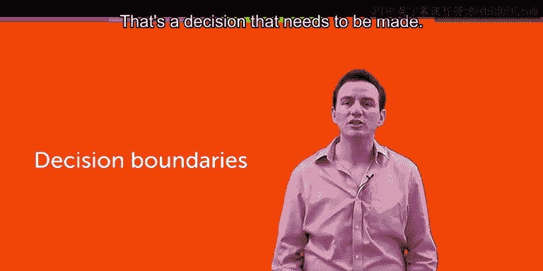
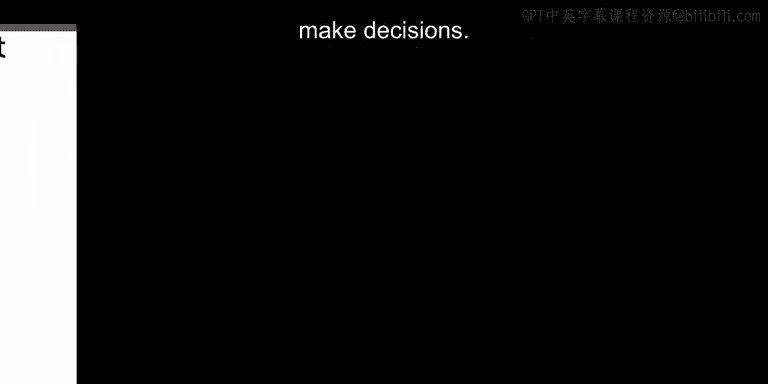
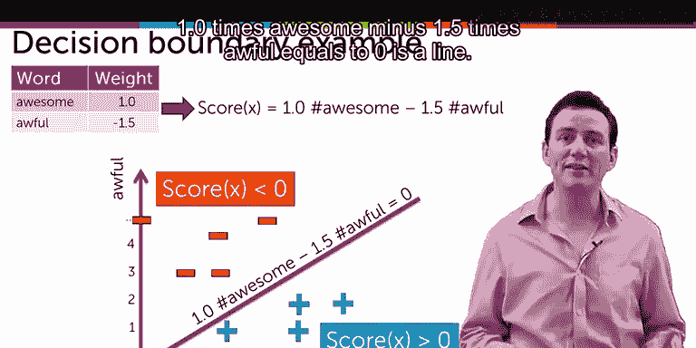
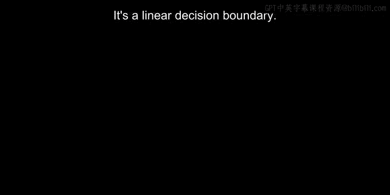
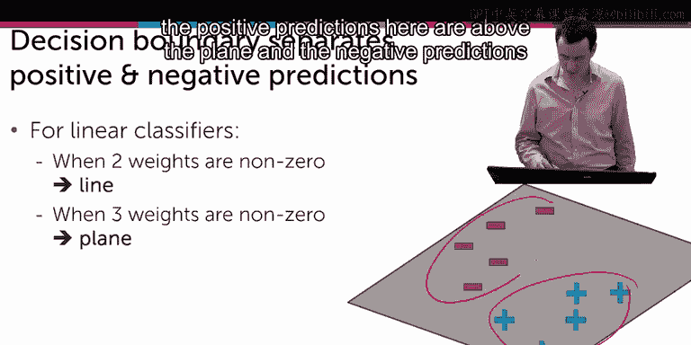

# 华盛顿大学《机器学习（基础篇，第1课／共4课）｜Machine Learning》中英字幕 - P42：41_决策边界.zh_en - GPT中英字幕课程资源 - BV1zw4m1e7Zh

。

So classifiers are really trying to make decisions。

 decisions as to whether a sentence is positive or negative or whether a set of。😊。

Lab tests plus x rays plus measurements lead to a certain disease like flu or code。

 that's a decision that needs to be made。

So let's talk a little bit about how classifiers， especially linear classifiers， make decisions。

To understand decision boundaries， suppose you only have two words with nonzero weight。

 you have awesome with positive weight of one， and awful， which is just awful。

 so it has a negative weight of 1。5。If you have this situation。

 then the score is going to be one times the number of awesomes in the sentence， minus 1。

5 times the number of awfuls。So we can plot this on an axis， there's the awesome axis。

 and then there is the awful axis。 So for example， the sentence。😊，The sushi was awesome。

 the food was awesome， but the service was awful then that has two awesomes and one awful it's plotted in the 0。

21 on the axis and similarly for something that has say three awfuls and one awesome for something thats all awesome。

 so three awesomes is at a 。30 and so on for other sentences。

Now let's understand a little better how we score the sentences and what does that imply about our decisions？

So for example， take the point30 that has three awesomes， no offs。

 three awesomes gives you a positive prediction because the score is greater than zero。

And that is true for every point really on the bottom right of the axis Well the points on the top left all have scored less than0。

 so for example， the 03 offerss one awesome is got score less than0， so those get labeled negatively。

😊，And in fact， what separates the negative predictions from the positive predictions is the line that defines the places where I don't know what's positive and what's negative。

 and that's the line where one times awesomes minus 1。5 times off equals to zero。

 and that's the line where I don't know the prediction is uncertain。

 and so we call that the decision boundary， everything on one side we predict is positive。

 everything on the other we predict as negative。Now notice that that decision boundary1 times also minus 1。

5 times off equal to 0 is a line， and so that's why it's called a linear classifier。

 it's a linear decision boundary。😊。

So decision monitor are will separate positive predictions from the negative predictions。

 so in the case of just two features， we see this is just a line。😊。

But the situation will differ as we increase the number of features so in two dimensions a linear function is aligned in three dimensions we have three words。

 for example they have no zero weight， everything else has zero weight then we get is a plane and so it's little hard to draw in 3D but the positive predictions here are above the plane and the negative predictions here are below the plane the plane is somehow inclined in the space。

😊。

Now when you have not just three non-zero words but in real applications're going to have tens of thousands of words with nonzero weights and in that case we call those hyperplanes those really high dimensional separators called hyperplanes now of course you can use more than linear classifiers you can use more complex classifiers and those still having lines or hyperplanes they have more complicated shapes or sququidly separations and we're going to learn more about that and。

😊，Classification course。