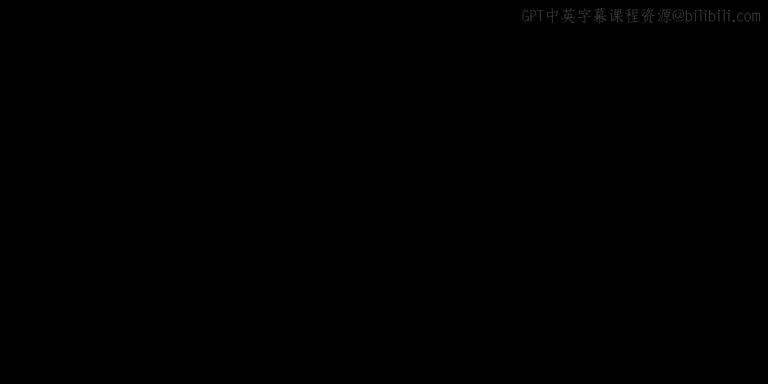
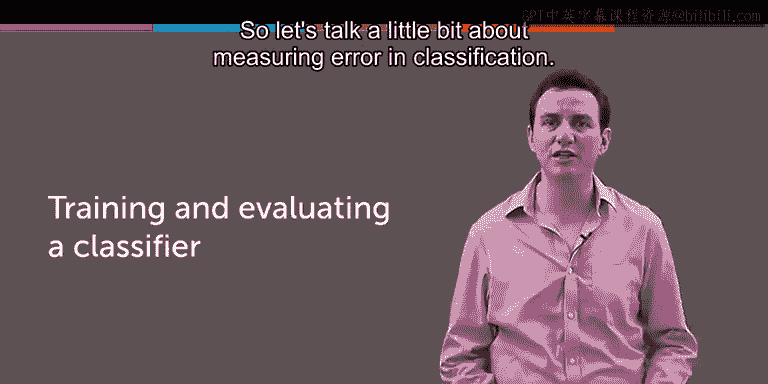
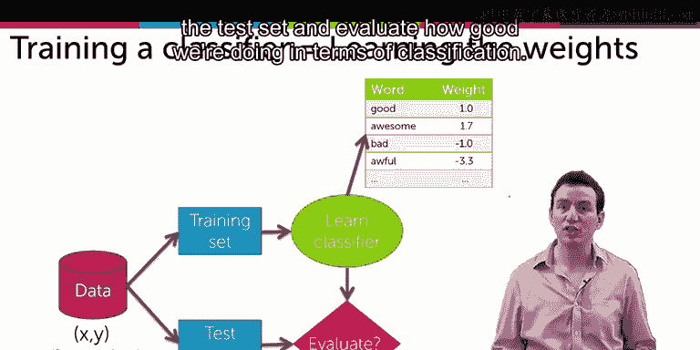
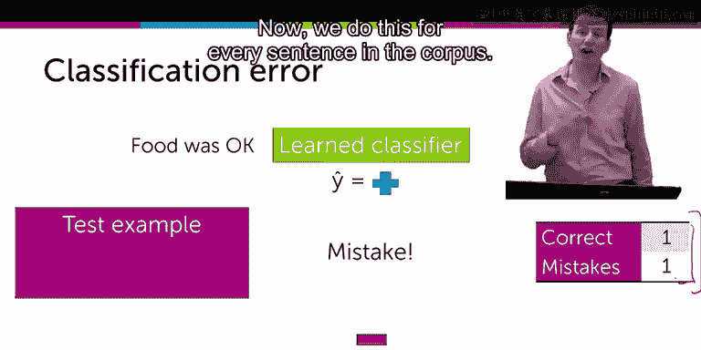
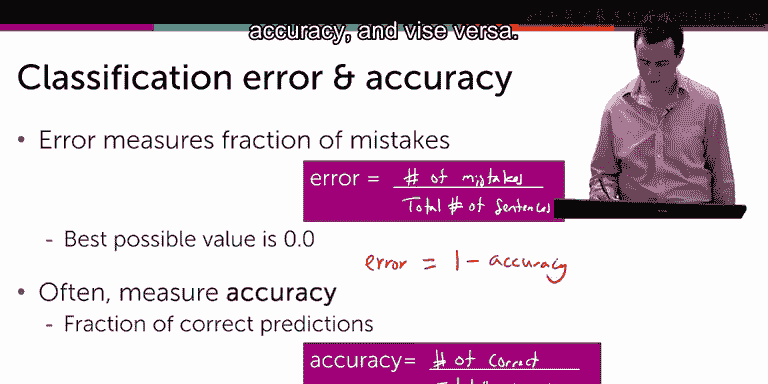

# 华盛顿大学《机器学习（基础篇，第1课／共4课）｜Machine Learning》中英字幕 - P43：42_训练和评估分类器.zh_en - GPT中英字幕课程资源 - BV1zw4m1e7Zh

。

In the regression model， we talked about predicting house prices and fitting a regression model for that。

 and we measured the error in terms of some squared errors。Here in classification。

 our errors are a little different because you're talking about what inputs we get correct and which inputs we get。

😊，Wrong。So let's talk a little bit about measuring error in classification。

 so when I learn a classifier I'm giving a set of input data。

 so these are a sentences that we marked as a positive or negative sentiment and as in regression we split it into a training set and a test set。

😊。

I feed the training set to the classifier I'm trying to learn and that algorithm is actually going to learn the weights for words。

 so for example it's going to learn the good has weight 1。0， awesome 1。7， bad minus 1。

0 and awful minus 3。3。And then these weights are going to be used to score every element of the test set and evaluate how good we're doing in terms of classification。

 So let's talk about what that evaluation looks like。

Let's discuss how we measure error， in fact， classification error when we're doing this classification。

So we're giving a set of test examples of the form Sushi was great is a positive sentence。

 and we're trying to figure out how many of these test sentences we get correct and how many do we get make mistakes。

So what we're going to do is take the sentence sushi is great and feed it through the classifier through the learn classifier。

 but we don't want that learned classifier to actually see the true label。

 we're going to see if it gets the true label right。

 so we'm going to hide that true label so the sentence gets fed to the learn classifier while the true label is hidden。

😊，And now given the sentence， we're going to predict why hat as being positive。

 so we believe this is a positive sentence， and so we've made a correct prediction。

 so the number of correct。Sentences goes up by one。 Now， let's take another sentence。

 Another test example。 So let's say， say。The food was okay as a negative sentence。

So that's a bit of an ambiguous sentence， but it's been labeled as negative in the training set so now I feed the sentence to the classifier。

 I hide the label and let's see what the classifier does in this case because the food is okay can be builted as positive maybe it makes a prediction that this is a positive sentence I've made a mistake because the true label is negative so we say hey mistake was made we now have one more mistake so we have one correct classification and one mistake Now we do this for every sentence in the corpus there are two。

😊。

Common measures of quality in classification。 So， for example， one of them is the notion of error。

 So error measures the fraction of of the test examples that we make mistakes on。

 So what we just do is say out of all the sentences they are classified。How many mistakes they made。

 So number of mistakes。And I divide that by the total。Number of test sentences。So for example。

 if there were 100 test sentences and I made10 mistakes， then ourarrowO be is 0。1 or 10%。Now。

 the best possible error that I can make is zero， basically， I make no mistakes。

Now it's common to so talk about error to also talk about accuracy of your classifier。

 so accuracy is exactly the opposite of that so in accuracy some measuring the number of errors we measure the number of correct classifications so the ratio here is。

Number of corrects。Divided by。Total number of。Sentences。

And unlike error where the best possible value is zero， in terms of accuracy。

 the best possible value is 1， I've got all the sentences right。And in fact。

 there is a really natural relationship between the two we know that。Error is equal to1 minus。

Accuracy。

🎼And vice ver。

