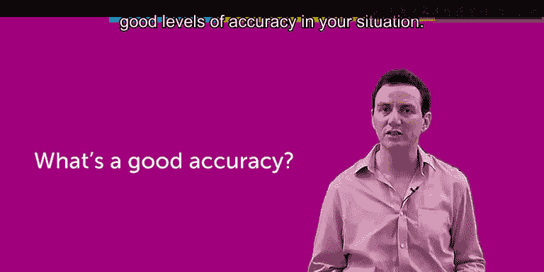
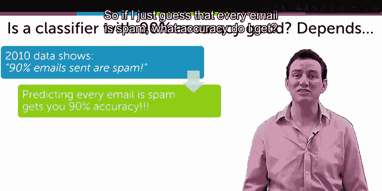
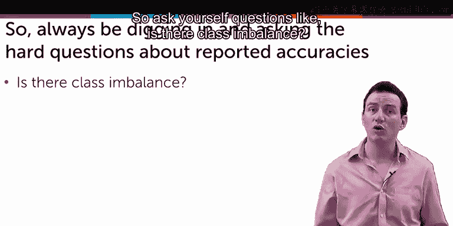

# 华盛顿大学《机器学习（基础篇，第1课／共4课）｜Machine Learning》中英字幕 - P44：43_什么是好的准确率.zh_en - GPT中英字幕课程资源 - BV1zw4m1e7Zh

。

We've discussed error and accuracy as ways to evaluate the classifier。

Now it's very important to understand the accuracies or errors that you're actually getting from a classifier really think deeply about whether those are good errors or good levels of accuracy in your situation so for example。

😊。

One of them。Com mistakes you might make is to say， you know， how good is my classification at all？

When you build a classifier， the first baseline comparison you should do is against random guessing。

 so for example if you have a binary classification problem like is the sentence of positive or negative sentiment。

 then just random guessing is going to give you 50% accuracy on average。😊。

So you better beat 50% if you have K classes， so for example， if you have three classes。

 you're going to have a random guessing accuracy of 33% for four classes will be 25% for K classes it be1 over K。

So at the very very very， very very very very， very very least you should beat random gasing really well because if you don't then your approach is basically pointless now even beyond beating random gasing you should really think deeply about whether you classify even if it looks really good is it really meaningfully good so for example。

 suppose you have a span predictor that gets 90% accuracy。😊，Should you go brag about it。

 is that awesome？Well， it really depends。So in the case of spam， not so good， because in 2010。

 data shows that 90% of the emails ever sent。W spam， 90% of the emails。

 so if I just guess that every male spam， what asked cur get 90%。

This is a problem where this is what's called majority class predictions。

 so I just predict a class that's most common and it can have amazing performance in cases where there's what's called class imbalance。

 one class has much more representation than the others spam is much more representative than regular good emails。

And so you have to be very cautious and really look at whether you have class imbalance when you try to figure out whether your accuracy is good。

And of course， this also beats this approach also beats random guessing if you know what the majority class is。

So you should always be digging into your problem and understanding。

 really thinking about the predictions you're getting and whether that accuracy is really meaningfully good for your problem。

😊，So ask yourself questions like is there class imbalance。

 how do I compare against baseline approaches like random guessing majority class and really fancier things than that and most importantly。

 think about your application and ask yourself what is a good enough accuracy to make my users really happy？

😊。

So in spam filtering， if your accuracy is not that good。

 then there will be important messages going to the spam folder and that could be a really bad thing。

