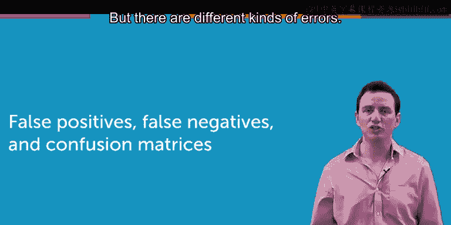
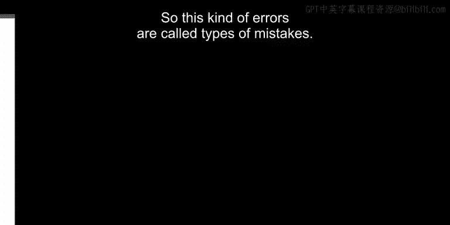
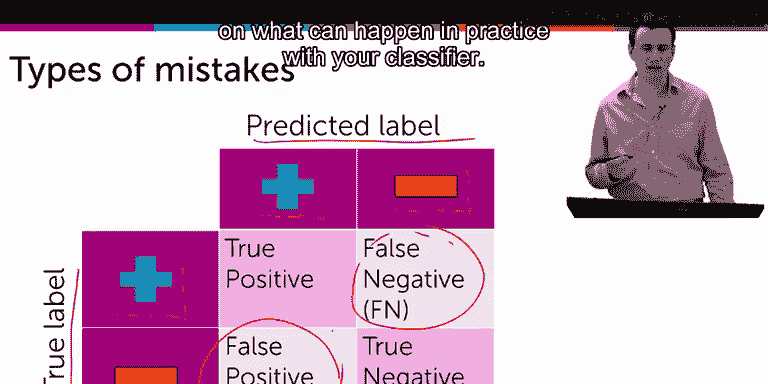
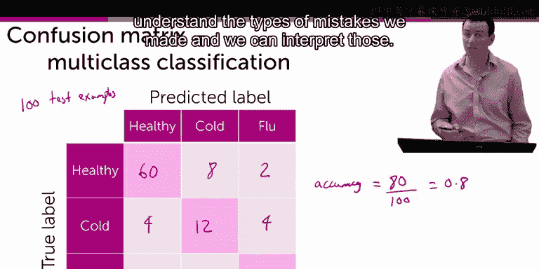
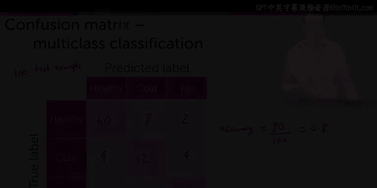

# 华盛顿大学《机器学习（基础篇，第1课／共4课）｜Machine Learning》中英字幕 - P45：44_假阳性、假阴性和混淆矩阵.zh_en - GPT中英字幕课程资源 - BV1zw4m1e7Zh

。

We've talked about accuracy and errors that classifier may make。

 but there are different kinds of errors。

These kinds of errors are called types of mistakes it's important to look at the types of mistakes a classifier might make and one way to do that is for what's called a confusion matrix so let's take that in a little bit so we're talking about the relationship between the true label and whatever classifier predicts so the predicted label so let's say that if the true label is positive and we predict a positive value for that sentence we call that a true positive because we got it right Similarlyly if the true label is negative and we predict that negative we call that a true negative that's good because we got that right。

😊。

Now there is two kinds of mistakes that I can make， so， for example， if the true label is positive。

 but we predict it as negative， we call that a false negative。😊，We said it was negative。

 but that was false because it was positive， similarly， if the true label is negative。

 but we predict it as positive， we call that a false positive。It was negative。

 but we predicted as positive and false positives and false negatives can have different impacts on what can happen in practice with your classifier。

 so let's look at a couple of practical examples of that。😊。

So let's look at two applications and what the cost has of false positives versus false negatives so if we consider spam filtering a false negative is an email that was spam but went into my folder you thought it was not spam so that's just annoying I got another spam email in my inbox maybe it's it bad but not super bad however if you look at a false positive that's an email that was not spam they got labeled as spam went to my spam filter I never saw it。

 I lost that email forever that has a higher cost。Now we can also look at medical diagnosis or other applications as a second application so what's a false negative medical diagnosis false negative is there's a disease that I have but it didn't get detected so the classifier said it was negative we don't have the disease so in this case the disease goes untreated which could be a really bad thing。

But the false positives can also be a bad thing that is I classify as having the disease where I never had a disease in this case I get treated potentially with a really bad drug of false side effects for a disease that it never had so it's a little bit unclear what's worse having a false positive or false negative in medicalplication it really depends on the cost of the treatment and how many side effects it has versus how bad the disease can be now this relationship between the true label and the predict label false positive false negatives is called the confusion matrix this matrix that we just drew so for example let's say that we have a setting with100。

Test examples。And we have of those 60 positive and 40ier negative。

 so there's a little bit of class imbalance， but not too much。So of those 62 positives。

 if I say I got 50 of them。Correct。Well， of the 40 true negatives。I got。35 of them correct。

 let's see what we've learned。 so out of the 100 examples I got 85 correct so we can talk about our accuracy。

Accuracy is 85 correct， over 100， which is 0。85。And we can also discuss the true positives and the true negatives。

 sorry， the false positive and the false negative。 So of the positives， I got label is negative。

 That's a false negative。 And that was 10。 I had 10 false negatives。 And on the other hand。

 of the true negatives。😊，We get five false positive。 So in this example， we got 85% accuracy。

 We got a higher false。Negative rate， then we had a false positive rate。

Now those words false positive and false negative apply only for binary classification for two classes。

 but idealcon matrix works well even when you have more classes so let's talk about a simple example of that so let's say that I have 100 test examples。

And this is for medical diagnosis， so the three classes healthy code of flu。

 and of the 100 test subjects， we had 70 with they were healthy。

 20 they had cold and 10 they had the flu。And let's suppose that we got 60 correct for healthy。12。

 correct for a code。 and we got。6，12，8， correct for flu。So at the total， our accuracy。Here。Was 80。

 which is。60 plus 12 plus 8 divided by 100， so that's 0。8， 80% accuracy。

 but we can talk about the false positives and sorry the false prediction so from healthy there are 10 mistakes and we can say it's more common to confuse healthy with having a cold than is were having the flu because the flu is a。

More complex disease， so we might have those 10 mistakes。

 eight were confused with code and two were confused with flu。Cold can go both ways。

 so we made eight mistakes， maybe you can say half of them got confused with healthy and half of them go diagnosed something stronger the flu。

Well of the two mistakes for the flu。Then maybe we would say that we made no mistakes as healthy。

 nobody that came in with a flu was thought， oh， you're healthy。

 but two of those then were thought to have just a cold and not the flu。

So this is an example of a confusion matrix we can really understand the types of mistakes being made and we can interpret those and this is a really important thing to do in classification。

