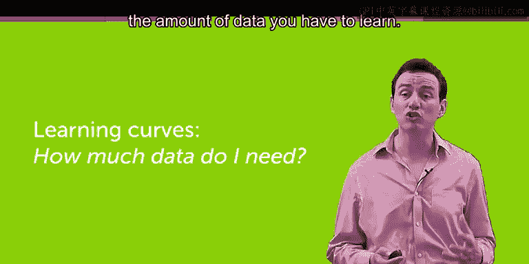
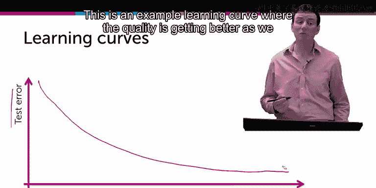
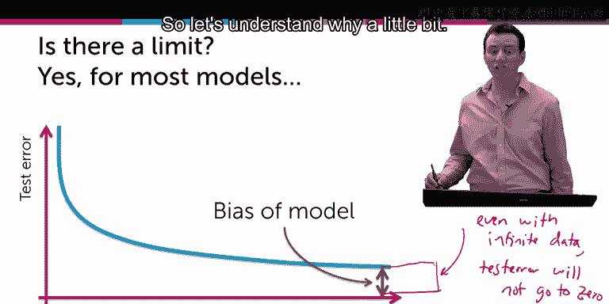
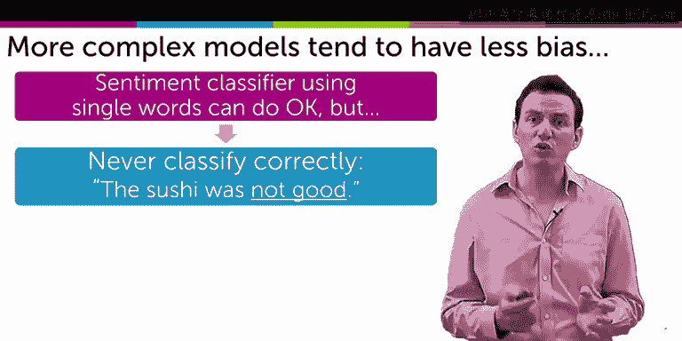
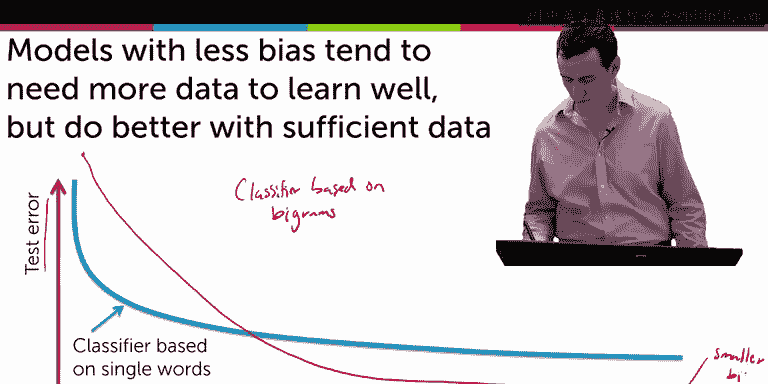

# 华盛顿大学《机器学习（基础篇，第1课／共4课）｜Machine Learning》中英字幕 - P46：45_学习曲线.zh_en - GPT中英字幕课程资源 - BV1zw4m1e7Zh

。

In the regression module， we talked about the relationship between error or accuracy and the complexity of the model。

Let's talk a little bit about the relationship in terms of the amount of data you have to learn。

And we explored the question of how much data we need to learn。

 and this is a really difficult and complex question in machine learning。So of course。

 the more data you have， the better， as long as the quality of the data is good。I mean bad data。

 lots of bad data is much worse than having much less， much fewer data points， but really good。

 clean， high quality data points。Now there are some theoretical techniques to analyze how much data you need。

 many of those help you understand kind of the overall trends but really tend to be too loose to using practice in practice there's some empirical techniques to really try to understand how much error we're making and what that kind of error looks like and in the follow-up courses we're going to explore those techniques much further but let me give you a little bit of guidance and a little insight on what that can do within the classification setting。

😊，Now an important representation for this relationship between data and quality is what's called a learning curve。

 so a learning curve relates the amount of data that we have for training with the error that we're making and here we're talking about test error。

Now， if you have very little data for training， then your test error is going to be high。

But if you have a lot of data for training， your test error is going to be low。

And now the curve is going to get。Better and better as you get more and more and more data。Whoops。

 it didn't go through that point， so I'm going to adjust raise。And here we go。

 this is an example learning curve where the quality is getting better as we add more data。😊。

Now you may ask， is there a limit， is this quality just going to get better and better forever as you add more data？

Now we know that the error is going to decrease as we add more data， the test error。However。

 there is some gap here and the question is whether that gap can go to zero and the answer is in general。

 no， this gap is called a bias。😊，So let's discuss a little bit what this bias or this gap is。

So intuitively， it says。Even。With。Infinite data。The test error will not go to zero。

So let's understand why a little bit。

More complex models tend to have less bias so if you look at a sentiment analysis class we been building。

 if you just using words like awesome， good， great。

 parable awful it can do okay maybe it do really well maybe it just does okay but even if you have infinite data even with all the data in the world。

 you're never going to get this sentence right the suU was not good。

Because you're not looking at pairs of words， you're just looking at the words good and not individually。

And so more complex models that for example， deal with combinations of words， for example。

 is' something called the by model where you look at pairs of subsequent words like not good。😊。

Those models require more parameters because there's more possibilities。They can do better。

They may have a parameter for goods， say 0。1。5 but not good， say minus 2。

1 and actually get that sentence， the sushi was not good correctly， so they have less bias。

They can represent sentences that couldn't be represented otherwise otherwise but so they're potentially more accurate but they need more data to learn because there is more parameters this is not just parameter for good。

 there's no parameter for not good and all possible combinations of words and the more parameters your model has in general the more data you need to learn so let's go back to our example。

😊，We talked about the effect of amount of training data on the test error。

 So let's say that I'm building a classifier using single words。 And the question is。

 how does that relate to a classifier based on pairs of words。Now。

 for a classifier based on diagrams， when you have less data。

 it's not going to do as well because it has more parameters to fit。But when you have more data。

 it's going to do better because it's going to be able to capture settings like。

The social was not good， and so the behavior you're going to get is something like this。

And at some point there's a crossover where it starts doing better than the classifier with single words。

But notice that the by model still has some bias here， although the bias is smaller。

It still has some bias。

你。