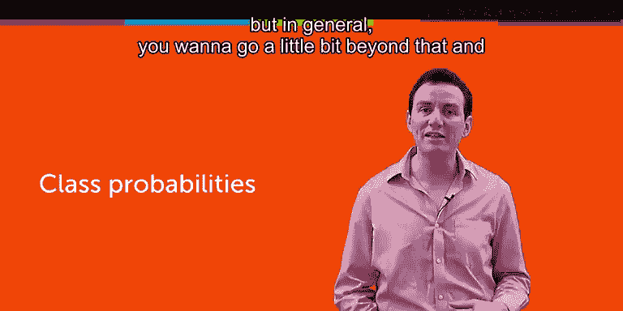
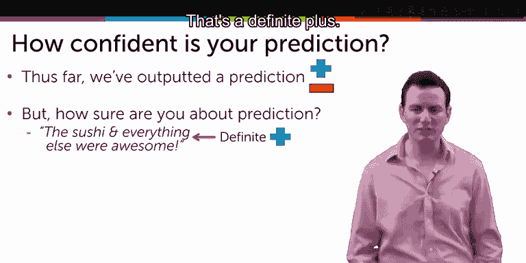

# 华盛顿大学《机器学习（基础篇，第1课／共4课）｜Machine Learning》中英字幕 - P47：46_类别概率.zh_en - GPT中英字幕课程资源 - BV1zw4m1e7Zh

。

So far we've talked about classification in terms of just predicting is this a positive sentence or a negative sentence is males spam or a not spam but in general you want to go a little bit beyond that and ask about what is the probability that this is males spam so how confident am I on the prediction instead of just looking at positive and negative I want to know how sure I am about the prediction so for example。

 if you take a sentence like the sushi and everything else were awesome？

That's a definite plus， definitely positive。

However， the sushi is good， the service was okay。It's probably a plus。

But I'm not so sure it's not as definite。And so what。

Clifier will often do is not just output is positive or negative but output how confident or how sure it is one way to do that is talk about probabilities so here are have to put the probability of being a positive or negatives。

😊，Sentence given the input sentence x， so the output label was a probability output label given the input sentence。

 so for example for the top example there something saying a defin a plus we say the probability that it's a plus given x input sentence is 0。

99。😊，Well， in the second one， the probability of being a plus， given x is only 0。

55 because I'm kind of uncertain about things。Predicting probabilities or level confidence is extremely important and as we'll see in the classification course it allows you to do many things。

 so for example when we know the probability you can make decisions like what is a good decision boundary that trades off false positives and false negatives and balance speed between the two？

😊。