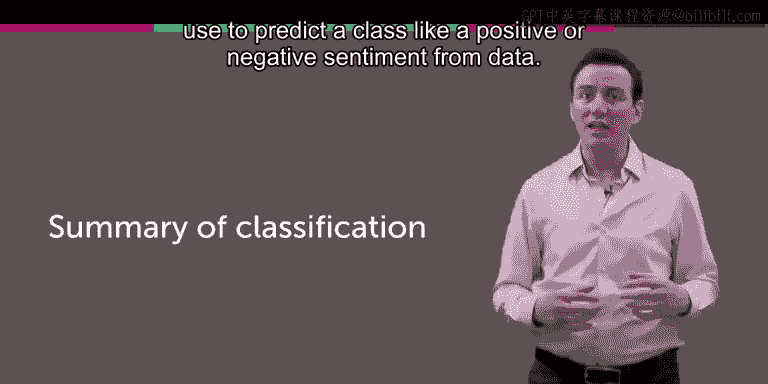
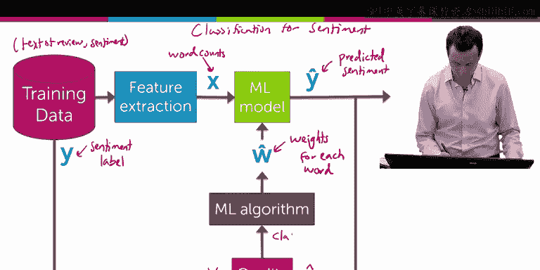

# 华盛顿大学《机器学习（基础篇，第1课／共4课）｜Machine Learning》中英字幕 - P48：47_分类机器学习模块图.zh_en - GPT中英字幕课程资源 - BV1zw4m1e7Zh

。

🎼Now weve seeing classification in a wide variety of settings and how it can really be used to predict a class like positive or negative sentiment from data。

In the regression section， Emily talked about this block diagram that really describes how a machine learning algorithm iterates through its data。

 so now let's take this same block diagram and work through it and describe how it works out in the case of classification with sentiment analysis。

😊，How does it look for classification？开。For sentiment。So in this case。

 the data is the text of the reviews。So for each review。

 the textile review associated with a particular labeled sentiment。From that text of the review。

 we feed it through a feature extraction phase， which gives us x， the inputs to our algorithm。

 and this x here is going to be the word counts。😊，So， word counts。For every data point。

 for every review now our machine learning model is going to take that input data so the word counts as well as some several parameters which I'm calling here W hat。

 which are the weights for each word。Yic。Word。And from combining this two。

 we're going to output the prediction so if the score is greater than 0 is going to be positive the score is less than 0 is going to be negative。

 so this output here is the predicted sentiment。😊，And if we're just using the model。

 we would be done here， but really in the machine learning algorithm phase。

 we're going to evaluate that result and then feed it back into the algorithm to improve the parameters。

 so we're going to take the predicted sentiment。😊，Yhy hat and compare it with the true label for the sentiment。

 so the sentiment。Label for each data point， so that's going to fit in and our quality measure here is going to be classification accuracy。

😊。

Classify。Kishun。Accuracy。And the machine learning algorithm。

 which we're going to discuss in more detail in the classification course。

 is going to take that accuracy and try to improve it and the way the improvement works is by updating the parameter WHt。

😊，And that's what the cycle of a machine learning algorithm for classification would look like。

In this module we've seen how to do classification。

 we've looked at various examples of where it can be applied。

 we talked about a few models for building classification。

 especially in the context of sentiment analysis， we saw some live demos and we even built a notebook where we built a classifier from data and analyzed it。

😊，And with this knowledge， you're ready to build an intelligent application that uses a classifier at its core。

