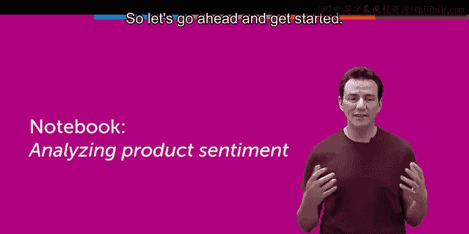
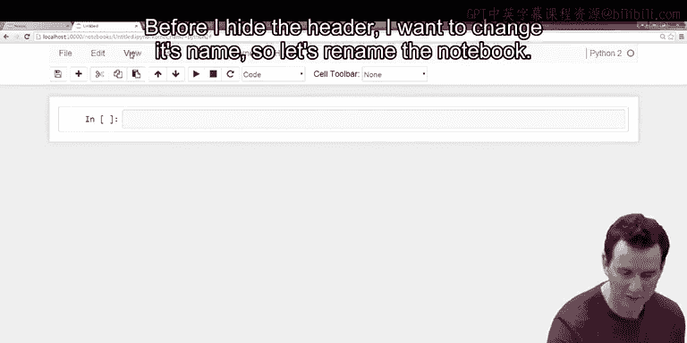
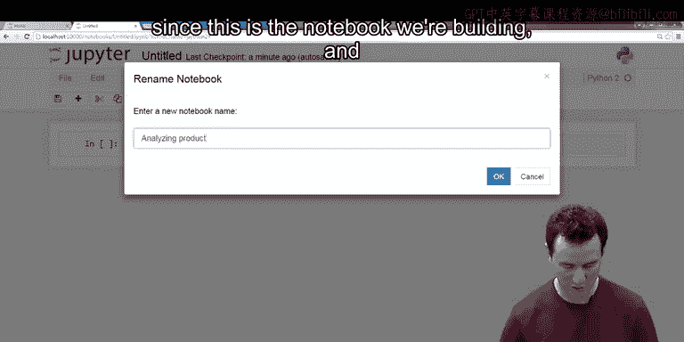
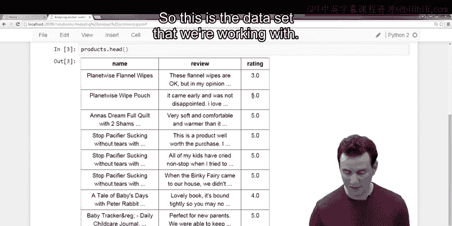
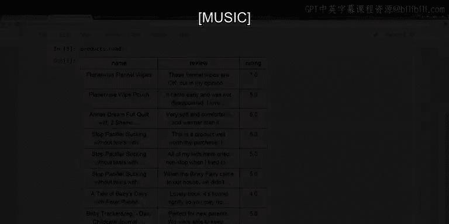

# 华盛顿大学《机器学习（基础篇，第1课／共4课）｜Machine Learning》中英字幕 - P49：48_加载并探索产品评论数据.zh_en - GPT中英字幕课程资源 - BV1zw4m1e7Zh

。

In this module， we talked about building sentiment analysis tools using classification。

 and now in this notebook， we're actually going to go ahead and build one of those things。

 So we're going to build a sentiment analyzer for products。 So let's go ahead and get started。 Okay。

 so here we are on an iPython notebook as usual And again， I'm going to hide the header。😊。

Before I had the other。

I'm going to change its name。 So let's rename the notebook。 So I'm going to call this the。嗯。

Analyzing。Azing。Product。

Sentiment。Since this is the notebook we're building， and I'm going to hide。

The header and I'm going to hide the tobar， just have a little bit more space。

And we're going to be using GraLb C today， so I'm going to import GraphLb to get ourselves started。

Here we go， so the first thing that we're going to do is read some data。

So let's read some product review data。So let me read some product。Review data。

 And this is a real data set that we're going to read。

 So I'm going to create an nest called products， which。Use this Graphlab as fame。

FromFrom a local file， I've downloaded the data you're going to download the data to。

 and this is Amazon。Ba product dataset set。Like we've downloaded that data and so the first thing that we're going to do is do a little bit of data exploration。

😊，So。That's a。Let's。Explore this data。Together。And this is fun。 So we have some product data。

 So let's just look at。😊，The head of the table， so the head is just the first few lines of this table that I've loaded up。

And so as you can see it's composed of three things， the name of the product。

 so plantwise flanno wipes， pretty good product， the review of this planno wipes are just okay but in my opinion something。

 something and the rating is three and it's out of five stars so three is kind of a middle of the road rating Well the plantwise wipe pouch this review really liked it and gave it a rating of5 so this is the data set that we're working with。

😊。

。

