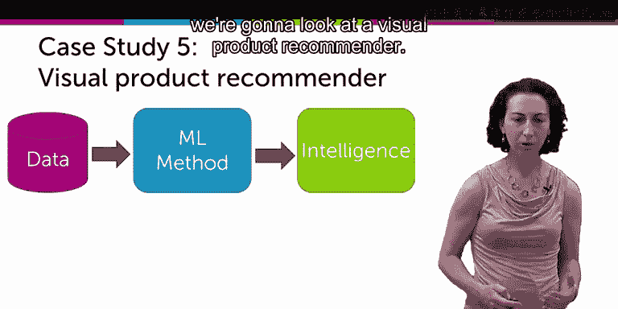

# 华盛顿大学《机器学习（基础篇，第1课／共4课）｜Machine Learning》中英字幕 - P4：3_为什么采用案例研究方法.zh_en - GPT中英字幕课程资源 - BV1zw4m1e7Zh

。

So the way we're going to learn about this data to intelligence pipeline is by examining a number of case studies that are going to ground the methods that we present in real world applications。

 and that's one of the really unique features of this course。

In our first case study。We're going to look at predicting house values。

 so the intelligence we're deriving is a value associated with some house that's not on the market。

 so we don't know what its value is and we want to learn that from data。And what's our data。

 well in this case， we're going to look at other houses and look at their house sales prices to inform the house value of this house we're interested in。

 and in addition to the sales prices， we're going to look at other features of the houses。

 like how many bedrooms the houses have bathrooms， number of square feet and so on。

And what we're going to do our machine learning method is something that's going to relate the house attributes to the sales price。

 because if we can learn this model， this relationship from our house level features to the observed sales price。

 then we can use that for predicting on this new house。

 we take its house attributes and predict its house sales price。

 and this method is called regression。In our second case study。

 we're going to explore a sentiment analysis task where we have reviews of some restaurants。

 so for example， in this case it says the sushi was awesome， the food was awesome。

 but the service was awful， and we want to take this review and be able to classify whether it had positive sentiment。

 it was a good review， thumbs up， or a negative sentiment， thumbs down。

And so how are we going to do this well we're going to look at a lot of other reviews。

 so we're going to look at the text of the review and the rating of the review in order to understand what's the relationship here for classification of this sentiment。

For example， in this case， maybe we might analyze the text of this review in terms of how many times it uses the wordA versus how many times it uses the word awful。

And from these other reviews that we have， we're going to learn some decision boundary between based on the balance of usage of these words。

 whether it's a positive or negative review， and the way we learn that from these other reviews is based on the ratings associated with that text。

 and so this method is called a classification method In our third case study。

 we're going to do a document retrieval task， where here what we want to do。

 the intelligence we're deriving is an article or a book or something like this that's of interest to a reader。

And the data that we have is a huge collection of possible articles that we could recommend。

And what we're going to do in this case is we're going to try and find structure in this data based on groups of related articles。

 such as maybe there's a collection of articles about sports and world news and entertainment in science。

 and if we find this structure and annotate our corpus our collection of documents with these types of labels which we don't have ahead of time we're trying to infer this from the data。

 then we can use this for very rapid document retrieval。

 because if I'm sitting here currently reading some article about world news。

 then maybe if I want to retrieve another article I already know which articles to search over。

And this type of approach is called clustering In our fourth case study。

 we're going to do this really interesting thing that's called collaborative filtering that's had a lot of impact in many domains in the last decade。

Specifically， we're going to look at doing product recommendation where you take your past purchases and try and use those to recommend some set of other products you might be interested in purchasing。

So in this case， the data that we're going to use to derive this intelligence for product recommendation is we like to understand。

 well， what's the relationship between what you bought before and what you're likely to buy in the future and to do this we're going to use other users purchase histories。

And possibly features of those users。 But the key idea here is we're going to take。This data。

 and we're going to arrange it into this customers by Product Matri。

Where the squares here indicate products that a customer actually purchase。

 so those are products that are liked by that customer。And from this matrix。

 we're going to learn features about users and features about products and once we learn those features about users and products。

 from this data that I've described we can think about using those features to see how much agreement there is between what the user likes。

 different attributes the user likes and whether the products is actually about those attributes。

 So in the example I'm showing here， maybe a user as a mom has certain features that are similar to other users that are also moms and from that we can infer things about products。

 what are attributes about， for example， baby products that are of interest to moms and we're using that information to form our recommendations and this type of approach going from this matrix。

 this customers by products matrix into these learn features about users and products is called matrix factorization。

Okay， well in our final case study， we're going to look at a visual product recommender。

So here our data is somebody's going to go to the web and they're going to input not text but an image。

 they're going to put an image like of a black shoe or a black boot or a high heel or some Docker shoe or a running shoe and what they want is they want a set of results。

Of shoes that might also be of interest to them， so shoes that are visually similar to the picture that they have。

 and they want to be able to search over those to purchase this item。

And the way we're going to do this to be able to go from an image to a set of related images is we need to have very good features about that image to find other images that are similar and the way we're going to derive those really detailed features is something called deep learning So in particular we're going to look at these neural networks where every layer of the neural network provides more and more descriptive features。

 So in the little example we show here the first layer might just detect in the image things like different edges whereas when we get to the second layer we start detecting corners and more interesting features like that。

 and as you go deeper and deeper in these layers， you get more intricate features arising。

So as you see， we're going to walk through a series of real- worldor case studies。

 real world problems and real world solutions using machine learning。

 and through this we're going to explore a series of methods that have a lot of power out there and are going to allow you to be able to develop and deploy new machine learning techniques on new problems that aren't the exact case studies we used。

 but the case studies will allow us to really ground the methods that we're describing with things that are very interpretable。

