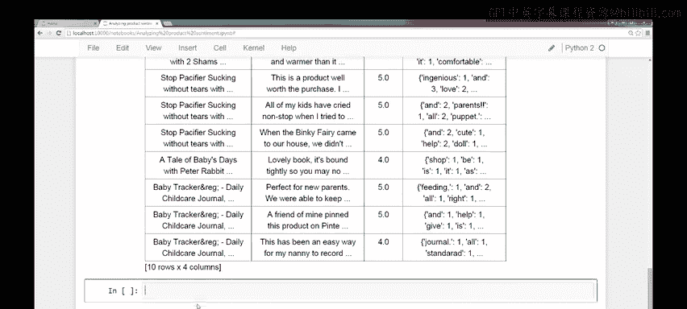

# 华盛顿大学《机器学习（基础篇，第1课／共4课）｜Machine Learning》中英字幕 - P50：49_创建词频向量.zh_en - GPT中英字幕课程资源 - BV1zw4m1e7Zh

。

And as part of using the data set， the first thing that we're going to do， just like in the module。

 we're going to build。A word count vector。Build。The word count。vectorctor。For each view。

Now normally youd have to implement this since plan something that goes review by review separates words called tokenizing。

 builds a account vector， but one of the nice things about using the tools here in this course is that just with one command we can build that word count vector。

😊，So in products， I'm going to add a new column called word count。

Which is going to start my word counts。And if you just call graphflb。

text Ana is a text analytics tool box for a bunch of functions， there is one called count words。

 notice there's also one called count ngrams if you want to use bygrams， trigrams， and so on。

And as input， I'm going to give the same products as frame。

 but I'm going to ask it to counter words in the review column。

And so we're going to execute that and it's done。 And so now if we take another look at the products。

😊，Table， so they head at that table。You'll see that now we have a fourth column with the word counts and we're going to explore that a little bit more soon。

 but you see for this first review include the word n5 times think once。

 probably that's why it wasn't a good product review。But there's others。

。

