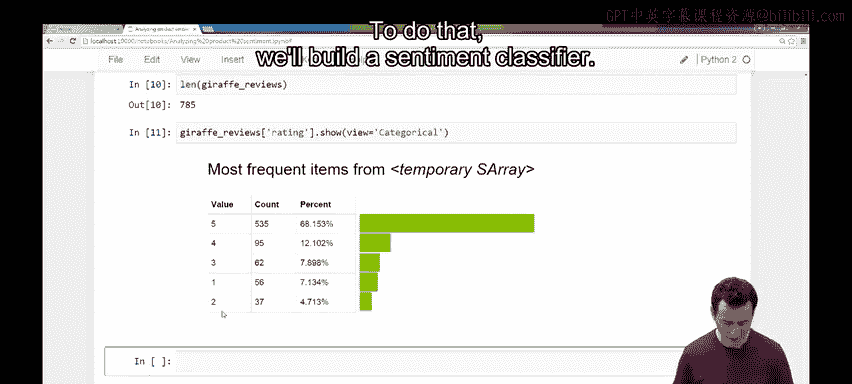

# 华盛顿大学《机器学习（基础篇，第1课／共4课）｜Machine Learning》中英字幕 - P51：50_探索最受欢迎的产品.zh_en - GPT中英字幕课程资源 - BV1zw4m1e7Zh

。

So let's take a look at what products we have so let's look at what reviews we have for different product names and here we're going to use the canvas again to do a little bit of visualization and so as of before I'm going to do GraLlab。

 Canvas and'm going to set the target to be my iPython notebook so it will show up right here on the iython notebook as we're building this。

Now we can take one of the columns of this s frame of the product。So for example。

 let's take the name of the product and we can just hit dot show on it。

And that's going to show a histogram of the different names of the different products in this data。

 So for example， right here。😊，So we see that this particular product， Woy Sophie。

 something gets the most reviews 785 reviews as compared to like simple wishes， something。

 something 562 reviews and and you can see that the number of reviews go down Fisher price products 489。

450 This is different baby products here that we're analyzing and you see the histogram of the different reviews of different products number of reviews So let's visit that first Woy Sophie。

 what is that。😊，So let me tell a little bit more about that product。 So let's explore。

The so called wooly Suie。And this is an extremely popular product。

 so it's actually happy to have one right here。😊，This is a bully Soie， the giraffe teethther。

 so it's a little plastic giraffe， it's the most gifted product for babies on Amazon and it's a teethther which means that babies like to cu in it so lots of reviews for this giraffes for babies to chew on and it's made out of plastic and sques。

😊，So this is what we're going to talk about a lot today， this is a giraffe。Now。

Let's look at the reviews for this particular giraffe， so I'm going to call it giraffe。😊，Girafffe。

Reviews。And when Im going to， I'm going to take all those products that I have。

All those products reviews， and I'm going to select this is another filter。 I'm going to select。😊。

Those rows where the product name。Is equal to the name of this particular giraffe is。Vully。Sophie。热的。

😔，地点儿。This is the product that we've been talking about。So if we take a quick look here。

 if I ask for the length of this。😊，New thing giraffe reviews， this new table。

 you see the 785 reviews for this plastic toy。😊，You说Tther。So 785 reviews。

 And let's look at the ratings。 So I'm going to take the giraffe reviews， the ratings。

Just for this particular product， and I'm going to do a dot showing it like we've been doing。

 I want to look at a particular view called the categorical view。😊。

Which is going to give me categorical。Vi which go give me asort histogram of the different reviews and how many scores we got so if you take a look at this little histogram here you will see something kind of interesting。

 people love this thing 535 the reviews were five stars this is a product 5355 stars reviews then the next most common is four stars then three stars then it jumps down to one star and finally two stars so eizable number of people really hated this product but most people loved it。

😊，So it would be fun to do a kind of sentiment analysis to try to understand what the really negative reviews or the really positive reviews of what this reviews is talking about。

 just like we discussed in the lectures in this module。

 so to do that we're going to build a sentiment classifier。😊。

你。