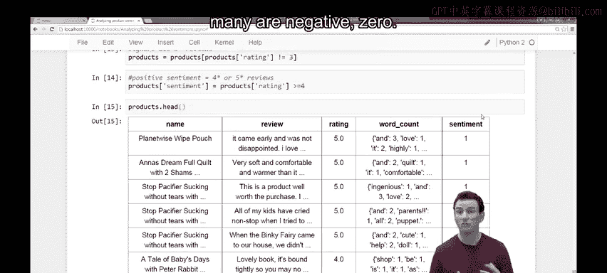

# 华盛顿大学《机器学习（基础篇，第1课／共4课）｜Machine Learning》中英字幕 - P52：51_定义哪些评论具有正面或负面情感.zh_en - GPT中英字幕课程资源 - BV1zw4m1e7Zh

。

Build a sentiment。Classy fire。And I'm going to put it。Pund here to make it a nice title。

So this is our next task here。When you build a sentiment classifier。

 you're talking about positives and negatives， so thumbs down and thumbs up。

 but if you remember our product ratings were not about positive and negative。

 they were numerical things， so for example if I take all the products。😊。

And I'll take the rating column。And I do a dot show， as we did above， just for the giraffe。

 I do a dot show for everything with the view。Equ to。Cateorical。

We're now building a histogram for all of the reviews and if you take a quick look at it。

 you'll see that most reviews are positive across the board， 107，000 reviews at five stars。

 so most people review positively。😊，And just write reusable products they like。

 they don't typically write reusable products they don't like。Then the next set of reviews。

 330004 stars， then three stars and again a lot of people write really bad reviews， one star。

 two star why would you give a two stars it might as well just even one star if you really hated it and this is what we observe in this sstogram but again for sentiment analysis we have to define what thumbs up and what thumbs down and so I'm going to make an arbitrary choice here let's say that。

😊，Things that four or five stars are things people liked， so those are positives。

 things that one in two stars are negative。😊，But the things that are three stars those is kind of in the middle。

 So let's just throw those out。 So we're going do a little bit of。😊。

What we call kind of data engineering， just defining what is a positive and negative sentiment。

So let's do that right now。 So in the subsection， we're going to define。Whats a positive。

And a negative。Sentiment。And we're going to do first。Is。ignoregnore。哦。3 star。Reviews。

And the way to do it is by saying， okay， I'm going to take the product table。The variable products。

 and I'm going to just select everything out of the product table whose rating was not3。

 so out of the product table， select all products whose rating。😊，Was not equal to three。

So that was our first step in our little data engineering task and now the next step in this task is to actually define what thumbs up and thumbs down so I'm going to say a。

😊，Positive。Sentiment。Equals。4 star or five star reviews。

So let's go ahead and add a new column to our table that defines the actual sentiment so products。

A new column called sentiment。It's going to be a binary column 01。

 and the way we're going to define a column is I'm going to say off the products。Ring。

Is it greater than equal to4， it's greater than equal to 4 is going to get a1 and if it's less than four。

 its going to get a zero。😊，And so now if I take another look at my product table， so head。😊。

You should see that I've added a new column the right called sentiment。

 and most of the sentiments are positive， as we saw earlier， but many are negative zero。

Okay。Now we're ready， we're finally ready to train or a sentiment classifier。

