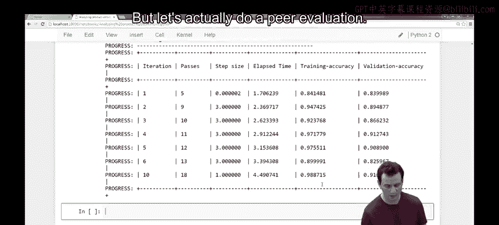

# 华盛顿大学《机器学习（基础篇，第1课／共4课）｜Machine Learning》中英字幕 - P53：52_训练情感分类器.zh_en - GPT中英字幕课程资源 - BV1zw4m1e7Zh

。

Let's。Train。The sentiment。Classifier and we're going to do this in two steps。 First。

 we're going to do a train test split of the data。 So I'm going to compute the training data。

 we' going to split the data into training data and test data。

Just like Emily talked in the regression class。 and just like we did in the regression notebook。

 So we're going to use。😊，We take this product table。Products。

And then we're going to do that random split。So， oh， whoops。Products。

And I'm going to do that random split where we're going to do 80% for training。

 20% for testing and just so that you can reproduce this at home。

 I'm going to do the seed equals to zero just like we discuss some regression I normally you wouldn't do this you pick another random seed but want the random seed to be the same so when you do it you get exactly the same results I did。

So this is my first step train test split on this data set and now're ready。

 we're going to build that famous sentiment。😊，Sentiment model。And here we're going to use GraphLb。

And we're going to use a particular classifier called the logistic classifier and in the course and classification we're going to learn a lot about different kinds of classifier like logistic regression。

 this one support vector machines， decisionion3 and others。

 but let's start with just a logistic classifier and you can just like in reaction we can type dot create after the name and it'll actually create a classifier for you。

😊，And as input， it takes just a few parameters， so we're going to take the training data。

It's one parameter。Then we're going to see that the target。

 the thing we're trying to classify is the sentiment column。

And then we're going to have to tell it what features you use。So for the features。We're going to use。

Just the word count column。So this is the new column that we created above。For word counts。

And I'm going to give it a validation set。 So the validation set。Is going to be my test data。So。

 validation set。Equals test data。Okay。So now we execute the sell and we should be building a sentiment。

classassifier model and' only going to take a few seconds and here we go it's done and you will see the iteration you went through going through the data and the validation accuracy as it goes along it seems to be getting better and better。

 but let's actually do a re evaluationval。😊。

。