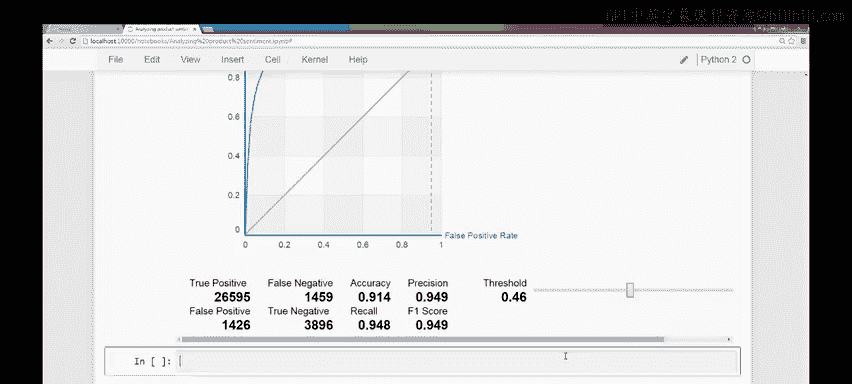

# 华盛顿大学《机器学习（基础篇，第1课／共4课）｜Machine Learning》中英字幕 - P54：53_评估分类器：ROC曲线.zh_en - GPT中英字幕课程资源 - BV1zw4m1e7Zh

。

Our next step is to evaluate。The sentiment。Model that we've built。Now。

We just talked in this module about classification error， precision。

 sorry false positives and false negatives， and'm going to explore that idea right here in this demonstration in this notebook。

😊，The sentiment model has a function called E， and that function evaluate allows you to evaluate its quality on some test data。

 and we're going to provide a particular metric。And this metric is called the ROC curve。

 and we're going to learn a little bit more about the ROC curve next。

 but the ROC curve is a way to explore the false positives and false negatives and that confusion matrix that we discuss。

Now here is， it shows you the results of the valuations a little hard to see in text。

 so let's do a little visualization of it again using Can so we can use sentimentmodel。

 show and what we're going to show the view that we're going to use。😊。

Is going to be the evaluation view。And here we go。Okay。This is really cool。

We've built a few things so this is a precision recall sorry this is a what's called the aero Su code curve is a curve that trades off false positives。

With true positives let me explain that a little bit。

 but first lets let's look at these numbers over here so this is the confusion matrix。

 the number of true positives， the things that we got right that were true is 26455。😊。

So right here the number of true negatives was only 4000 of 30965 so this is a highly unbalanced case and then the number of false positives and number of false negatives is about the same the overall accuracy was 91。

1% so 0。911 and we also discuss a few metrics like precision recall and phone score which we're going to learn more about later in the course and later in the specialization。

😊，Now the thing about the false positives and false negatives is that there is a very natural way to change the threshold of what we believe the transition from negative class so positive class should be。

 saying this is what the threshold shows on the right， but let me first show it on the curve here。😊。

So you can see it is possible for me to get， for example， a very high true positive rate。

 so 04 if I sorry a very low 0。4 if I don't allow myself to get any，😊，False positives。

 So if I'm very worried about false positives， I can be very conservative， get no false positives。

 but again， not capture many of the true positives and make other mistakes。

 and you see as you go through the curve， there's a kink here。

 this is the point where you get not too many false positives but a lot of true positives and then over on this end you get every true positive。

😊，But you get a lot of false positives， how do you get every true positive but get a lot of false positivesms。

 you just say every data point is positive， then you get all the true positives。

 but you also make a lot of mistakes and we'll discuss more of this when we talk about the precision recall curve。

 but nicely you can change the threshold over here and walk that curve up there。😊，As you can see。

 and so for example， at the far end on the right， you see that the true positive rate is really high。

 there's no false positives， but there's no true negatives。😊，So there's no false negative。

 there's no true negative， you just got everything right。嗯。

And then you can slide it just the other way。 So you can play with this and really kind of get a good sense of what this curve really means。

 thearrowic curve。 And that's the valuation we're going to be doing。😊。

。