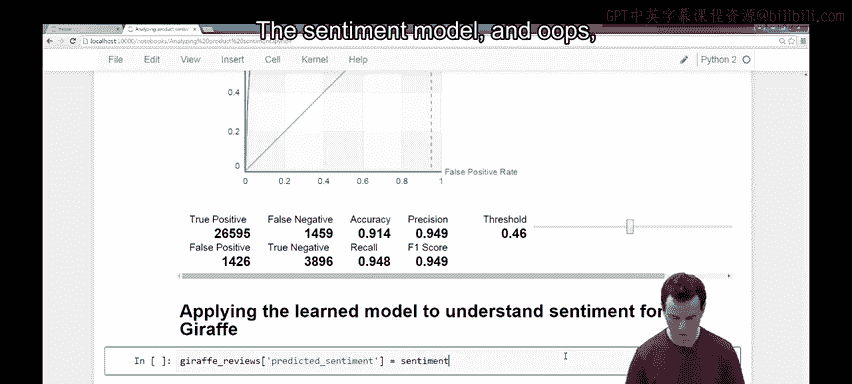
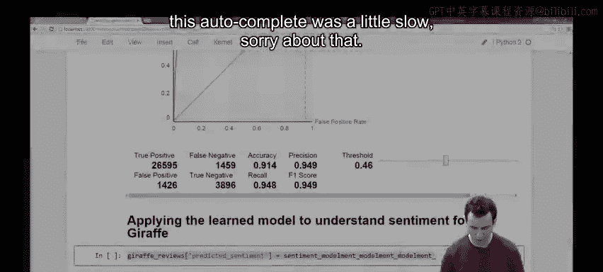
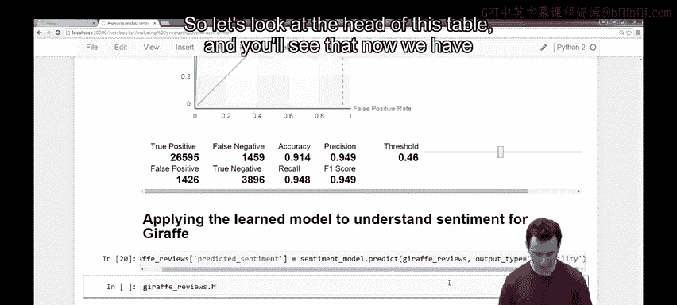

# 华盛顿大学《机器学习（基础篇，第1课／共4课）｜Machine Learning》中英字幕 - P55：54_应用模型查找产品最正面和最负面的评论.zh_en - GPT中英字幕课程资源 - BV1zw4m1e7Zh

。

We built a model， we understood its accuracy about 0。911%。

 let's go and actually use this model for something， something actually quite cool。So。

What we're going to do is。Apply the model。Learned。Moel。To understand。Sentiment。For our friend。

 the giraffe。So here we go， let's understand that a little bit。

 so here's what I'm going to do I'm going to take those giraffe reviews that I build a little bit earlier。

And I'm going to create a new column to this draft reviews called My predicted。Sentiment。

And this predicted sentiment is going to come from taking this sentiment model that we build。

The sentiment model。

And。Ops。The autocompte was a little slow， sorry about that。

We have a little glitch there。Okay。We have to take the sentiment model。

And we're going to call this function predict。On it。

 And we're trying to predict how does it feel about the giraffe reviews。

 So how do you feel about my friends the giraffe reviews and the output。 And this is a key thing。

 We're not just going to output。😊，01， whether I predict the sentiment to be0 or1。

 I'm going to say output probability。And if you remember we just talked about this in the module that by outputting probability you can get a more fine grain estimate of what the prediction looks like。

 so we just run it and just let's take a quick look at what this new giraffe reviews look like。

 so let's look at the ahead。😊。

Of the table。And you'll see that now we have the name of the product， the review， the rating。

 the work count， and I added another column called the predicted sentiment and for some reviews it's really high 。

999。99 and here's a review that's。😊，Prety low sentiment。

 There should really be a large warning on the。They don't like it for some reason。

 now let's try to understand， let's look at their reviews and see what reviews are positive or negative。

😊，And let see what the people are saying about the product。 So here's what I'm going to do。

We're gonna。Sort。The reviews。Based on the predicted。Sentiment。And explore。

And the cool thing here is the predictive sentiment is a much more fine grain description of whether reviews positive or negative。

 The star is are really skewed， five stars， four stars， three stars one star。

 but doesn't tell you how far along the spectrum you are but now that we have this numbers。

 this x column we can do a lot more so I'm going to take this giraffe data。😊。

And I'm going to sort it。 So all I have to do is take it， take the same the same value。

 and I'm going to call the function。sortt。On it。And you have to say what column you're sorting based on。

 So we're going to sort based on this new column we call predicted。Sentiment。

And one little trick here， we're going to say ascending。Is equal to false。

 So it's still sorting that。Ascending order is going to sort descend sendinging order。

 starting think from the most positive reviews down to the most negatives。

 Now that we've asserted it， we're going just show the first few lines of the table。

 And what you should see is that。The reviews are now sorted based on that sentiment。

 so the very top here we have the most positive one has predicted sentiment of 1。

9999 and they're all sorted。😊。