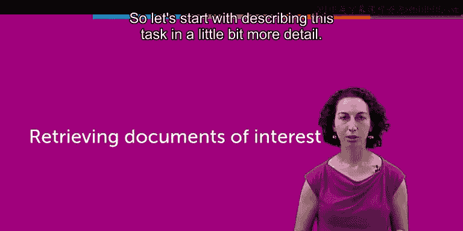
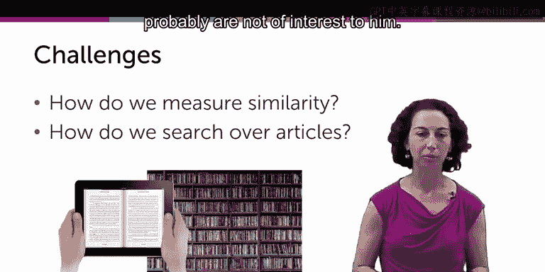

# 华盛顿大学《机器学习（基础篇，第1课／共4课）｜Machine Learning》中英字幕 - P58：57_什么是文档检索任务.zh_en - GPT中英字幕课程资源 - BV1zw4m1e7Zh

。

So let's start with describing this task in a little bit more detail。

Okay， so let's say we're sitting here reading an article。Here we are reading our article。

 and actually it's Carlos who's reading this article because this is an article about soccer。

Or as he would call it football。If he was wearing his Argentina Jersey。Or。Fucci ball。

 if he was wearing his Brazil jey， and clearly I'm not pronouncing either of those words correctly。

 Carlos can correct me later， but the point is that he likes this article and what we'd like to do is retrieve another article that he might be interested in reading。

But a question is how do we do this， there are lots and lots of articles out there and I can't expect him to go and read each of them and say yes。

 he's interested and no he's not so we'd like to think of a way to automatically retrieve a document that might be of interest to him。

Like questions here are first， how do we measure similarities between articles。

 we need to have that in order to say that this article is similar to the one that he's reading now and might also be of interest to him or that here's a large set of articles that are very different and probably are not of interest to him and then the second question is how are we going to search over the articles that exist out there and retrieve the next article to recommend？

