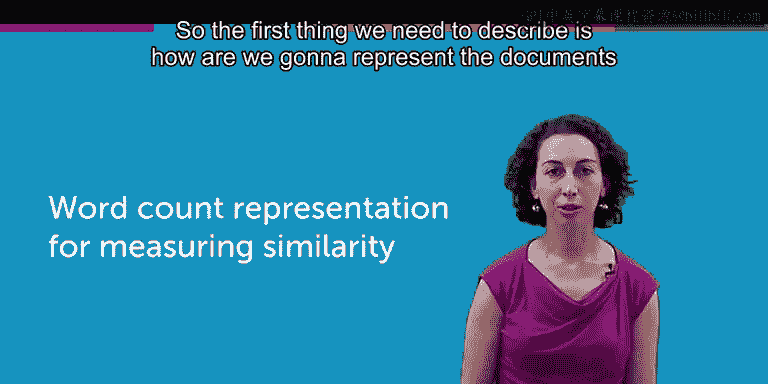
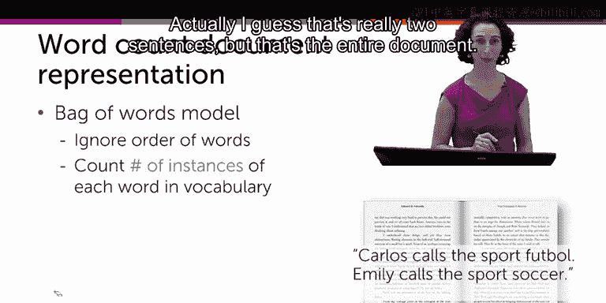
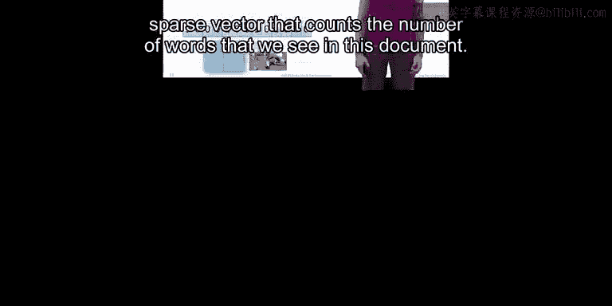
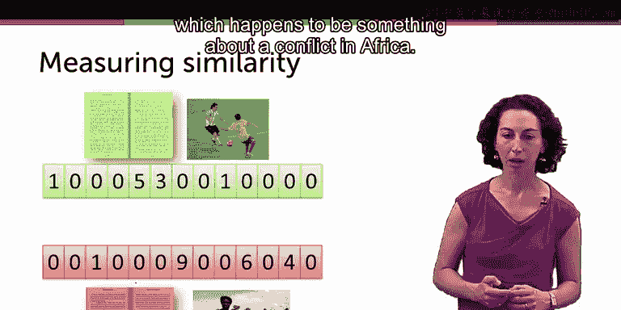
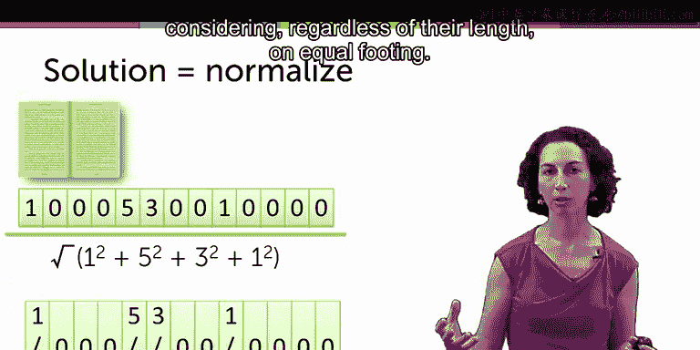

# 华盛顿大学《机器学习（基础篇，第1课／共4课）｜Machine Learning》中英字幕 - P59：58_用于度量相似度的词频表示.zh_en - GPT中英字幕课程资源 - BV1zw4m1e7Zh

。

So the first thing we need to describe is how are we going to represent the documents that we're looking at Okay。

 so perhaps the most popular model to represent a document is something called a bag of words model where we simply ignore the order of words that are present in the document and the reason it's called a bag of words models we think of taking a bag throwing all the words from that document into the bag shaking it up and the new document we've created with the words all jumbled up as exactly the same representation as I'll describe as the original document where the words were ordered。

And what we're going to do instead of considering the structure the order of the words is we're simply going to count the number of instances of every word in the document。

 so let's look at a specific example of this and so in this document we're going to imagine that there's just one sentence and that sentence says that Carlos calls the sport football。

 Emily calls the sport soccer。Actually， I guess that's really two sentences but that's the entire document and what we're going to do to count the number of instances of words in this very short document is we're just going to look at a vector and this vector is defined over the vocabulary in whatever language we're looking at so maybe。

One word in our vocabulary is the name Carlos。Another place in this vector is the index for the word sport。

And then somewhere else， we have the word football。

 luckily in our English vocabulary that I'm writing here。And then let's say， Emily。

 is this last entry， what words are we missing， we're missing the word calls。And of course。

 the word the。Okay， so how many instances of Carlos， well， there's only one。

 how many instances of the， we have two of the two of calls。Two of sport， one of football。

And I forgot the word soccer， one word of Emily。 And let's just throw soccer in here。

 imagining this was the index。 and this would be our word count vector with。For this document。

 every other entry would be zero and all these other entries represent all the other words that are out there in the vocabulary。

 like the word cat， and dog。And tree。And every other word you can think of。So it's a very。

 very long and sparse vector that counts the number of words that we see in this document。

Okay so we talked about this representation of our documents in terms of just these raw word counts。

 this value of wordss model， and now we want to talk about how we're going measure the similarity between different documents because we're going to use that in order to find documents that are related to one another。

 so like we talked about before Carlos is reading an article。

 what's another article he might be interested in。Okay。

 so imagine that this is the count factor we have for this article on soccer with this famous Argentan player Mesy。

 and then there's another article here that I'm showing in blue and the associated word counts and this article is about another famous soccer player Pave。

Is that right？太累太累。So when we think about measuring similarity。😊。

What we can do is simply look at an elementwise product over this vector so for every element in the vector we're going to multiply the two elements appearing in these two different count vectors and add up over all the different elements in this vector so here I've done this math where we have one times3 all the other elements multiply to zero except at some point that fifth entry in the vector we have five times two and if we do this multiplication over the whole vector。

 the sum of these terms is 13 so that measures the similarity between these two articles on soccer。

But now let's compare to another article， which happens to be something about a conflict in Africa。

 and so I'm providing the examples of word counts that appear in this article。

 and what we see is when we go to measure the similarities between this articles using the method that I described of element wise product and then adding that the similarity here in this case is zero。

Okay， so let's talk about an issue that arises when we use these raw word counts to measure the similarity between documents。

So to do this let's look at these green and blue articles that we had before and so I'm repeating the word count vectors that we had and what we calculated before was the fact that the similarity between these two articles that are both about soccer is 13 but now let's look at what happens if we simply double the length of the document so now every word that appeared in that original document appears twice and this twice as long document so the word count vector is simply two times the word count vector we had before so when we go to calculate the similarity here what we see is now the similarity is calculated to be 52。

So let's think about this。 what we're saying is that。Two documents that。

Are related to each other in the same way as before， they're both talking about the same two sports。

 but one just is replicated twice。Is a lot more similar， we would say yes。

 Carlos is a lot more interested in this longer document than what happened when Carlos was reading the shorter documents。

 so this doesn't make a lot of sense when we're trying to do document retrieval and if bias is very strongly towards long documents。

 so let's think about how we can cope with this。So one solution is very straightforward where we're simply going to normalize this vector。

 So we take this word count vector and we're going to compute the norm of the vector。

 And so if you guys remember computing the norm of a vector。

 we simply add the square of every entry in the vector and then take the square root。

 So in this case， we have the square root of。😊，1 squared plus5 squared plus3 squared plus1 squared and that happens to be the number six and so the resulting normalized word count vector is shown on the bottom of the slide here and what this does is it allows us to place all of our articles that we're considering regardless of their length on equal footing and then use this normalized vector when we go to do retrieval。

