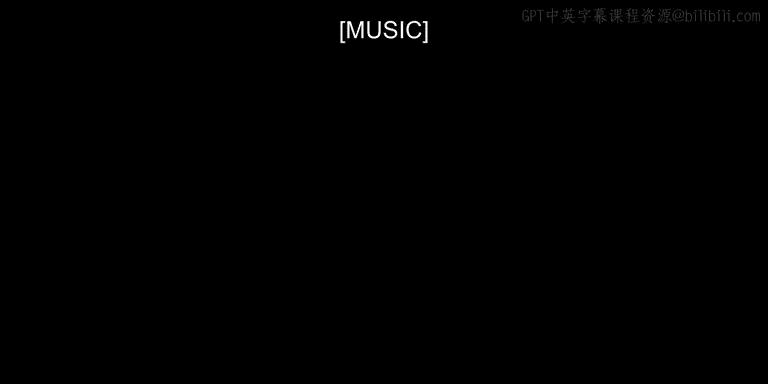
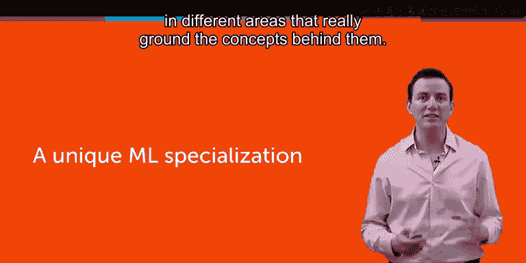
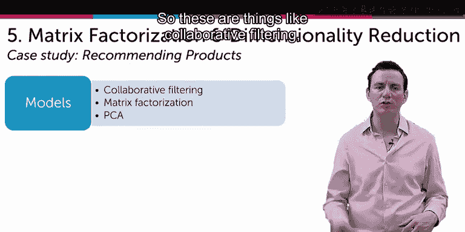

# 华盛顿大学《机器学习（基础篇，第1课／共4课）｜Machine Learning》中英字幕 - P5：4_专项课程概览.zh_en - GPT中英字幕课程资源 - BV1zw4m1e7Zh

。

As Emily discussed， we're going to see machine learning through the lens of a wide range of case studies in different areas that really ground the concepts behind that。

😊。

Other machine learning classes that you might take out there are really a laundry list of algorithms and methods。

 so things like support vector machines and kernels and logistic regressionions and networks and so on。

 and they're just like a laundry list of methods and the problem with that approach is that since you start from the algorithms。

 you end up with really simplistic use cases or applications。

 they're really disconnected from reality So we're doing things very different in the specialization。

 and we've done this for quite a while here， Emily and I created a course at the University of Washington on machine learning at scale for big data where we pioneered this use case approach for teaching machine learning and in that course we saw a lot of positive feedback from folks really understanding ground the concepts。

 So we're going start from the use cases in the first course and by starting from use cases。

 youre really going to be able to。😊，The key concepts and the techniques that allow you to build。

meeasure the quality and understand whether your intelligent application is working well or not。

 And in the end， you're going build a bunch of these intelligent applications。

 So to build such intelligent applications， you typically have to think about what task am I going to do I'm going to solve a sentiment analysis problem and what models。

 what machine learning models am I going to use， things like support vector machines or logistic regression and what methods I'm going to use to optimize the parameters of that model And then I ask a question like is this really providing the intelligence that I'm hoping for。

 how do we measure the quality of that system， So in this specialization。

 What we're gonna to do is defer the core pieces of how to describe a model and optimize it to the follow on courses and this first course is going to focus on helping us figure out what task we're trying to solve what machine learning methods make sense and how to measure them And with that using the algorithms as black。

😊，we're going to be able to build a wide range of really intelligent cool applications together and we'll actually code them and build them and demonstrate them in a wide range of ways。

 Now the following one courses it's going to be four of those plus a capstone that really go into depth in different areas。

 So let me give you a few quick examples or for kind of depth we're going to see throughout the specialization So the regression course is going to talk about various models of predicting a real values。

 So for example， house price from the features of the house and we're going to discuss linear regression techniques we're going to discuss advanced techniques like bridge regression and laso that are allow you to select what features are are most appropriate for your problem we're going to talk about optimization techniques like gradient descent and coordinates disscent to optimize the parameters of those models as well as some key machine learning concepts like loss functions bias various straightoffs。

 crossfo things that you need to know to really take these methods and。😊，Improve them， develop them。

 and build applications with them。The second course on classification， we're going to build。

 for example， the sentiment analysis use case that Emma talked about and talk about models for classifications from linear classifiers to more advanced things like you linear regression。

 sorry logistic regression， support vector machines。

 but then add kernels and decision trees which allow you to deal with nonlinear complex features we talk about optimization methods for dealing with these techniques at scale and for building ensembles of them。

 something called boosting and then the underlying concepts。😊。

In machine learning that really help you grasp， classifier and scale it up and apply it to different methods。

Now in the next course， we're going to focus on clustering and retrieval。

 especially in the context of documents。 so we're going to talk about basic techniques like nearest neighbors。

 as well as more advanced clustering techniques， mystery mixer Gaussians and even latent digital allocation kind of advanced text analysis clustering technique we're going to talk about the algorithms that underpin these things and how to scale them up with techniques like kd trees and sampling and expectation maximization Now the core concepts here are really around how to scale those things up how to measure the quality and really how to write them as distributed algorithms using techniques like mapre which are implementing in systems like Hadoop that you might have learned about So in in the fourth course you're actually going to write some mapre code for distributed machine learning。

😊，Now in the final technical course， we're going to focus on techniques of matrix factorization and dimensionality reduction。

 which are widely applicable， but in particular for recommender systems for recommending products so these are things like collaborative filtering matrix factorization PCA and the underlying techniques for optimizing them like according the descent I can violate the composition SVD and then a wide variety of core machine learning concepts。

 they're really useful， especially in the recommender domain like how to pick a diverse set。😊。

Of recommendations and how to scale them up to large problems。

Now the capstone is going to be really exciting and towards the end of this module I'm going to go back and tell you quite a bit more about the capstone。

 but just to give you kind of a little hint， you're want to build something extremely cool that you can show to all your friends。

 potential employers and you'll see that you know you can build a really smart intelligent application around recommenders。

 the combined text data， image data， sentiment analysis， deep learning it is going to be really cool。

😊。