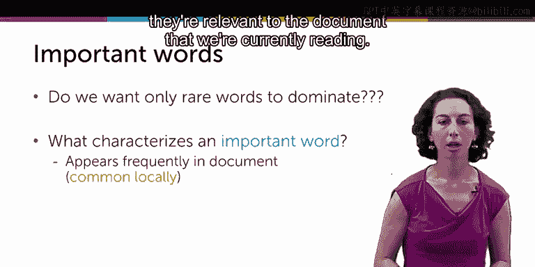

# 华盛顿大学《机器学习（基础篇，第1课／共4课）｜Machine Learning》中英字幕 - P60：59_使用TF-IDF优先考虑重要词语.zh_en - GPT中英字幕课程资源 - BV1zw4m1e7Zh

。

So the normalized count vectors that we just described helped address some of the issues with our original proposal of just using raw word counts as our representation of the document。

 but there's another issue which is often what we'd like to do is really emphasize the important words in a document。

 so we're going to discuss a little bit about what it means to be an important word and how we can think about emphasizing them。

Okay before we talk about important words， let's first talk about rare words。

 so again let's imagine that we're reading an article about soccer and in this article there are lots and lots of common words like the and player and field and goal and what we mean by a common word is a word that appears frequently in the corpus and the corpus that's just terminology for all the documents out there that we are looking at when we're doing this task of retrieval。

And what happens though is that these common words dominate the similarity metric that we talked about when we compare against other documents because like I said。

 these words appear in lots and lots of documents， whereas in contrast there are some very rare words in this document we're looking at words like football and messy the specific player we're reading about that get completely swamped by all these common words and these words like football are messy。

 they get swamped because they just appear very infrequently in the corpus so let's think about how to increase the importance of these rare words because those often are the ones that are。

Really relevant in describing what's unique about this article and what might indicate which other articles out there Carlos。

 for example， is interested in reading。

Okay， so like we said， what characterizes a rare word is the fact that it infrequently appears in the corpus and what we want to do is we somehow want to upweight these rare words and equivalently to thinking about emphasizing words that appear only in a few documents。

 we can think about taking each word and discounting the weight on that word based on how many documents that word appears in in the entire corpus。

Okay， so a question is do we really want to just emphasize the rare words Well we clearly don't want to emphasize the very common words。

 the words like the and u and it and everything like that。

 but what we want to include are things that are very relevant for that document so not just words like messy but also probably soccer and field and goal。

 things that describe the sport that we're looking at which might be different than even another article about sports an article about basketball that talks about。

Baskettball hoop and court and words like that。 So in this case。

 we want to emphasize what I'll call important words Okay。

 and so what we're going to trade off here is we're going to think about。

Words that appear very frequently in the document， so they're relevant to the document that we're currently reading。

 so I'll call this common locally。

And at the same time， we want them to appear relatively infrequently in the corpus。

 so I'll call this rare globally。And what characterizes a quote， unquote。

 important word is some trade off between this local frequency and global rarity。

