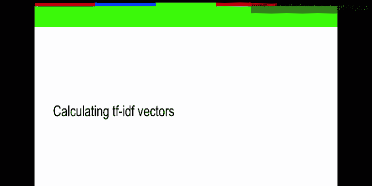
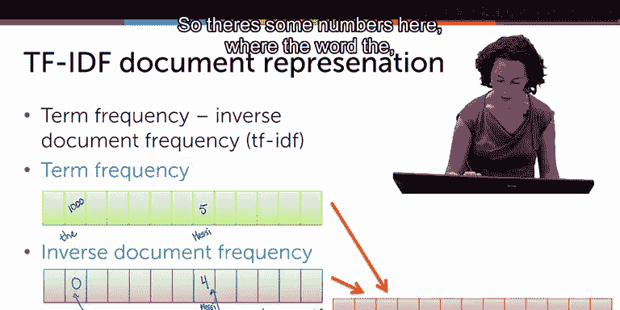

# 华盛顿大学《机器学习（基础篇，第1课／共4课）｜Machine Learning》中英字幕 - P61：60_计算TF-IDF向量.zh_en - GPT中英字幕课程资源 - BV1zw4m1e7Zh

。

Okay， so one way to represent this tradeoff between something that's common locally but rare globally is something that's called TF IDF or term frequency。

 inverse document frequency。Okay， so first let's describe what term frequency is and here what we're going to do is look locally。

 we're looking just at the document that the person is currently reading and we simply count the number of words like we did。

 so this is just our word count factor。But then what we're going to do is we're going to down weight this vector based on something called the inverse document frequency。

So for this， we're going to look at all documents in our corpus and we're going to compute the following thing。

 which is log of the number of documents in the corpus divided by one plus the number of documents that contain the word that we're looking at。

Okay， so let's think a little bit about why we have this form so first。

Let's think about a very common word， so a word appearing in many documents。Well， what happens。

 we end up with the log。Of some。Large number。Divide apply 1 plus。Another large number。

And we'll say this is approximately log of one。Which is equal to zero。

So what we see here is that we're going to be very， very strongly down weighting all the way to zero。

 the counts of any word that appears extremely frequently。

 a word that appears in all of our documents。Okay， but in contrast， if we have a rare word。

We're going to have log。Of let's say， a large number。

 assuming we have a large number of documents that we're searching over。

 divided by one plus a small number。And this is going to be， I'll just say some。Larrgish number。

Or a not zero or small number。And the reason that we have this one here is the fact that we can't assume that every word appears in。

Any document in the corpus， so there might be somewhere in the vocabulary that doesn't appear anywhere in our corpus。

 and so we want to avoid dividing by zero。Okay， so let's look at an example where。

There's the index for the word the。And let's say that the appears。I don't know。

 something like a thousand times in the document that I'm looking at， and then there's the word。

Messy， messssy appears。Five times。Okay， now I'm going to look at computing the。

Inverse document frequency for that word， so the word the let's assume that the word the appears in every document in the corpus。

 well really every document except one so that I can do some some easy math here so。

When I'm looking at this entry。I'm going to compute log of the number of documents in the corpus and let's assume that we have 64 documents in this corpus。

 and then we have one plus， and I assume that the word the didn't appear in one of these 64 documents must have been a pretty short document。

And so what this。Gives us is the zero that we talked about before。

So the gets down weighted completely by zero。In contrast， when we look at messy。

Let's assume that again， we have some 64 total documents。

And let's assume that the word messy appears only in three of these documents。So we get log。Of 16。

Which if we use log base two gives us four okay， so this is our term frequency and our inverse document frequency for these two words。

And when we go to compute the term frequency inverse document frequency for this specific document。

 which is going to be our new representation of this document。

 we simply multiply these two vectors together。 So there's some numbers here where the word the。

Turns into a zero。And then these are some other numbers， and then the word。Messy。

It's going to be upweighted so a weight of 20 and again there's some other computation we're doing for all the other words in our vocabulary。

 but the point that we want to make here is the fact that these very common words like the get down weighted and the rare and potentially very important words like messsy are getting upweighted。

