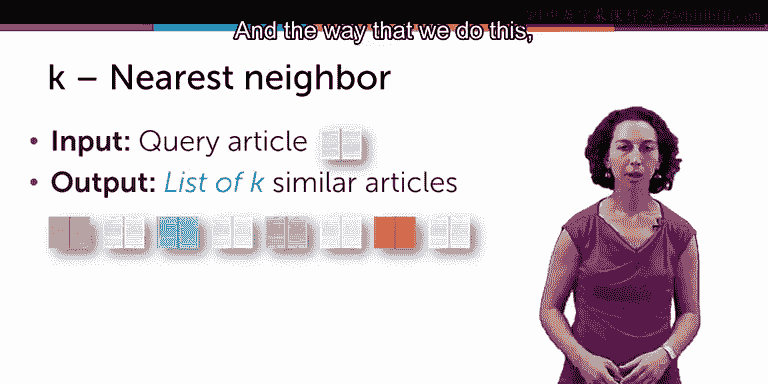

# 华盛顿大学《机器学习（基础篇，第1课／共4课）｜Machine Learning》中英字幕 - P62：61_使用最近邻搜索检索相似文档.zh_en - GPT中英字幕课程资源 - BV1zw4m1e7Zh

。

Okay， so we've talked about how to represent documents and we've also talked about how to measure similarity between documents。

 so now let's turn to the actual task of interest which is retrieving a document。

 so somebody's reading an article， we're assuming they like that article and we like to present them with another article to read。

So in particular， one of the most popular ways of doing this is something called nearest neighbor search。

 where we have our query article， that's the article that we're reading， and then there's the corpus。

 that's all the documents out there that we want to search over to recommend some new article and so what we need to do for nearest neighbor search is we need to specify a distance metric so this is going to be like our measure of similarity that we talked about earlier。

 and then what this algorithm is going to output is a collection of related articles。

So the one example of nearest neighbor search is just something called one nearest neighbor where you have your query article and what you're going to return is just simply the most related article out of all those article out there to the query article and the algorithm is very straightforward we're just going to search over every article in our corpus。

 these are all these little green article and we're going to compute the similarity using the methods that we described earlier between the query article and this article we're examining in the corpus。

And then if that similarity is better than the best similarity that we've found so far。

 then we're going to keep this article as our best article that we found so far， and then at the end。

 after we've iterated through every article in our corpus。

 we're going to look at what was the best article that we found and we're going to recommend this to the reader。

A very straightforward variant of this is something called K nearest Neigh search where instead of just outputting the most relevant article that we found。

 we're going to present the reader with a collection of K different articles that are the top K most relevant articles and the way that we do this。

 the algorithm is nearly identical except instead of keeping just the most related article we're going to keep a priority queue of the top K articles found so far。

